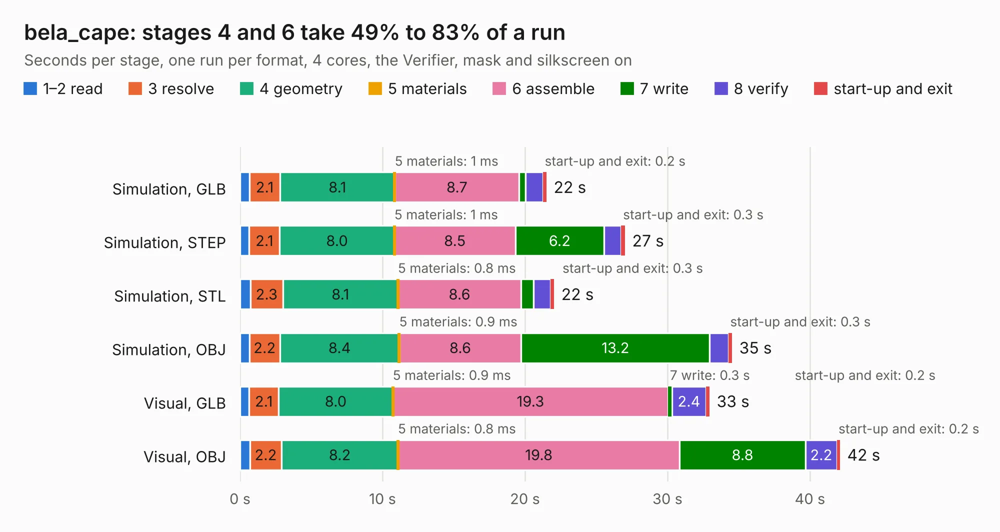

# 547. bela_cape

Board 547 of the 3,123 of [Corpus Testing](../Corpus-Testing.md), on [Corpus Page 6](../CorpusTestingPages/Corpus-Testing-06.md#547-bela_cape).

| Mode and format | 1–2 read | 3 resolve | 4 geometry | 5 materials | 6 assemble | 7 write | 8 verify | start-up and exit | Total |
|---|---:|---:|---:|---:|---:|---:|---:|---:|---:|
| Simulation, GLB | 0.7 | 2.1 | 8.1 | 1&nbsp;ms | 8.7 | 0.4 | 1.2 | 0.2 | 21.5 |
| Simulation, STEP | 0.6 | 2.1 | 8.0 | 1&nbsp;ms | 8.5 | 6.2 | 1.2 | 0.3 | 27.0 |
| Simulation, STL | 0.7 | 2.3 | 8.1 | 0.8&nbsp;ms | 8.6 | 0.9 | 1.2 | 0.3 | 22.0 |
| Simulation, OBJ | 0.7 | 2.2 | 8.4 | 0.9&nbsp;ms | 8.6 | 13.2 | 1.3 | 0.3 | 34.5 |
| Visual, GLB | 0.6 | 2.1 | 8.0 | 0.9&nbsp;ms | 19.3 | 0.3 | 2.4 | 0.2 | 33.0 |
| Visual, OBJ | 0.7 | 2.2 | 8.2 | 0.8&nbsp;ms | 19.8 | 8.8 | 2.2 | 0.2 | 42.1 |

<table align="center"><tr><td valign="top">

| Board | Repo: [belaplatform/bela-hardware](https://github.com/belaplatform/bela-hardware) Board: `bela_cape.kicad_pcb` |
|---|---|
| Folder | cape / bela_cape_rev_C1 |
| Complexity | 362&nbsp;/&nbsp;1000 (size&nbsp;262, features&nbsp;100) |
| KESE&nbsp;features | through vias, rounded, trapezoid or chamfered pads, filled zones, copper drawings, curved board outline, stack-up, dielectric εr and tanδ, mask and silkscreen colours |
| Tested | 9th November 2026 |
| Copper&nbsp;layers | 4 |
| File&nbsp;format | KiCad 6 (20211014) |
| Parts,&nbsp;tracks,&nbsp;vias | 140, 1,480, 166 |
| Triangles,&nbsp;simulation | 2,456,094 in 229 parts |
| Verifier | PASS in all six runs |

</td><td valign="top">

<table>
<tr><th>File type</th><th>File size</th><th>Peak memory used</th></tr>
<tr><th colspan="3" align="left">Simulation</th></tr>
<tr><td>GLB</td><td align="right">82&nbsp;MB</td><td align="right">788&nbsp;MB</td></tr>
<tr><td>STEP</td><td align="right">365&nbsp;MB</td><td align="right">981&nbsp;MB</td></tr>
<tr><td>STL</td><td align="right">123&nbsp;MB</td><td align="right">774&nbsp;MB</td></tr>
<tr><td>OBJ</td><td align="right">258&nbsp;MB</td><td align="right">1.6&nbsp;GB</td></tr>
<tr><th colspan="3" align="left">Visual</th></tr>
<tr><td>GLB</td><td align="right">54&nbsp;MB</td><td align="right">1.0&nbsp;GB</td></tr>
<tr><td>OBJ</td><td align="right">168&nbsp;MB</td><td align="right">1.2&nbsp;GB</td></tr>
</table>

</td></tr></table>

| Previous | Next |
|:---|---:|
| [546. belamini_cape_C2](b0546b_bela-hardware_belamini-cape-C2.md) | [548. analog_out_fix_c2](b0548b_bela-hardware_analog-out-fix-c2.md) |
