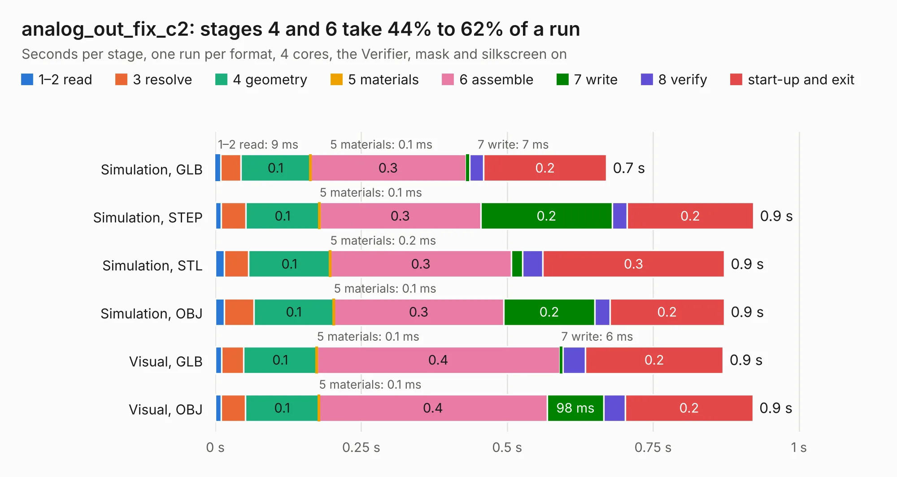

# 548. analog_out_fix_c2

Board 548 of the 3,125 of [Corpus Testing](../Corpus-Testing.md), on [Corpus Page 6](../CorpusTestingPages/Corpus-Testing-06.md#548-analog_out_fix_c2).

| Mode and format | 1–2 read | 3 resolve | 4 geometry | 5 materials | 6 assemble | 7 write | 8 verify | start-up and exit | Total |
|---|---:|---:|---:|---:|---:|---:|---:|---:|---:|
| Simulation, GLB | 9&nbsp;ms | 35&nbsp;ms | 0.1 | 0.1&nbsp;ms | 0.3 | 7&nbsp;ms | 24&nbsp;ms | 0.2 | 0.7 |
| Simulation, STEP | 10&nbsp;ms | 42&nbsp;ms | 0.1 | 0.1&nbsp;ms | 0.3 | 0.2 | 26&nbsp;ms | 0.2 | 0.9 |
| Simulation, STL | 15&nbsp;ms | 42&nbsp;ms | 0.1 | 0.2&nbsp;ms | 0.3 | 19&nbsp;ms | 35&nbsp;ms | 0.3 | 0.9 |
| Simulation, OBJ | 15&nbsp;ms | 51&nbsp;ms | 0.1 | 0.1&nbsp;ms | 0.3 | 0.2 | 25&nbsp;ms | 0.2 | 0.9 |
| Visual, GLB | 11&nbsp;ms | 38&nbsp;ms | 0.1 | 0.1&nbsp;ms | 0.4 | 6&nbsp;ms | 38&nbsp;ms | 0.2 | 0.9 |
| Visual, OBJ | 10&nbsp;ms | 42&nbsp;ms | 0.1 | 0.1&nbsp;ms | 0.4 | 98&nbsp;ms | 37&nbsp;ms | 0.2 | 0.9 |

<table align="center"><tr><td valign="top">

| Board | Repo: [belaplatform/bela-hardware](https://github.com/belaplatform/bela-hardware) Board: `analog_out_fix_c2.kicad_pcb` |
|---|---|
| Folder | cape / bela_cape_rev_C2 / analog_out_fix_c2 |
| Complexity | 102&nbsp;/&nbsp;1000 (size&nbsp;92, features&nbsp;10) |
| KESE&nbsp;features | rounded, trapezoid or chamfered pads |
| Tested | 9th November 2026 |
| Copper&nbsp;layers | 2 |
| File&nbsp;format | KiCad 6 (20211014) |
| Parts,&nbsp;tracks,&nbsp;vias | 6, 27, 0 |
| Triangles,&nbsp;simulation | 34,078 in 16 parts |
| Verifier | PASS in all six runs |

</td><td valign="top">

<table>
<tr><th>File type</th><th>File size</th><th>Peak memory used</th></tr>
<tr><th colspan="3" align="left">Simulation</th></tr>
<tr><td>GLB</td><td align="right">1.2&nbsp;MB</td><td align="right">44&nbsp;MB</td></tr>
<tr><td>STEP</td><td align="right">4.1&nbsp;MB</td><td align="right">49&nbsp;MB</td></tr>
<tr><td>STL</td><td align="right">1.7&nbsp;MB</td><td align="right">45&nbsp;MB</td></tr>
<tr><td>OBJ</td><td align="right">3.2&nbsp;MB</td><td align="right">56&nbsp;MB</td></tr>
<tr><th colspan="3" align="left">Visual</th></tr>
<tr><td>GLB</td><td align="right">706&nbsp;kB</td><td align="right">67&nbsp;MB</td></tr>
<tr><td>OBJ</td><td align="right">1.9&nbsp;MB</td><td align="right">59&nbsp;MB</td></tr>
</table>

</td></tr></table>

| Previous | Next |
|:---|---:|
| [547. bela_cape](b0547b_bela-hardware_cape-bela-cape-rev-C1_bela-cape.md) | [549. panel](b0549b_bela-hardware_panel.md) |
