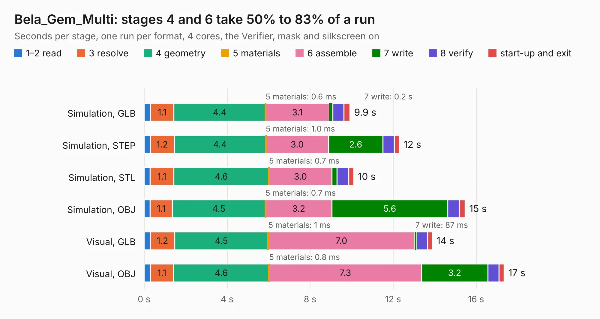

# 549. Bela_Gem_Multi

Board 549 of the 3,116 of [Corpus Testing](../Corpus-Testing.md), on [Corpus Page 6](../CorpusTestingPages/Corpus-Testing-06.md#549-bela_gem_multi).

| Mode and format | 1–2 read | 3 resolve | 4 geometry | 5 materials | 6 assemble | 7 write | 8 verify | start-up and exit | Total |
|---|---:|---:|---:|---:|---:|---:|---:|---:|---:|
| Simulation, GLB | 0.3 | 1.1 | 4.4 | 0.6&nbsp;ms | 3.1 | 0.2 | 0.5 | 0.3 | 9.9 |
| Simulation, STEP | 0.3 | 1.2 | 4.4 | 1.0&nbsp;ms | 3.0 | 2.6 | 0.6 | 0.2 | 12.3 |
| Simulation, STL | 0.3 | 1.1 | 4.6 | 0.7&nbsp;ms | 3.0 | 0.2 | 0.6 | 0.2 | 10.1 |
| Simulation, OBJ | 0.3 | 1.1 | 4.5 | 0.7&nbsp;ms | 3.2 | 5.6 | 0.6 | 0.3 | 15.5 |
| Visual, GLB | 0.3 | 1.2 | 4.5 | 1&nbsp;ms | 7.0 | 87&nbsp;ms | 0.5 | 0.2 | 13.9 |
| Visual, OBJ | 0.3 | 1.1 | 4.6 | 0.8&nbsp;ms | 7.3 | 3.2 | 0.5 | 0.2 | 17.3 |

<table align="center"><tr><td valign="top">

| Board | Repo: [belaplatform/bela-hardware](https://github.com/belaplatform/bela-hardware) Board: `Bela_Gem_Multi.kicad_pcb` |
|---|---|
| Folder | GemMulti / GemMulti_rev_A4 |
| Complexity | 225&nbsp;/&nbsp;1000 (size&nbsp;70, features&nbsp;155) |
| KESE&nbsp;features | slotted holes, custom pads, rounded, trapezoid or chamfered pads, filled zones, copper drawings, curved board outline, knockout text, TrueType text, stack-up, dielectric εr and tanδ, copper finish, mask and silkscreen colours |
| Tested | 9th November 2026 |
| Copper&nbsp;layers | 4 |
| File&nbsp;format | KiCad 9 (20241229) |
| Parts,&nbsp;tracks,&nbsp;vias | 27, 0, 0 |
| Triangles,&nbsp;simulation | 965,156 in 145 parts |
| Verifier | PASS in all six runs |

</td><td valign="top">

<table>
<tr><th>File type</th><th>File size</th><th>Peak memory used</th></tr>
<tr><th colspan="3" align="left">Simulation</th></tr>
<tr><td>GLB</td><td align="right">31&nbsp;MB</td><td align="right">366&nbsp;MB</td></tr>
<tr><td>STEP</td><td align="right">101&nbsp;MB</td><td align="right">434&nbsp;MB</td></tr>
<tr><td>STL</td><td align="right">48&nbsp;MB</td><td align="right">366&nbsp;MB</td></tr>
<tr><td>OBJ</td><td align="right">99&nbsp;MB</td><td align="right">694&nbsp;MB</td></tr>
<tr><th colspan="3" align="left">Visual</th></tr>
<tr><td>GLB</td><td align="right">17&nbsp;MB</td><td align="right">484&nbsp;MB</td></tr>
<tr><td>OBJ</td><td align="right">52&nbsp;MB</td><td align="right">492&nbsp;MB</td></tr>
</table>

</td></tr></table>

| Previous | Next |
|:---|---:|
| [548. bela_cape](b0548b_bela-hardware_cape-bela-cape-rev-C3_bela-cape.md) | [550. bela_mini_multi_pb2_wing_bottom](b0550b_bela-hardware_bela-mini-multi-pb2-wing-bottom.md) |
