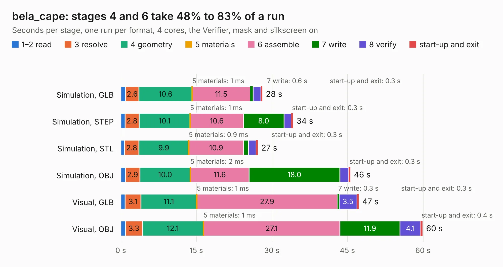

# 549. bela_cape

Board 549 of the 3,118 of [Corpus Testing](../Corpus-Testing.md), on [Corpus Page 6](../CorpusTestingPages/Corpus-Testing-06.md#549-bela_cape).

| Mode and format | 1–2 read | 3 resolve | 4 geometry | 5 materials | 6 assemble | 7 write | 8 verify | start-up and exit | Total |
|---|---:|---:|---:|---:|---:|---:|---:|---:|---:|
| Simulation, GLB | 1.0 | 2.6 | 10.6 | 1&nbsp;ms | 11.5 | 0.6 | 1.5 | 0.3 | 28.1 |
| Simulation, STEP | 0.8 | 2.8 | 10.1 | 1&nbsp;ms | 10.6 | 8.0 | 1.5 | 0.3 | 34.2 |
| Simulation, STL | 0.8 | 2.8 | 9.9 | 0.9&nbsp;ms | 10.9 | 1.0 | 1.5 | 0.3 | 27.2 |
| Simulation, OBJ | 0.9 | 2.9 | 10.0 | 2&nbsp;ms | 11.6 | 18.0 | 1.8 | 0.3 | 45.6 |
| Visual, GLB | 0.9 | 3.1 | 11.1 | 1&nbsp;ms | 27.9 | 0.3 | 3.5 | 0.3 | 47.2 |
| Visual, OBJ | 0.9 | 3.3 | 12.1 | 1&nbsp;ms | 27.1 | 11.9 | 4.1 | 0.4 | 59.9 |

<table align="center"><tr><td valign="top">

| Board | Repo: [belaplatform/bela-hardware](https://github.com/belaplatform/bela-hardware) Board: `bela_cape.kicad_pcb` |
|---|---|
| Folder | cape / bela_cape_rev_C2 |
| Complexity | 358&nbsp;/&nbsp;1000 (size&nbsp;263, features&nbsp;95) |
| KESE&nbsp;features | through vias, rounded, trapezoid or chamfered pads, filled zones, copper drawings, curved board outline, stack-up, dielectric εr and tanδ |
| Tested | 9th November 2026 |
| Copper&nbsp;layers | 4 |
| File&nbsp;format | KiCad 6 (20211014) |
| Parts,&nbsp;tracks,&nbsp;vias | 149, 1,563, 173 |
| Triangles,&nbsp;simulation | 2,518,100 in 235 parts |
| Verifier | PASS in all six runs |

</td><td valign="top">

<table>
<tr><th>File type</th><th>File size</th><th>Peak memory used</th></tr>
<tr><th colspan="3" align="left">Simulation</th></tr>
<tr><td>GLB</td><td align="right">84&nbsp;MB</td><td align="right">780&nbsp;MB</td></tr>
<tr><td>STEP</td><td align="right">374&nbsp;MB</td><td align="right">997&nbsp;MB</td></tr>
<tr><td>STL</td><td align="right">126&nbsp;MB</td><td align="right">779&nbsp;MB</td></tr>
<tr><td>OBJ</td><td align="right">265&nbsp;MB</td><td align="right">1.7&nbsp;GB</td></tr>
<tr><th colspan="3" align="left">Visual</th></tr>
<tr><td>GLB</td><td align="right">56&nbsp;MB</td><td align="right">1.1&nbsp;GB</td></tr>
<tr><td>OBJ</td><td align="right">173&nbsp;MB</td><td align="right">1.3&nbsp;GB</td></tr>
</table>

</td></tr></table>

| Previous | Next |
|:---|---:|
| [548. panel](b0548b_bela-hardware_panel.md) | [550. bela_cape](b0550b_bela-hardware_cape-bela-cape-rev-C3_bela-cape.md) |
