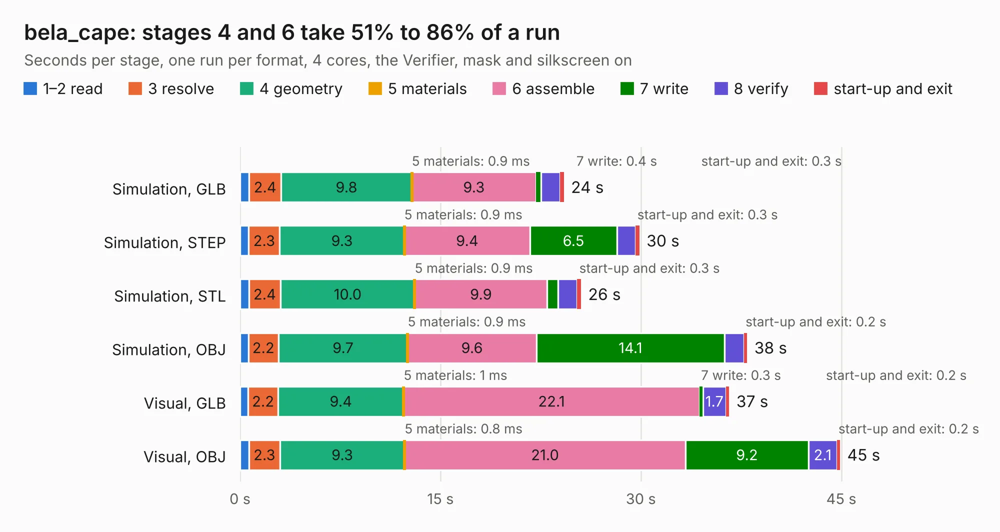

# 549. bela_cape

Board 549 of the 3,117 of [Corpus Testing](../Corpus-Testing.md), on [Corpus Page 6](../CorpusTestingPages/Corpus-Testing-06.md#549-bela_cape).

| Mode and format | 1–2 read | 3 resolve | 4 geometry | 5 materials | 6 assemble | 7 write | 8 verify | start-up and exit | Total |
|---|---:|---:|---:|---:|---:|---:|---:|---:|---:|
| Simulation, GLB | 0.7 | 2.4 | 9.8 | 0.9&nbsp;ms | 9.3 | 0.4 | 1.4 | 0.3 | 24.2 |
| Simulation, STEP | 0.6 | 2.3 | 9.3 | 0.9&nbsp;ms | 9.4 | 6.5 | 1.4 | 0.3 | 29.9 |
| Simulation, STL | 0.7 | 2.4 | 10.0 | 0.9&nbsp;ms | 9.9 | 0.8 | 1.4 | 0.3 | 25.5 |
| Simulation, OBJ | 0.6 | 2.2 | 9.7 | 0.9&nbsp;ms | 9.6 | 14.1 | 1.5 | 0.2 | 38.0 |
| Visual, GLB | 0.6 | 2.2 | 9.4 | 1&nbsp;ms | 22.1 | 0.3 | 1.7 | 0.2 | 36.6 |
| Visual, OBJ | 0.7 | 2.3 | 9.3 | 0.8&nbsp;ms | 21.0 | 9.2 | 2.1 | 0.2 | 44.9 |

<table align="center"><tr><td valign="top">

| Board | Repo: [belaplatform/bela-hardware](https://github.com/belaplatform/bela-hardware) Board: `bela_cape.kicad_pcb` |
|---|---|
| Folder | cape / bela_cape_rev_C3 |
| Complexity | 349&nbsp;/&nbsp;1000 (size&nbsp;264, features&nbsp;85) |
| KESE&nbsp;features | through vias, rounded, trapezoid or chamfered pads, filled zones, copper drawings, stack-up, dielectric εr and tanδ |
| Tested | 9th November 2026 |
| Copper&nbsp;layers | 4 |
| File&nbsp;format | KiCad 8 (20240108) |
| Parts,&nbsp;tracks,&nbsp;vias | 150, 1,587, 176 |
| Triangles,&nbsp;simulation | 2,533,044 in 237 parts |
| Verifier | PASS in all six runs |

</td><td valign="top">

<table>
<tr><th>File type</th><th>File size</th><th>Peak memory used</th></tr>
<tr><th colspan="3" align="left">Simulation</th></tr>
<tr><td>GLB</td><td align="right">85&nbsp;MB</td><td align="right">827&nbsp;MB</td></tr>
<tr><td>STEP</td><td align="right">375&nbsp;MB</td><td align="right">992&nbsp;MB</td></tr>
<tr><td>STL</td><td align="right">127&nbsp;MB</td><td align="right">814&nbsp;MB</td></tr>
<tr><td>OBJ</td><td align="right">268&nbsp;MB</td><td align="right">1.7&nbsp;GB</td></tr>
<tr><th colspan="3" align="left">Visual</th></tr>
<tr><td>GLB</td><td align="right">56&nbsp;MB</td><td align="right">1.1&nbsp;GB</td></tr>
<tr><td>OBJ</td><td align="right">174&nbsp;MB</td><td align="right">1.2&nbsp;GB</td></tr>
</table>

</td></tr></table>

| Previous | Next |
|:---|---:|
| [548. bela_cape](b0548b_bela-hardware_cape-bela-cape-rev-C2_bela-cape.md) | [550. Bela_Gem_Multi](b0550b_bela-hardware_Bela-Gem-Multi.md) |
