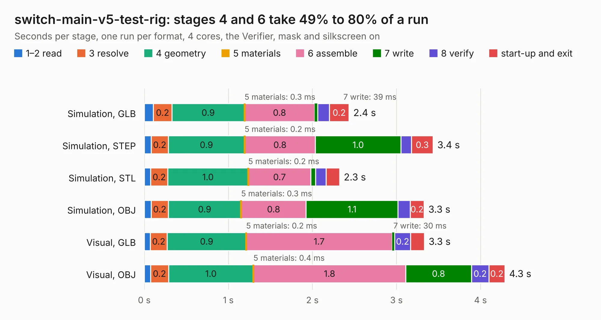

# 550. switch-main-v5-test-rig

Board 550 of the 3,106 of [Corpus Testing](../Corpus-Testing.md), on [Corpus Page 6](../CorpusTestingPages/Corpus-Testing-06.md#550-switch-main-v5-test-rig).

| Mode and format | 1–2 read | 3 resolve | 4 geometry | 5 materials | 6 assemble | 7 write | 8 verify | start-up and exit | Total |
|---|---:|---:|---:|---:|---:|---:|---:|---:|---:|
| Simulation, GLB | 0.1 | 0.2 | 0.9 | 0.3&nbsp;ms | 0.8 | 39&nbsp;ms | 0.1 | 0.2 | 2.4 |
| Simulation, STEP | 80&nbsp;ms | 0.2 | 0.9 | 0.2&nbsp;ms | 0.8 | 1.0 | 0.1 | 0.3 | 3.4 |
| Simulation, STL | 76&nbsp;ms | 0.2 | 1.0 | 0.2&nbsp;ms | 0.7 | 56&nbsp;ms | 0.1 | 0.2 | 2.3 |
| Simulation, OBJ | 83&nbsp;ms | 0.2 | 0.9 | 0.3&nbsp;ms | 0.8 | 1.1 | 0.1 | 0.2 | 3.3 |
| Visual, GLB | 71&nbsp;ms | 0.2 | 0.9 | 0.2&nbsp;ms | 1.7 | 30&nbsp;ms | 0.2 | 0.2 | 3.3 |
| Visual, OBJ | 74&nbsp;ms | 0.2 | 1.0 | 0.4&nbsp;ms | 1.8 | 0.8 | 0.2 | 0.2 | 4.3 |

<table align="center"><tr><td valign="top">

| Board | Repo: [ben5049/switch-v5-hardware](https://github.com/ben5049/switch-v5-hardware) Board: `switch-main-v5-test-rig.kicad_pcb` |
|---|---|
| Folder | pcbs / switch-main-v5-test-rig |
| Complexity | 198&nbsp;/&nbsp;1000 (size&nbsp;123, features&nbsp;75) |
| KESE&nbsp;features | through vias, filled zones, curved board outline, knockout text, TrueType text |
| Tested | 9th November 2026 |
| Copper&nbsp;layers | 2 |
| File&nbsp;format | KiCad 9 (20241229) |
| Parts,&nbsp;tracks,&nbsp;vias | 4, 155, 25 |
| Triangles,&nbsp;simulation | 282,850 in 48 parts |
| Verifier | PASS in all six runs |

</td><td valign="top">

<table>
<tr><th>File type</th><th>File size</th><th>Peak memory used</th></tr>
<tr><th colspan="3" align="left">Simulation</th></tr>
<tr><td>GLB</td><td align="right">9.4&nbsp;MB</td><td align="right">208&nbsp;MB</td></tr>
<tr><td>STEP</td><td align="right">42&nbsp;MB</td><td align="right">242&nbsp;MB</td></tr>
<tr><td>STL</td><td align="right">14&nbsp;MB</td><td align="right">208&nbsp;MB</td></tr>
<tr><td>OBJ</td><td align="right">28&nbsp;MB</td><td align="right">228&nbsp;MB</td></tr>
<tr><th colspan="3" align="left">Visual</th></tr>
<tr><td>GLB</td><td align="right">7.1&nbsp;MB</td><td align="right">224&nbsp;MB</td></tr>
<tr><td>OBJ</td><td align="right">21&nbsp;MB</td><td align="right">221&nbsp;MB</td></tr>
</table>

</td></tr></table>

| Previous | Next |
|:---|---:|
| [549. Bela_Gem_Stereo](b0549b_bela-hardware_Bela-Gem-Stereo.md) | [551. switch-main-v5](b0551b_switch-v5-hardware_switch-main-v5.md) |
