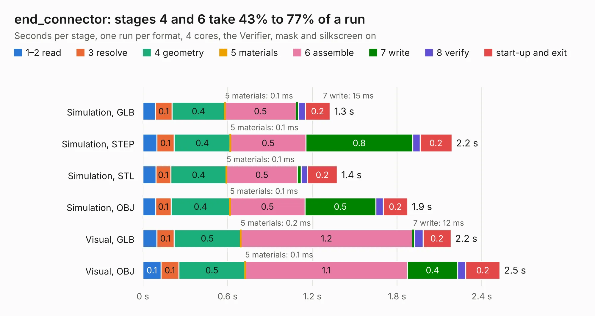

# 551. end_connector

Board 551 of the 3,101 of [Corpus Testing](../Corpus-Testing.md), on [Corpus Page 6](../CorpusTestingPages/Corpus-Testing-06.md#551-end_connector).

| Mode and format | 1–2 read | 3 resolve | 4 geometry | 5 materials | 6 assemble | 7 write | 8 verify | start-up and exit | Total |
|---|---:|---:|---:|---:|---:|---:|---:|---:|---:|
| Simulation, GLB | 89&nbsp;ms | 0.1 | 0.4 | 0.1&nbsp;ms | 0.5 | 15&nbsp;ms | 50&nbsp;ms | 0.2 | 1.3 |
| Simulation, STEP | 99&nbsp;ms | 0.1 | 0.4 | 0.1&nbsp;ms | 0.5 | 0.8 | 53&nbsp;ms | 0.2 | 2.2 |
| Simulation, STL | 92&nbsp;ms | 0.1 | 0.4 | 0.1&nbsp;ms | 0.5 | 27&nbsp;ms | 46&nbsp;ms | 0.2 | 1.4 |
| Simulation, OBJ | 90&nbsp;ms | 0.1 | 0.4 | 0.1&nbsp;ms | 0.5 | 0.5 | 52&nbsp;ms | 0.2 | 1.9 |
| Visual, GLB | 99&nbsp;ms | 0.1 | 0.5 | 0.2&nbsp;ms | 1.2 | 12&nbsp;ms | 63&nbsp;ms | 0.2 | 2.2 |
| Visual, OBJ | 0.1 | 0.1 | 0.5 | 0.1&nbsp;ms | 1.1 | 0.4 | 57&nbsp;ms | 0.2 | 2.5 |

<table align="center"><tr><td valign="top">

| Board | Repo: [BerkeleyLab/DxP-sensor-probes](https://github.com/BerkeleyLab/DxP-sensor-probes) Board: `end_connector.kicad_pcb` |
|---|---|
| Folder | end_connector |
| Complexity | 170&nbsp;/&nbsp;1000 (size&nbsp;105, features&nbsp;65) |
| KESE&nbsp;features | through vias, slotted holes, rounded, trapezoid or chamfered pads, filled zones, curved board outline |
| Tested | 9th November 2026 |
| Copper&nbsp;layers | 2 |
| File&nbsp;format | KiCad 10 (20260206) |
| Parts,&nbsp;tracks,&nbsp;vias | 1, 118, 6 |
| Triangles,&nbsp;simulation | 78,214 in 17 parts |
| Verifier | PASS in all six runs |

</td><td valign="top">

<table>
<tr><th>File type</th><th>File size</th><th>Peak memory used</th></tr>
<tr><th colspan="3" align="left">Simulation</th></tr>
<tr><td>GLB</td><td align="right">2.8&nbsp;MB</td><td align="right">177&nbsp;MB</td></tr>
<tr><td>STEP</td><td align="right">15&nbsp;MB</td><td align="right">180&nbsp;MB</td></tr>
<tr><td>STL</td><td align="right">3.9&nbsp;MB</td><td align="right">175&nbsp;MB</td></tr>
<tr><td>OBJ</td><td align="right">7.9&nbsp;MB</td><td align="right">173&nbsp;MB</td></tr>
<tr><th colspan="3" align="left">Visual</th></tr>
<tr><td>GLB</td><td align="right">2.3&nbsp;MB</td><td align="right">156&nbsp;MB</td></tr>
<tr><td>OBJ</td><td align="right">6.4&nbsp;MB</td><td align="right">155&nbsp;MB</td></tr>
</table>

</td></tr></table>

| Previous | Next |
|:---|---:|
| [550. loggerhw_v5.0](b0550b_DxP-data-logger_loggerhw-v5-0.md) | [552. extension_board_MF](b0552b_DxP-sensor-probes_extension-board-MF.md) |
