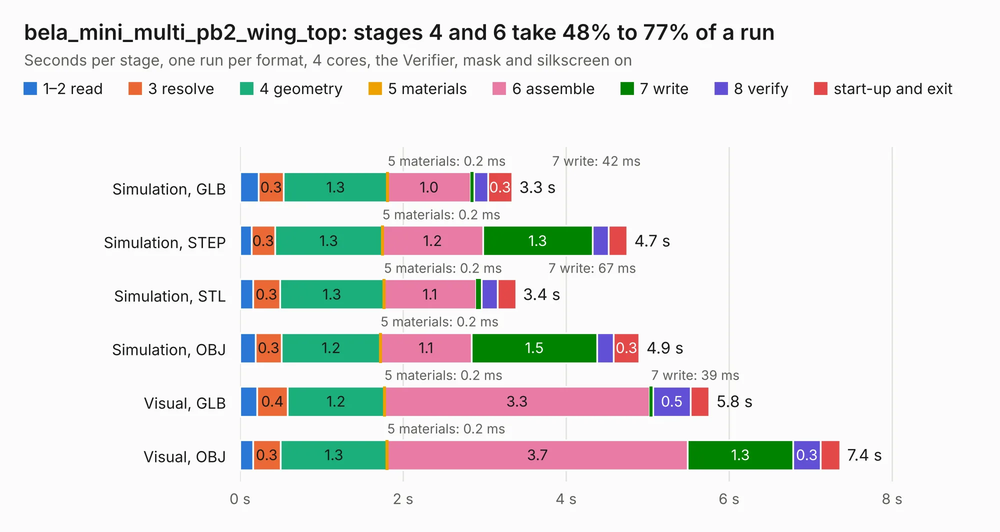

# 551. bela_mini_multi_pb2_wing_top

Board 551 of the 3,116 of [Corpus Testing](../Corpus-Testing.md), on [Corpus Page 6](../CorpusTestingPages/Corpus-Testing-06.md#551-bela_mini_multi_pb2_wing_top).

| Mode and format | 1–2 read | 3 resolve | 4 geometry | 5 materials | 6 assemble | 7 write | 8 verify | start-up and exit | Total |
|---|---:|---:|---:|---:|---:|---:|---:|---:|---:|
| Simulation, GLB | 0.2 | 0.3 | 1.3 | 0.2&nbsp;ms | 1.0 | 42&nbsp;ms | 0.2 | 0.3 | 3.3 |
| Simulation, STEP | 0.1 | 0.3 | 1.3 | 0.2&nbsp;ms | 1.2 | 1.3 | 0.2 | 0.2 | 4.7 |
| Simulation, STL | 0.2 | 0.3 | 1.3 | 0.2&nbsp;ms | 1.1 | 67&nbsp;ms | 0.2 | 0.2 | 3.4 |
| Simulation, OBJ | 0.2 | 0.3 | 1.2 | 0.2&nbsp;ms | 1.1 | 1.5 | 0.2 | 0.3 | 4.9 |
| Visual, GLB | 0.2 | 0.4 | 1.2 | 0.2&nbsp;ms | 3.3 | 39&nbsp;ms | 0.5 | 0.2 | 5.8 |
| Visual, OBJ | 0.2 | 0.3 | 1.3 | 0.2&nbsp;ms | 3.7 | 1.3 | 0.3 | 0.2 | 7.4 |

<table align="center"><tr><td valign="top">

| Board | Repo: [belaplatform/bela-hardware](https://github.com/belaplatform/bela-hardware) Board: `bela_mini_multi_pb2_wing_top.kicad_pcb` |
|---|---|
| Folder | GemMulti / wing_top |
| Complexity | 273&nbsp;/&nbsp;1000 (size&nbsp;143, features&nbsp;130) |
| KESE&nbsp;features | through vias, custom pads, rounded, trapezoid or chamfered pads, filled zones, copper drawings, curved board outline, TrueType text, stack-up, dielectric εr and tanδ, mask and silkscreen colours |
| Tested | 9th November 2026 |
| Copper&nbsp;layers | 2 |
| File&nbsp;format | KiCad 9 (20241229) |
| Parts,&nbsp;tracks,&nbsp;vias | 15, 125, 75 |
| Triangles,&nbsp;simulation | 312,934 in 31 parts |
| Verifier | PASS in all six runs |

</td><td valign="top">

<table>
<tr><th>File type</th><th>File size</th><th>Peak memory used</th></tr>
<tr><th colspan="3" align="left">Simulation</th></tr>
<tr><td>GLB</td><td align="right">11&nbsp;MB</td><td align="right">244&nbsp;MB</td></tr>
<tr><td>STEP</td><td align="right">47&nbsp;MB</td><td align="right">273&nbsp;MB</td></tr>
<tr><td>STL</td><td align="right">16&nbsp;MB</td><td align="right">249&nbsp;MB</td></tr>
<tr><td>OBJ</td><td align="right">31&nbsp;MB</td><td align="right">264&nbsp;MB</td></tr>
<tr><th colspan="3" align="left">Visual</th></tr>
<tr><td>GLB</td><td align="right">8.3&nbsp;MB</td><td align="right">266&nbsp;MB</td></tr>
<tr><td>OBJ</td><td align="right">24&nbsp;MB</td><td align="right">262&nbsp;MB</td></tr>
</table>

</td></tr></table>

| Previous | Next |
|:---|---:|
| [550. bela_mini_multi_pb2_wing_bottom](b0550b_bela-hardware_bela-mini-multi-pb2-wing-bottom.md) | [552. Bela_Gem_Stereo](b0552b_bela-hardware_Bela-Gem-Stereo.md) |
