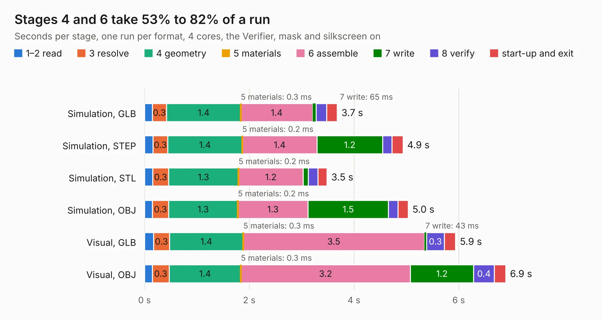

# 554. bela_mini_multi_pb2_wing_bottom

Board 554 of the 3,132 of [Corpus Testing](../Corpus-Testing.md), on [Corpus Page 6](../CorpusTestingPages/Corpus-Testing-06.md#554-bela_mini_multi_pb2_wing_bottom).

| Mode and format | 1–2 read | 3 resolve | 4 geometry | 5 materials | 6 assemble | 7 write | 8 verify | start-up and exit | Total |
|---|---:|---:|---:|---:|---:|---:|---:|---:|---:|
| Simulation, GLB | 0.1 | 0.3 | 1.4 | 0.3&nbsp;ms | 1.4 | 65&nbsp;ms | 0.2 | 0.2 | 3.7 |
| Simulation, STEP | 0.2 | 0.3 | 1.4 | 0.2&nbsp;ms | 1.4 | 1.2 | 0.2 | 0.2 | 4.9 |
| Simulation, STL | 0.2 | 0.3 | 1.3 | 0.2&nbsp;ms | 1.2 | 96&nbsp;ms | 0.2 | 0.2 | 3.5 |
| Simulation, OBJ | 0.2 | 0.3 | 1.3 | 0.2&nbsp;ms | 1.3 | 1.5 | 0.2 | 0.2 | 5.0 |
| Visual, GLB | 0.2 | 0.3 | 1.4 | 0.3&nbsp;ms | 3.5 | 43&nbsp;ms | 0.3 | 0.2 | 5.9 |
| Visual, OBJ | 0.1 | 0.3 | 1.4 | 0.3&nbsp;ms | 3.2 | 1.2 | 0.4 | 0.2 | 6.9 |

<table align="center"><tr><td valign="top">

| Board | Repo: [belaplatform/bela-hardware](https://github.com/belaplatform/bela-hardware) Board: `bela_mini_multi_pb2_wing_bottom.kicad_pcb` |
|---|---|
| Folder | GemMulti / wing_bottom |
| Complexity | 285&nbsp;/&nbsp;1000 (size&nbsp;155, features&nbsp;130) |
| KESE&nbsp;features | through vias, custom pads, rounded, trapezoid or chamfered pads, filled zones, copper drawings, curved board outline, TrueType text, stack-up, dielectric εr and tanδ, mask and silkscreen colours |
| Tested | 9th November 2026 |
| Copper&nbsp;layers | 2 |
| File&nbsp;format | KiCad 9 (20241229) |
| Parts,&nbsp;tracks,&nbsp;vias | 37, 219, 65 |
| Triangles,&nbsp;simulation | 376,142 in 58 parts |
| Verifier | PASS in all six runs |

</td><td valign="top">

<table>
<tr><th>File type</th><th>File size</th><th>Peak memory used</th></tr>
<tr><th colspan="3" align="left">Simulation</th></tr>
<tr><td>GLB</td><td align="right">13&nbsp;MB</td><td align="right">263&nbsp;MB</td></tr>
<tr><td>STEP</td><td align="right">65&nbsp;MB</td><td align="right">311&nbsp;MB</td></tr>
<tr><td>STL</td><td align="right">19&nbsp;MB</td><td align="right">261&nbsp;MB</td></tr>
<tr><td>OBJ</td><td align="right">38&nbsp;MB</td><td align="right">319&nbsp;MB</td></tr>
<tr><th colspan="3" align="left">Visual</th></tr>
<tr><td>GLB</td><td align="right">10&nbsp;MB</td><td align="right">317&nbsp;MB</td></tr>
<tr><td>OBJ</td><td align="right">30&nbsp;MB</td><td align="right">314&nbsp;MB</td></tr>
</table>

</td></tr></table>

| Previous | Next |
|:---|---:|
| [553. Bela_Gem_Multi](b0553b_bela-hardware_Bela-Gem-Multi.md) | [555. bela_mini_multi_pb2_wing_top](b0555b_bela-hardware_bela-mini-multi-pb2-wing-top.md) |
