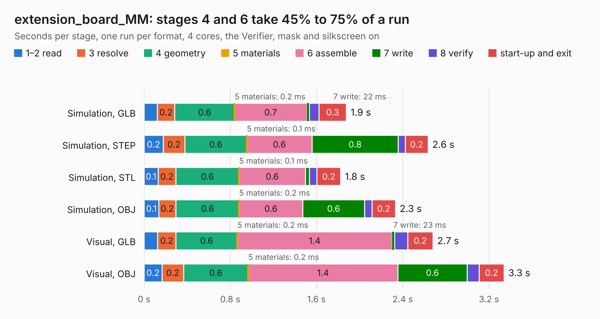

# 555. extension_board_MM

Board 555 of the 3,111 of [Corpus Testing](../Corpus-Testing.md), on [Corpus Page 6](../CorpusTestingPages/Corpus-Testing-06.md#555-extension_board_mm).

| Mode and format | 1–2 read | 3 resolve | 4 geometry | 5 materials | 6 assemble | 7 write | 8 verify | start-up and exit | Total |
|---|---:|---:|---:|---:|---:|---:|---:|---:|---:|
| Simulation, GLB | 0.1 | 0.2 | 0.6 | 0.2&nbsp;ms | 0.7 | 22&nbsp;ms | 91&nbsp;ms | 0.3 | 1.9 |
| Simulation, STEP | 0.2 | 0.2 | 0.6 | 0.1&nbsp;ms | 0.6 | 0.8 | 66&nbsp;ms | 0.2 | 2.6 |
| Simulation, STL | 0.1 | 0.2 | 0.6 | 0.1&nbsp;ms | 0.6 | 36&nbsp;ms | 71&nbsp;ms | 0.2 | 1.8 |
| Simulation, OBJ | 0.1 | 0.2 | 0.6 | 0.2&nbsp;ms | 0.6 | 0.6 | 68&nbsp;ms | 0.2 | 2.3 |
| Visual, GLB | 0.1 | 0.2 | 0.6 | 0.2&nbsp;ms | 1.4 | 23&nbsp;ms | 0.1 | 0.2 | 2.7 |
| Visual, OBJ | 0.2 | 0.2 | 0.6 | 0.2&nbsp;ms | 1.4 | 0.6 | 0.1 | 0.2 | 3.3 |

<table align="center"><tr><td valign="top">

| Board | Repo: [BerkeleyLab/DxP-sensor-probes](https://github.com/BerkeleyLab/DxP-sensor-probes) Board: `extension_board_MM.kicad_pcb` |
|---|---|
| Folder | extension_board_MM |
| Complexity | 168&nbsp;/&nbsp;1000 (size&nbsp;123, features&nbsp;45) |
| KESE&nbsp;features | through vias, filled zones, curved board outline |
| Tested | 9th November 2026 |
| Copper&nbsp;layers | 2 |
| File&nbsp;format | KiCad 10 (20260206) |
| Parts,&nbsp;tracks,&nbsp;vias | 0, 564, 30 |
| Triangles,&nbsp;simulation | 115,188 in 17 parts |
| Note | no components |
| Verifier | PASS in all six runs |

</td><td valign="top">

<table>
<tr><th>File type</th><th>File size</th><th>Peak memory used</th></tr>
<tr><th colspan="3" align="left">Simulation</th></tr>
<tr><td>GLB</td><td align="right">4.1&nbsp;MB</td><td align="right">186&nbsp;MB</td></tr>
<tr><td>STEP</td><td align="right">20&nbsp;MB</td><td align="right">187&nbsp;MB</td></tr>
<tr><td>STL</td><td align="right">5.8&nbsp;MB</td><td align="right">184&nbsp;MB</td></tr>
<tr><td>OBJ</td><td align="right">12&nbsp;MB</td><td align="right">184&nbsp;MB</td></tr>
<tr><th colspan="3" align="left">Visual</th></tr>
<tr><td>GLB</td><td align="right">3.2&nbsp;MB</td><td align="right">162&nbsp;MB</td></tr>
<tr><td>OBJ</td><td align="right">9.2&nbsp;MB</td><td align="right">161&nbsp;MB</td></tr>
</table>

</td></tr></table>

| Previous | Next |
|:---|---:|
| [554. extension_board_MF](b0554b_DxP-sensor-probes_extension-board-MF.md) | [556. FF_connector](b0556b_DxP-sensor-probes_FF-connector.md) |
