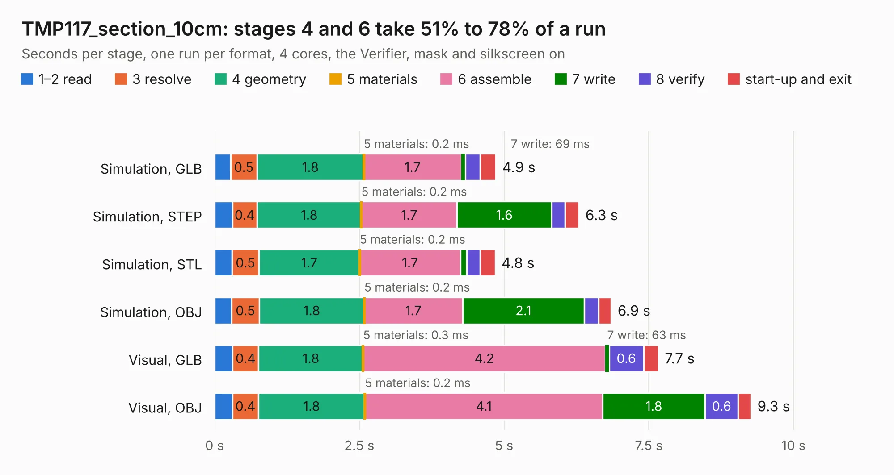

# 557. TMP117_section_10cm

Board 557 of the 3,100 of [Corpus Testing](../Corpus-Testing.md), on [Corpus Page 6](../CorpusTestingPages/Corpus-Testing-06.md#557-tmp117_section_10cm).

| Mode and format | 1–2 read | 3 resolve | 4 geometry | 5 materials | 6 assemble | 7 write | 8 verify | start-up and exit | Total |
|---|---:|---:|---:|---:|---:|---:|---:|---:|---:|
| Simulation, GLB | 0.3 | 0.5 | 1.8 | 0.2&nbsp;ms | 1.7 | 69&nbsp;ms | 0.3 | 0.3 | 4.9 |
| Simulation, STEP | 0.3 | 0.4 | 1.8 | 0.2&nbsp;ms | 1.7 | 1.6 | 0.2 | 0.2 | 6.3 |
| Simulation, STL | 0.3 | 0.5 | 1.7 | 0.2&nbsp;ms | 1.7 | 0.1 | 0.2 | 0.3 | 4.8 |
| Simulation, OBJ | 0.3 | 0.5 | 1.8 | 0.2&nbsp;ms | 1.7 | 2.1 | 0.2 | 0.2 | 6.9 |
| Visual, GLB | 0.3 | 0.4 | 1.8 | 0.3&nbsp;ms | 4.2 | 63&nbsp;ms | 0.6 | 0.3 | 7.7 |
| Visual, OBJ | 0.3 | 0.4 | 1.8 | 0.2&nbsp;ms | 4.1 | 1.8 | 0.6 | 0.2 | 9.3 |

<table align="center"><tr><td valign="top">

| Board | Repo: [BerkeleyLab/DxP-sensor-probes](https://github.com/BerkeleyLab/DxP-sensor-probes) Board: `TMP117_section_10cm.kicad_pcb` |
|---|---|
| Folder | TMP117_section_10cm |
| Complexity | 262&nbsp;/&nbsp;1000 (size&nbsp;187, features&nbsp;75) |
| KESE&nbsp;features | through vias, slotted holes, rounded, trapezoid or chamfered pads, filled zones, copper drawings, curved board outline |
| Tested | 9th November 2026 |
| Copper&nbsp;layers | 2 |
| File&nbsp;format | KiCad 10 (20260206) |
| Parts,&nbsp;tracks,&nbsp;vias | 26, 3,397, 59 |
| Triangles,&nbsp;simulation | 431,324 in 33 parts |
| Verifier | PASS in all six runs |

</td><td valign="top">

<table>
<tr><th>File type</th><th>File size</th><th>Peak memory used</th></tr>
<tr><th colspan="3" align="left">Simulation</th></tr>
<tr><td>GLB</td><td align="right">15&nbsp;MB</td><td align="right">287&nbsp;MB</td></tr>
<tr><td>STEP</td><td align="right">81&nbsp;MB</td><td align="right">346&nbsp;MB</td></tr>
<tr><td>STL</td><td align="right">22&nbsp;MB</td><td align="right">298&nbsp;MB</td></tr>
<tr><td>OBJ</td><td align="right">45&nbsp;MB</td><td align="right">357&nbsp;MB</td></tr>
<tr><th colspan="3" align="left">Visual</th></tr>
<tr><td>GLB</td><td align="right">13&nbsp;MB</td><td align="right">377&nbsp;MB</td></tr>
<tr><td>OBJ</td><td align="right">39&nbsp;MB</td><td align="right">371&nbsp;MB</td></tr>
</table>

</td></tr></table>

| Previous | Next |
|:---|---:|
| [556. TMP117-ADXL345_section_5cm](b0556b_DxP-sensor-probes_TMP117-ADXL345-section-5cm.md) | [558. TMP117_section_5cm](b0558b_DxP-sensor-probes_TMP117-section-5cm.md) |
