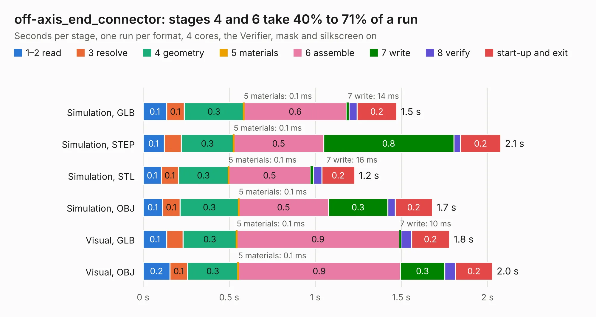

# 557. off-axis_end_connector

Board 557 of the 3,109 of [Corpus Testing](../Corpus-Testing.md), on [Corpus Page 6](../CorpusTestingPages/Corpus-Testing-06.md#557-off-axis_end_connector).

| Mode and format | 1–2 read | 3 resolve | 4 geometry | 5 materials | 6 assemble | 7 write | 8 verify | start-up and exit | Total |
|---|---:|---:|---:|---:|---:|---:|---:|---:|---:|
| Simulation, GLB | 0.1 | 0.1 | 0.3 | 0.1&nbsp;ms | 0.6 | 14&nbsp;ms | 46&nbsp;ms | 0.2 | 1.5 |
| Simulation, STEP | 0.1 | 99&nbsp;ms | 0.3 | 0.1&nbsp;ms | 0.5 | 0.8 | 39&nbsp;ms | 0.2 | 2.1 |
| Simulation, STL | 0.1 | 0.1 | 0.3 | 0.1&nbsp;ms | 0.5 | 16&nbsp;ms | 48&nbsp;ms | 0.2 | 1.2 |
| Simulation, OBJ | 0.1 | 0.1 | 0.3 | 0.1&nbsp;ms | 0.5 | 0.3 | 43&nbsp;ms | 0.2 | 1.7 |
| Visual, GLB | 0.1 | 95&nbsp;ms | 0.3 | 0.1&nbsp;ms | 0.9 | 10&nbsp;ms | 62&nbsp;ms | 0.2 | 1.8 |
| Visual, OBJ | 0.2 | 0.1 | 0.3 | 0.1&nbsp;ms | 0.9 | 0.3 | 62&nbsp;ms | 0.2 | 2.0 |

<table align="center"><tr><td valign="top">

| Board | Repo: [BerkeleyLab/DxP-sensor-probes](https://github.com/BerkeleyLab/DxP-sensor-probes) Board: `off-axis_end_connector.kicad_pcb` |
|---|---|
| Folder | off-axis_end_connector |
| Complexity | 155&nbsp;/&nbsp;1000 (size&nbsp;90, features&nbsp;65) |
| KESE&nbsp;features | through vias, rounded, trapezoid or chamfered pads, filled zones, copper drawings, curved board outline |
| Tested | 9th November 2026 |
| Copper&nbsp;layers | 2 |
| File&nbsp;format | KiCad 10 (20260206) |
| Parts,&nbsp;tracks,&nbsp;vias | 1, 25, 10 |
| Triangles,&nbsp;simulation | 71,242 in 17 parts |
| Verifier | PASS in all six runs |

</td><td valign="top">

<table>
<tr><th>File type</th><th>File size</th><th>Peak memory used</th></tr>
<tr><th colspan="3" align="left">Simulation</th></tr>
<tr><td>GLB</td><td align="right">2.6&nbsp;MB</td><td align="right">168&nbsp;MB</td></tr>
<tr><td>STEP</td><td align="right">13&nbsp;MB</td><td align="right">176&nbsp;MB</td></tr>
<tr><td>STL</td><td align="right">3.6&nbsp;MB</td><td align="right">168&nbsp;MB</td></tr>
<tr><td>OBJ</td><td align="right">7.1&nbsp;MB</td><td align="right">169&nbsp;MB</td></tr>
<tr><th colspan="3" align="left">Visual</th></tr>
<tr><td>GLB</td><td align="right">1.8&nbsp;MB</td><td align="right">155&nbsp;MB</td></tr>
<tr><td>OBJ</td><td align="right">4.9&nbsp;MB</td><td align="right">155&nbsp;MB</td></tr>
</table>

</td></tr></table>

| Previous | Next |
|:---|---:|
| [556. FF_connector](b0556b_DxP-sensor-probes_FF-connector.md) | [558. sensor_board_outline](b0558b_DxP-sensor-probes_sensor-board-outline.md) |
