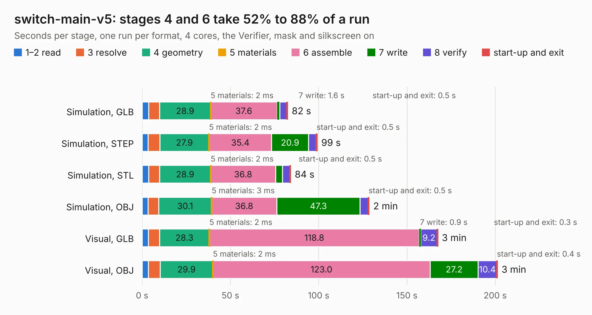

# 557. switch-main-v5

Board 557 of the 3,127 of [Corpus Testing](../Corpus-Testing.md), on [Corpus Page 6](../CorpusTestingPages/Corpus-Testing-06.md#557-switch-main-v5).

| Mode and format | 1–2 read | 3 resolve | 4 geometry | 5 materials | 6 assemble | 7 write | 8 verify | start-up and exit | Total |
|---|---:|---:|---:|---:|---:|---:|---:|---:|---:|
| Simulation, GLB | 3.6 | 6.3 | 28.9 | 2&nbsp;ms | 37.6 | 1.6 | 3.9 | 0.5 | 82.4 |
| Simulation, STEP | 3.3 | 6.7 | 27.9 | 2&nbsp;ms | 35.4 | 20.9 | 4.3 | 0.5 | 99.1 |
| Simulation, STL | 3.7 | 6.3 | 28.9 | 2&nbsp;ms | 36.8 | 3.8 | 4.2 | 0.5 | 84.1 |
| Simulation, OBJ | 3.3 | 6.0 | 30.1 | 3&nbsp;ms | 36.8 | 47.3 | 4.6 | 0.5 | 128.6 |
| Visual, GLB | 3.5 | 6.3 | 28.3 | 2&nbsp;ms | 118.8 | 0.9 | 9.2 | 0.3 | 167.4 |
| Visual, OBJ | 3.6 | 6.6 | 29.9 | 2&nbsp;ms | 123.0 | 27.2 | 10.4 | 0.4 | 201.2 |

<table align="center"><tr><td valign="top">

| Board | Repo: [ben5049/switch-v5-hardware](https://github.com/ben5049/switch-v5-hardware) Board: `switch-main-v5.kicad_pcb` |
|---|---|
| Folder | pcbs / switch-main-v5 |
| Complexity | 539&nbsp;/&nbsp;1000 (size&nbsp;329, features&nbsp;210) |
| KESE&nbsp;features | through vias, slotted holes, custom pads, rounded, trapezoid or chamfered pads, arc tracks, filled zones, copper drawings, curved board outline, knockout text, TrueType text, stack-up, dielectric εr and tanδ, copper finish, mask and silkscreen colours, castellated pads |
| Tested | 9th November 2026 |
| Copper&nbsp;layers | 6 |
| File&nbsp;format | KiCad 10 (20260206) |
| Parts,&nbsp;tracks,&nbsp;vias | 601, 7,020, 1,267 |
| Triangles,&nbsp;simulation | 9,865,620 in 704 parts |
| Verifier | PASS in all six runs |

</td><td valign="top">

<table>
<tr><th>File type</th><th>File size</th><th>Peak memory used</th></tr>
<tr><th colspan="3" align="left">Simulation</th></tr>
<tr><td>GLB</td><td align="right">326&nbsp;MB</td><td align="right">2.6&nbsp;GB</td></tr>
<tr><td>STEP</td><td align="right">1.4&nbsp;GB</td><td align="right">3.3&nbsp;GB</td></tr>
<tr><td>STL</td><td align="right">493&nbsp;MB</td><td align="right">2.6&nbsp;GB</td></tr>
<tr><td>OBJ</td><td align="right">1.1&nbsp;GB</td><td align="right">6.2&nbsp;GB</td></tr>
<tr><th colspan="3" align="left">Visual</th></tr>
<tr><td>GLB</td><td align="right">202&nbsp;MB</td><td align="right">3.3&nbsp;GB</td></tr>
<tr><td>OBJ</td><td align="right">657&nbsp;MB</td><td align="right">4.2&nbsp;GB</td></tr>
</table>

</td></tr></table>

| Previous | Next |
|:---|---:|
| [556. switch-main-v5-test-rig](b0556b_switch-v5-hardware_switch-main-v5-test-rig.md) | [558. loggerhw_v5.0](b0558b_DxP-data-logger_loggerhw-v5-0.md) |
