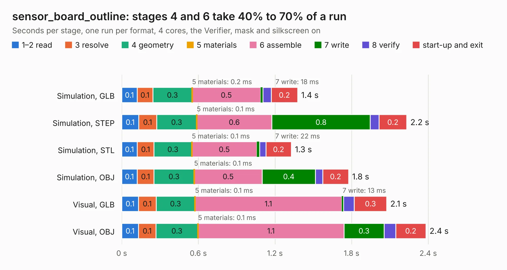

# 558. sensor_board_outline

Board 558 of the 3,106 of [Corpus Testing](../Corpus-Testing.md), on [Corpus Page 6](../CorpusTestingPages/Corpus-Testing-06.md#558-sensor_board_outline).

| Mode and format | 1–2 read | 3 resolve | 4 geometry | 5 materials | 6 assemble | 7 write | 8 verify | start-up and exit | Total |
|---|---:|---:|---:|---:|---:|---:|---:|---:|---:|
| Simulation, GLB | 0.1 | 0.1 | 0.3 | 0.2&nbsp;ms | 0.5 | 18&nbsp;ms | 66&nbsp;ms | 0.2 | 1.4 |
| Simulation, STEP | 0.1 | 0.1 | 0.3 | 0.1&nbsp;ms | 0.6 | 0.8 | 69&nbsp;ms | 0.2 | 2.2 |
| Simulation, STL | 0.1 | 0.1 | 0.3 | 0.1&nbsp;ms | 0.5 | 22&nbsp;ms | 50&nbsp;ms | 0.2 | 1.3 |
| Simulation, OBJ | 0.1 | 0.1 | 0.3 | 0.1&nbsp;ms | 0.5 | 0.4 | 56&nbsp;ms | 0.2 | 1.8 |
| Visual, GLB | 0.1 | 0.1 | 0.3 | 0.1&nbsp;ms | 1.1 | 13&nbsp;ms | 85&nbsp;ms | 0.3 | 2.1 |
| Visual, OBJ | 0.1 | 0.1 | 0.3 | 0.1&nbsp;ms | 1.1 | 0.3 | 90&nbsp;ms | 0.2 | 2.4 |

<table align="center"><tr><td valign="top">

| Board | Repo: [BerkeleyLab/DxP-sensor-probes](https://github.com/BerkeleyLab/DxP-sensor-probes) Board: `sensor_board_outline.kicad_pcb` |
|---|---|
| Folder | sensor_board_outline |
| Complexity | 188&nbsp;/&nbsp;1000 (size&nbsp;123, features&nbsp;65) |
| KESE&nbsp;features | through vias, slotted holes, filled zones, copper drawings, curved board outline |
| Tested | 9th November 2026 |
| Copper&nbsp;layers | 2 |
| File&nbsp;format | KiCad 10 (20260206) |
| Parts,&nbsp;tracks,&nbsp;vias | 0, 625, 6 |
| Triangles,&nbsp;simulation | 86,656 in 17 parts |
| Note | no components |
| Verifier | PASS in all six runs |

</td><td valign="top">

<table>
<tr><th>File type</th><th>File size</th><th>Peak memory used</th></tr>
<tr><th colspan="3" align="left">Simulation</th></tr>
<tr><td>GLB</td><td align="right">3.0&nbsp;MB</td><td align="right">183&nbsp;MB</td></tr>
<tr><td>STEP</td><td align="right">14&nbsp;MB</td><td align="right">181&nbsp;MB</td></tr>
<tr><td>STL</td><td align="right">4.3&nbsp;MB</td><td align="right">178&nbsp;MB</td></tr>
<tr><td>OBJ</td><td align="right">8.5&nbsp;MB</td><td align="right">178&nbsp;MB</td></tr>
<tr><th colspan="3" align="left">Visual</th></tr>
<tr><td>GLB</td><td align="right">2.2&nbsp;MB</td><td align="right">156&nbsp;MB</td></tr>
<tr><td>OBJ</td><td align="right">6.2&nbsp;MB</td><td align="right">157&nbsp;MB</td></tr>
</table>

</td></tr></table>

| Previous | Next |
|:---|---:|
| [557. off-axis_end_connector](b0557b_DxP-sensor-probes_off-axis-end-connector.md) | [559. TMP117-ADXL345_section_5cm](b0559b_DxP-sensor-probes_TMP117-ADXL345-section-5cm.md) |
