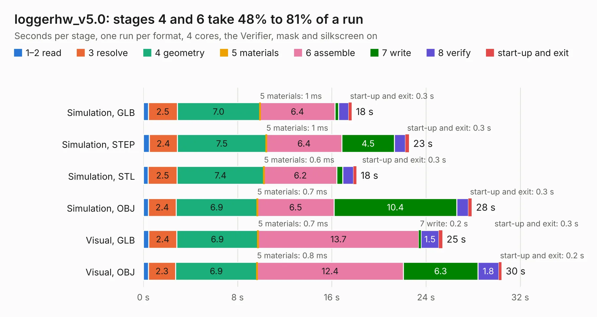

# 559. loggerhw_v5.0

Board 559 of the 3,131 of [Corpus Testing](../Corpus-Testing.md), on [Corpus Page 6](../CorpusTestingPages/Corpus-Testing-06.md#559-loggerhw_v50).

| Mode and format | 1–2 read | 3 resolve | 4 geometry | 5 materials | 6 assemble | 7 write | 8 verify | start-up and exit | Total |
|---|---:|---:|---:|---:|---:|---:|---:|---:|---:|
| Simulation, GLB | 0.4 | 2.5 | 7.0 | 1&nbsp;ms | 6.4 | 0.3 | 0.8 | 0.3 | 17.7 |
| Simulation, STEP | 0.5 | 2.4 | 7.5 | 1&nbsp;ms | 6.4 | 4.5 | 0.9 | 0.3 | 22.6 |
| Simulation, STL | 0.4 | 2.5 | 7.4 | 0.6&nbsp;ms | 6.2 | 0.5 | 0.9 | 0.3 | 18.1 |
| Simulation, OBJ | 0.4 | 2.4 | 6.9 | 0.7&nbsp;ms | 6.5 | 10.4 | 1.0 | 0.3 | 27.9 |
| Visual, GLB | 0.5 | 2.4 | 6.9 | 0.7&nbsp;ms | 13.7 | 0.2 | 1.5 | 0.3 | 25.4 |
| Visual, OBJ | 0.4 | 2.3 | 6.9 | 0.8&nbsp;ms | 12.4 | 6.3 | 1.8 | 0.2 | 30.4 |

<table align="center"><tr><td valign="top">

| Board | Repo: [BerkeleyLab/DxP-data-logger](https://github.com/BerkeleyLab/DxP-data-logger) Board: `loggerhw_v5.0.kicad_pcb` |
|---|---|
| Complexity | 298&nbsp;/&nbsp;1000 (size&nbsp;243, features&nbsp;55) |
| KESE&nbsp;features | through vias, rounded, trapezoid or chamfered pads, filled zones, curved board outline |
| Tested | 9th November 2026 |
| Copper&nbsp;layers | 4 |
| File&nbsp;format | KiCad 10 (20260206) |
| Parts,&nbsp;tracks,&nbsp;vias | 57, 1,163, 322 |
| Triangles,&nbsp;simulation | 1,744,726 in 99 parts |
| Verifier | PASS in all six runs |

</td><td valign="top">

<table>
<tr><th>File type</th><th>File size</th><th>Peak memory used</th></tr>
<tr><th colspan="3" align="left">Simulation</th></tr>
<tr><td>GLB</td><td align="right">61&nbsp;MB</td><td align="right">694&nbsp;MB</td></tr>
<tr><td>STEP</td><td align="right">244&nbsp;MB</td><td align="right">791&nbsp;MB</td></tr>
<tr><td>STL</td><td align="right">87&nbsp;MB</td><td align="right">665&nbsp;MB</td></tr>
<tr><td>OBJ</td><td align="right">183&nbsp;MB</td><td align="right">1.2&nbsp;GB</td></tr>
<tr><th colspan="3" align="left">Visual</th></tr>
<tr><td>GLB</td><td align="right">38&nbsp;MB</td><td align="right">813&nbsp;MB</td></tr>
<tr><td>OBJ</td><td align="right">116&nbsp;MB</td><td align="right">802&nbsp;MB</td></tr>
</table>

</td></tr></table>

| Previous | Next |
|:---|---:|
| [558. switch-main-v5](b0558b_switch-v5-hardware_switch-main-v5.md) | [560. end_connector](b0560b_DxP-sensor-probes_end-connector.md) |
