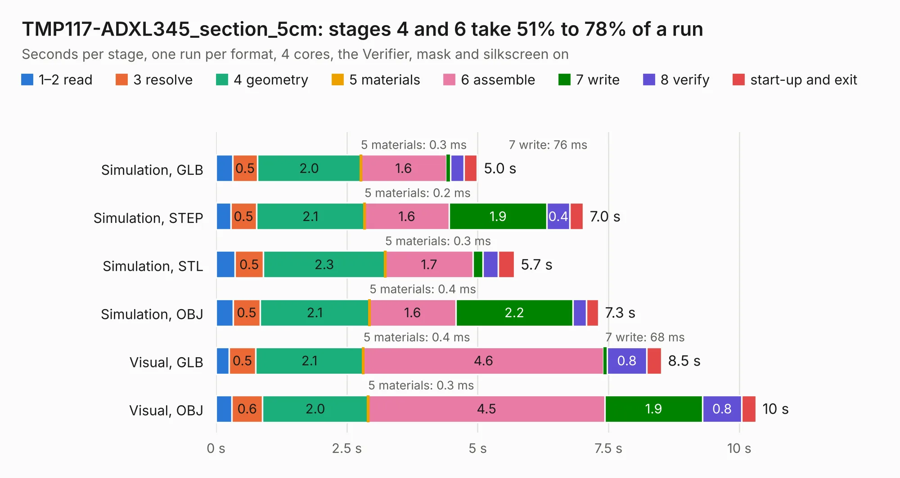

# 559. TMP117-ADXL345_section_5cm

Board 559 of the 3,111 of [Corpus Testing](../Corpus-Testing.md), on [Corpus Page 6](../CorpusTestingPages/Corpus-Testing-06.md#559-tmp117-adxl345_section_5cm).

| Mode and format | 1–2 read | 3 resolve | 4 geometry | 5 materials | 6 assemble | 7 write | 8 verify | start-up and exit | Total |
|---|---:|---:|---:|---:|---:|---:|---:|---:|---:|
| Simulation, GLB | 0.3 | 0.5 | 2.0 | 0.3&nbsp;ms | 1.6 | 76&nbsp;ms | 0.3 | 0.3 | 5.0 |
| Simulation, STEP | 0.3 | 0.5 | 2.1 | 0.2&nbsp;ms | 1.6 | 1.9 | 0.4 | 0.3 | 7.0 |
| Simulation, STL | 0.4 | 0.5 | 2.3 | 0.3&nbsp;ms | 1.7 | 0.2 | 0.3 | 0.3 | 5.7 |
| Simulation, OBJ | 0.3 | 0.5 | 2.1 | 0.4&nbsp;ms | 1.6 | 2.2 | 0.3 | 0.2 | 7.3 |
| Visual, GLB | 0.3 | 0.5 | 2.1 | 0.4&nbsp;ms | 4.6 | 68&nbsp;ms | 0.8 | 0.3 | 8.5 |
| Visual, OBJ | 0.3 | 0.6 | 2.0 | 0.3&nbsp;ms | 4.5 | 1.9 | 0.8 | 0.3 | 10.3 |

<table align="center"><tr><td valign="top">

| Board | Repo: [BerkeleyLab/DxP-sensor-probes](https://github.com/BerkeleyLab/DxP-sensor-probes) Board: `TMP117-ADXL345_section_5cm.kicad_pcb` |
|---|---|
| Folder | TMP117-ADXL345_section_5cm |
| Complexity | 256&nbsp;/&nbsp;1000 (size&nbsp;181, features&nbsp;75) |
| KESE&nbsp;features | through vias, slotted holes, rounded, trapezoid or chamfered pads, filled zones, copper drawings, curved board outline |
| Tested | 9th November 2026 |
| Copper&nbsp;layers | 2 |
| File&nbsp;format | KiCad 10 (20260206) |
| Parts,&nbsp;tracks,&nbsp;vias | 26, 2,428, 52 |
| Triangles,&nbsp;simulation | 413,486 in 41 parts |
| Verifier | PASS in all six runs |

</td><td valign="top">

<table>
<tr><th>File type</th><th>File size</th><th>Peak memory used</th></tr>
<tr><th colspan="3" align="left">Simulation</th></tr>
<tr><td>GLB</td><td align="right">15&nbsp;MB</td><td align="right">300&nbsp;MB</td></tr>
<tr><td>STEP</td><td align="right">79&nbsp;MB</td><td align="right">333&nbsp;MB</td></tr>
<tr><td>STL</td><td align="right">21&nbsp;MB</td><td align="right">293&nbsp;MB</td></tr>
<tr><td>OBJ</td><td align="right">43&nbsp;MB</td><td align="right">340&nbsp;MB</td></tr>
<tr><th colspan="3" align="left">Visual</th></tr>
<tr><td>GLB</td><td align="right">12&nbsp;MB</td><td align="right">343&nbsp;MB</td></tr>
<tr><td>OBJ</td><td align="right">36&nbsp;MB</td><td align="right">348&nbsp;MB</td></tr>
</table>

</td></tr></table>

| Previous | Next |
|:---|---:|
| [558. sensor_board_outline](b0558b_DxP-sensor-probes_sensor-board-outline.md) | [560. TMP117_section_10cm](b0560b_DxP-sensor-probes_TMP117-section-10cm.md) |
