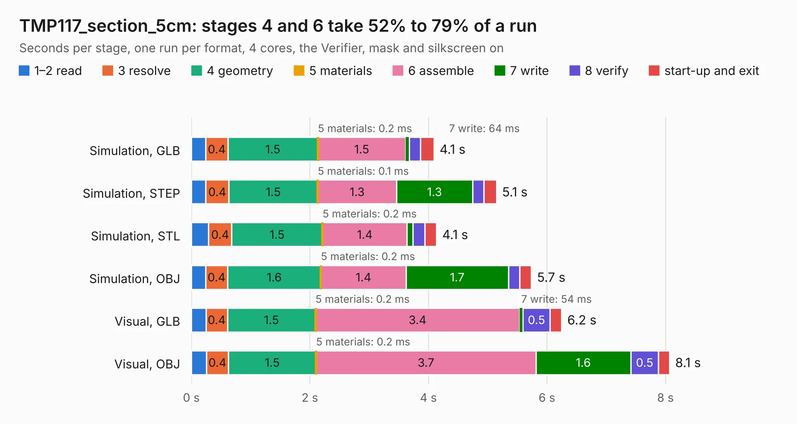

# 561. TMP117_section_5cm

Board 561 of the 3,110 of [Corpus Testing](../Corpus-Testing.md), on [Corpus Page 6](../CorpusTestingPages/Corpus-Testing-06.md#561-tmp117_section_5cm).

| Mode and format | 1–2 read | 3 resolve | 4 geometry | 5 materials | 6 assemble | 7 write | 8 verify | start-up and exit | Total |
|---|---:|---:|---:|---:|---:|---:|---:|---:|---:|
| Simulation, GLB | 0.2 | 0.4 | 1.5 | 0.2&nbsp;ms | 1.5 | 64&nbsp;ms | 0.2 | 0.2 | 4.1 |
| Simulation, STEP | 0.2 | 0.4 | 1.5 | 0.1&nbsp;ms | 1.3 | 1.3 | 0.2 | 0.2 | 5.1 |
| Simulation, STL | 0.3 | 0.4 | 1.5 | 0.2&nbsp;ms | 1.4 | 98&nbsp;ms | 0.2 | 0.2 | 4.1 |
| Simulation, OBJ | 0.2 | 0.4 | 1.6 | 0.2&nbsp;ms | 1.4 | 1.7 | 0.2 | 0.2 | 5.7 |
| Visual, GLB | 0.2 | 0.4 | 1.5 | 0.2&nbsp;ms | 3.4 | 54&nbsp;ms | 0.5 | 0.2 | 6.2 |
| Visual, OBJ | 0.3 | 0.4 | 1.5 | 0.2&nbsp;ms | 3.7 | 1.6 | 0.5 | 0.2 | 8.1 |

<table align="center"><tr><td valign="top">

| Board | Repo: [BerkeleyLab/DxP-sensor-probes](https://github.com/BerkeleyLab/DxP-sensor-probes) Board: `TMP117_section_5cm.kicad_pcb` |
|---|---|
| Folder | TMP117_section_5cm |
| Complexity | 262&nbsp;/&nbsp;1000 (size&nbsp;187, features&nbsp;75) |
| KESE&nbsp;features | through vias, slotted holes, rounded, trapezoid or chamfered pads, filled zones, copper drawings, curved board outline |
| Tested | 9th November 2026 |
| Copper&nbsp;layers | 2 |
| File&nbsp;format | KiCad 10 (20260206) |
| Parts,&nbsp;tracks,&nbsp;vias | 26, 3,397, 59 |
| Triangles,&nbsp;simulation | 430,328 in 33 parts |
| Verifier | PASS in all six runs |

</td><td valign="top">

<table>
<tr><th>File type</th><th>File size</th><th>Peak memory used</th></tr>
<tr><th colspan="3" align="left">Simulation</th></tr>
<tr><td>GLB</td><td align="right">15&nbsp;MB</td><td align="right">288&nbsp;MB</td></tr>
<tr><td>STEP</td><td align="right">80&nbsp;MB</td><td align="right">344&nbsp;MB</td></tr>
<tr><td>STL</td><td align="right">22&nbsp;MB</td><td align="right">303&nbsp;MB</td></tr>
<tr><td>OBJ</td><td align="right">45&nbsp;MB</td><td align="right">361&nbsp;MB</td></tr>
<tr><th colspan="3" align="left">Visual</th></tr>
<tr><td>GLB</td><td align="right">13&nbsp;MB</td><td align="right">362&nbsp;MB</td></tr>
<tr><td>OBJ</td><td align="right">39&nbsp;MB</td><td align="right">358&nbsp;MB</td></tr>
</table>

</td></tr></table>

| Previous | Next |
|:---|---:|
| [560. TMP117_section_10cm](b0560b_DxP-sensor-probes_TMP117-section-10cm.md) | [562. Marble](b0562b_Marble_Marble.md) |
