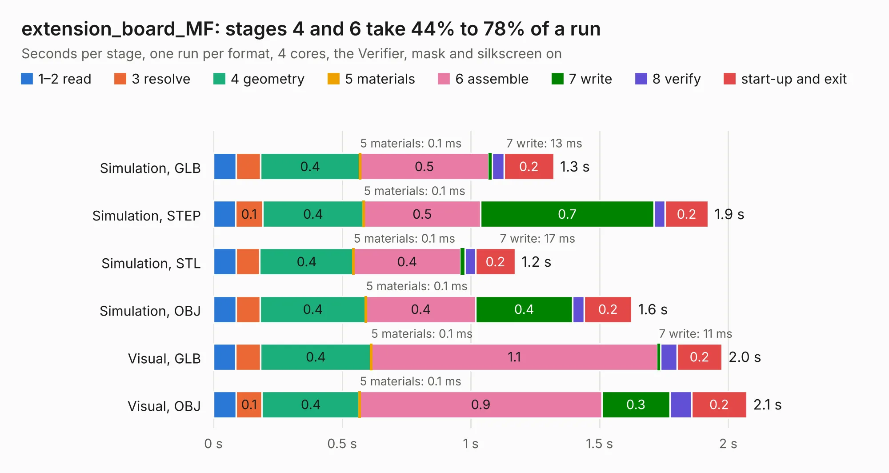

# 561 extension_board_MF

Board 561 of the 3,138 of [Corpus Testing](../Corpus-Testing.md), on [Corpus Page 6](../CorpusTestingPages/Corpus-Testing-06.md#561-extension_board_mf).

| Mode and format | 1–2 read | 3 resolve | 4 geometry | 5 materials | 6 assemble | 7 write | 8 verify | start-up and exit | Total |
|---|---:|---:|---:|---:|---:|---:|---:|---:|---:|
| Simulation, GLB | 88&nbsp;ms | 94&nbsp;ms | 0.4 | 0.1&nbsp;ms | 0.5 | 13&nbsp;ms | 47&nbsp;ms | 0.2 | 1.3 |
| Simulation, STEP | 86&nbsp;ms | 0.1 | 0.4 | 0.1&nbsp;ms | 0.5 | 0.7 | 44&nbsp;ms | 0.2 | 1.9 |
| Simulation, STL | 88&nbsp;ms | 93&nbsp;ms | 0.4 | 0.1&nbsp;ms | 0.4 | 17&nbsp;ms | 42&nbsp;ms | 0.2 | 1.2 |
| Simulation, OBJ | 88&nbsp;ms | 93&nbsp;ms | 0.4 | 0.1&nbsp;ms | 0.4 | 0.4 | 45&nbsp;ms | 0.2 | 1.6 |
| Visual, GLB | 87&nbsp;ms | 96&nbsp;ms | 0.4 | 0.1&nbsp;ms | 1.1 | 11&nbsp;ms | 64&nbsp;ms | 0.2 | 2.0 |
| Visual, OBJ | 89&nbsp;ms | 0.1 | 0.4 | 0.1&nbsp;ms | 0.9 | 0.3 | 83&nbsp;ms | 0.2 | 2.1 |

<table align="center"><tr><td valign="top">

| Board | Repo: [BerkeleyLab/DxP-sensor-probes](https://github.com/BerkeleyLab/DxP-sensor-probes) Board: `extension_board_MF.kicad_pcb` |
|---|---|
| Folder | extension_board_MF |
| Complexity | 175&nbsp;/&nbsp;1000 (size&nbsp;110, features&nbsp;65) |
| KESE&nbsp;features | through vias, slotted holes, filled zones, copper drawings, curved board outline |
| Tested | 9th November 2026 |
| Copper&nbsp;layers | 2 |
| File&nbsp;format | KiCad 10 (20260206) |
| Parts,&nbsp;tracks,&nbsp;vias | 0, 275, 6 |
| Triangles,&nbsp;simulation | 81,920 in 17 parts |
| Note | no components |
| Verifier | PASS in all six runs |

</td><td valign="top">

<table>
<tr><th>File type</th><th>File size</th><th>Peak memory used</th></tr>
<tr><th colspan="3" align="left">Simulation</th></tr>
<tr><td>GLB</td><td align="right">3.0&nbsp;MB</td><td align="right">173&nbsp;MB</td></tr>
<tr><td>STEP</td><td align="right">16&nbsp;MB</td><td align="right">183&nbsp;MB</td></tr>
<tr><td>STL</td><td align="right">4.1&nbsp;MB</td><td align="right">177&nbsp;MB</td></tr>
<tr><td>OBJ</td><td align="right">8.4&nbsp;MB</td><td align="right">173&nbsp;MB</td></tr>
<tr><th colspan="3" align="left">Visual</th></tr>
<tr><td>GLB</td><td align="right">2.4&nbsp;MB</td><td align="right">158&nbsp;MB</td></tr>
<tr><td>OBJ</td><td align="right">6.6&nbsp;MB</td><td align="right">158&nbsp;MB</td></tr>
</table>

</td></tr></table>

| Previous | Next |
|:---|---:|
| [560 end_connector](b0560b_DxP-sensor-probes_end-connector.md) | [562 extension_board_MM](b0562b_DxP-sensor-probes_extension-board-MM.md) |
