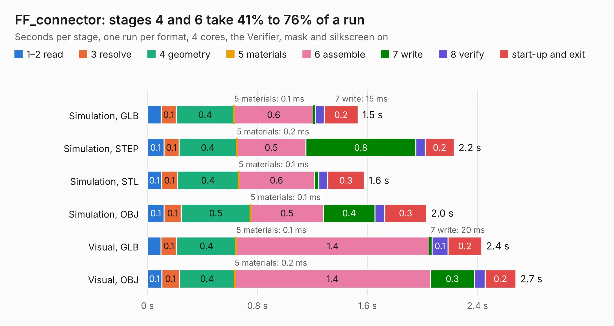

# 562. FF_connector

Board 562 of the 3,127 of [Corpus Testing](../Corpus-Testing.md), on [Corpus Page 6](../CorpusTestingPages/Corpus-Testing-06.md#562-ff_connector).

| Mode and format | 1–2 read | 3 resolve | 4 geometry | 5 materials | 6 assemble | 7 write | 8 verify | start-up and exit | Total |
|---|---:|---:|---:|---:|---:|---:|---:|---:|---:|
| Simulation, GLB | 0.1 | 0.1 | 0.4 | 0.1&nbsp;ms | 0.6 | 15&nbsp;ms | 65&nbsp;ms | 0.2 | 1.5 |
| Simulation, STEP | 0.1 | 0.1 | 0.4 | 0.2&nbsp;ms | 0.5 | 0.8 | 67&nbsp;ms | 0.2 | 2.2 |
| Simulation, STL | 0.1 | 0.1 | 0.4 | 0.1&nbsp;ms | 0.6 | 32&nbsp;ms | 65&nbsp;ms | 0.3 | 1.6 |
| Simulation, OBJ | 0.1 | 0.1 | 0.5 | 0.1&nbsp;ms | 0.5 | 0.4 | 71&nbsp;ms | 0.3 | 2.0 |
| Visual, GLB | 98&nbsp;ms | 0.1 | 0.4 | 0.1&nbsp;ms | 1.4 | 20&nbsp;ms | 0.1 | 0.2 | 2.4 |
| Visual, OBJ | 0.1 | 0.1 | 0.4 | 0.2&nbsp;ms | 1.4 | 0.3 | 77&nbsp;ms | 0.2 | 2.7 |

<table align="center"><tr><td valign="top">

| Board | Repo: [BerkeleyLab/DxP-sensor-probes](https://github.com/BerkeleyLab/DxP-sensor-probes) Board: `FF_connector.kicad_pcb` |
|---|---|
| Folder | FF_connector |
| Complexity | 143&nbsp;/&nbsp;1000 (size&nbsp;103, features&nbsp;40) |
| KESE&nbsp;features | slotted holes, filled zones, curved board outline |
| Tested | 9th November 2026 |
| Copper&nbsp;layers | 2 |
| File&nbsp;format | KiCad 10 (20260206) |
| Parts,&nbsp;tracks,&nbsp;vias | 0, 196, 0 |
| Triangles,&nbsp;simulation | 79,696 in 17 parts |
| Note | no components |
| Verifier | PASS in all six runs |

</td><td valign="top">

<table>
<tr><th>File type</th><th>File size</th><th>Peak memory used</th></tr>
<tr><th colspan="3" align="left">Simulation</th></tr>
<tr><td>GLB</td><td align="right">2.9&nbsp;MB</td><td align="right">175&nbsp;MB</td></tr>
<tr><td>STEP</td><td align="right">16&nbsp;MB</td><td align="right">183&nbsp;MB</td></tr>
<tr><td>STL</td><td align="right">4.0&nbsp;MB</td><td align="right">175&nbsp;MB</td></tr>
<tr><td>OBJ</td><td align="right">8.0&nbsp;MB</td><td align="right">176&nbsp;MB</td></tr>
<tr><th colspan="3" align="left">Visual</th></tr>
<tr><td>GLB</td><td align="right">2.4&nbsp;MB</td><td align="right">155&nbsp;MB</td></tr>
<tr><td>OBJ</td><td align="right">6.7&nbsp;MB</td><td align="right">156&nbsp;MB</td></tr>
</table>

</td></tr></table>

| Previous | Next |
|:---|---:|
| [561. extension_board_MM](b0561b_DxP-sensor-probes_extension-board-MM.md) | [563. off-axis_end_connector](b0563b_DxP-sensor-probes_off-axis-end-connector.md) |
