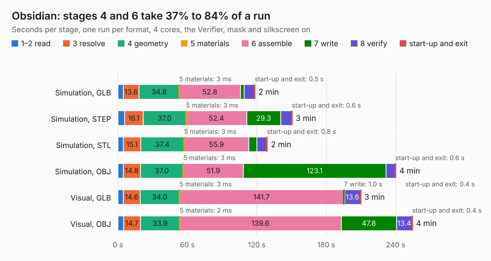

# 564. Obsidian

Board 564 of the 3,111 of [Corpus Testing](../Corpus-Testing.md), on [Corpus Page 6](../CorpusTestingPages/Corpus-Testing-06.md#564-obsidian).

| Mode and format | 1–2 read | 3 resolve | 4 geometry | 5 materials | 6 assemble | 7 write | 8 verify | start-up and exit | Total |
|---|---:|---:|---:|---:|---:|---:|---:|---:|---:|
| Simulation, GLB | 4.6 | 13.6 | 34.8 | 3&nbsp;ms | 52.8 | 3.3 | 8.8 | 0.5 | 118.4 |
| Simulation, STEP | 5.8 | 16.1 | 37.0 | 3&nbsp;ms | 52.4 | 29.3 | 9.5 | 0.6 | 150.6 |
| Simulation, STL | 4.7 | 15.1 | 37.4 | 3&nbsp;ms | 55.9 | 7.0 | 8.3 | 0.8 | 129.2 |
| Simulation, OBJ | 4.6 | 14.8 | 37.0 | 3&nbsp;ms | 51.9 | 123.1 | 8.0 | 0.6 | 240.1 |
| Visual, GLB | 4.6 | 14.6 | 34.0 | 3&nbsp;ms | 141.7 | 1.0 | 13.6 | 0.4 | 209.9 |
| Visual, OBJ | 4.8 | 14.7 | 33.9 | 2&nbsp;ms | 139.6 | 47.8 | 13.4 | 0.4 | 254.5 |

<table align="center"><tr><td valign="top">

| Board | Repo: [BerkeleyLab/Obsidian](https://github.com/BerkeleyLab/Obsidian) Board: `Obsidian.kicad_pcb` |
|---|---|
| Folder | Obsidian |
| Complexity | 515&nbsp;/&nbsp;1000 (size&nbsp;335, features&nbsp;180) |
| KESE&nbsp;features | through vias, padstacks, slotted holes, custom pads, rounded, trapezoid or chamfered pads, arc tracks, filled zones, copper drawings, copper text, TrueType text, stack-up, dielectric εr and tanδ |
| Tested | 9th November 2026 |
| Copper&nbsp;layers | 8 |
| File&nbsp;format | KiCad 9 (20241229) |
| Parts,&nbsp;tracks,&nbsp;vias | 504, 11,970, 1,259 |
| Triangles,&nbsp;simulation | 12,905,622 in 462 parts |
| Verifier | PASS in all six runs |

</td><td valign="top">

<table>
<tr><th>File type</th><th>File size</th><th>Peak memory used</th></tr>
<tr><th colspan="3" align="left">Simulation</th></tr>
<tr><td>GLB</td><td align="right">431&nbsp;MB</td><td align="right">2.6&nbsp;GB</td></tr>
<tr><td>STEP</td><td align="right">1.4&nbsp;GB</td><td align="right">3.9&nbsp;GB</td></tr>
<tr><td>STL</td><td align="right">645&nbsp;MB</td><td align="right">2.6&nbsp;GB</td></tr>
<tr><td>OBJ</td><td align="right">1.4&nbsp;GB</td><td align="right">8.1&nbsp;GB</td></tr>
<tr><th colspan="3" align="left">Visual</th></tr>
<tr><td>GLB</td><td align="right">208&nbsp;MB</td><td align="right">3.6&nbsp;GB</td></tr>
<tr><td>OBJ</td><td align="right">689&nbsp;MB</td><td align="right">4.7&nbsp;GB</td></tr>
</table>

</td></tr></table>

| Previous | Next |
|:---|---:|
| [563. AMC_FMC_Carrier-PcbDoc](b0563b_Marble-Mini_AMC-FMC-Carrier-PcbDoc.md) | [565. zest](b0565b_zest_zest.md) |
