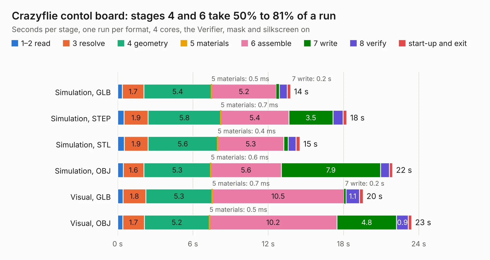

# 565. Crazyflie contol board

Board 565 of the 3,105 of [Corpus Testing](../Corpus-Testing.md), on [Corpus Page 6](../CorpusTestingPages/Corpus-Testing-06.md#565-crazyflie-contol-board).

| Mode and format | 1–2 read | 3 resolve | 4 geometry | 5 materials | 6 assemble | 7 write | 8 verify | start-up and exit | Total |
|---|---:|---:|---:|---:|---:|---:|---:|---:|---:|
| Simulation, GLB | 0.4 | 1.7 | 5.4 | 0.5&nbsp;ms | 5.2 | 0.2 | 0.6 | 0.3 | 13.8 |
| Simulation, STEP | 0.5 | 1.9 | 5.8 | 0.7&nbsp;ms | 5.4 | 3.5 | 0.8 | 0.3 | 18.3 |
| Simulation, STL | 0.5 | 1.9 | 5.6 | 0.4&nbsp;ms | 5.3 | 0.3 | 0.6 | 0.3 | 14.5 |
| Simulation, OBJ | 0.4 | 1.6 | 5.3 | 0.6&nbsp;ms | 5.6 | 7.9 | 0.7 | 0.3 | 21.9 |
| Visual, GLB | 0.4 | 1.8 | 5.3 | 0.7&nbsp;ms | 10.5 | 0.2 | 1.1 | 0.3 | 19.6 |
| Visual, OBJ | 0.4 | 1.7 | 5.2 | 0.5&nbsp;ms | 10.2 | 4.8 | 0.9 | 0.3 | 23.4 |

<table align="center"><tr><td valign="top">

| Board | Repo: [bitcraze/crazyflie-electronics](https://github.com/bitcraze/crazyflie-electronics) Board: `Crazyflie contol board.kicad_pcb` |
|---|---|
| Folder | ecad |
| Complexity | 302&nbsp;/&nbsp;1000 (size&nbsp;247, features&nbsp;55) |
| KESE&nbsp;features | through vias, drill offsets, filled zones, curved board outline |
| Tested | 9th November 2026 |
| Copper&nbsp;layers | 4 |
| File&nbsp;format | KiCad 3 (3) |
| Parts,&nbsp;tracks,&nbsp;vias | 114, 1,301, 140 |
| Triangles,&nbsp;simulation | 1,252,200 in 102 parts |
| Verifier | PASS in all six runs |

</td><td valign="top">

<table>
<tr><th>File type</th><th>File size</th><th>Peak memory used</th></tr>
<tr><th colspan="3" align="left">Simulation</th></tr>
<tr><td>GLB</td><td align="right">44&nbsp;MB</td><td align="right">487&nbsp;MB</td></tr>
<tr><td>STEP</td><td align="right">185&nbsp;MB</td><td align="right">582&nbsp;MB</td></tr>
<tr><td>STL</td><td align="right">63&nbsp;MB</td><td align="right">489&nbsp;MB</td></tr>
<tr><td>OBJ</td><td align="right">135&nbsp;MB</td><td align="right">891&nbsp;MB</td></tr>
<tr><th colspan="3" align="left">Visual</th></tr>
<tr><td>GLB</td><td align="right">29&nbsp;MB</td><td align="right">648&nbsp;MB</td></tr>
<tr><td>OBJ</td><td align="right">89&nbsp;MB</td><td align="right">649&nbsp;MB</td></tr>
</table>

</td></tr></table>

| Previous | Next |
|:---|---:|
| [564. zest](b0564b_zest_zest.md) | [566. ESP32S3](b0566b_22xt-kicad_ESP32S3.md) |
