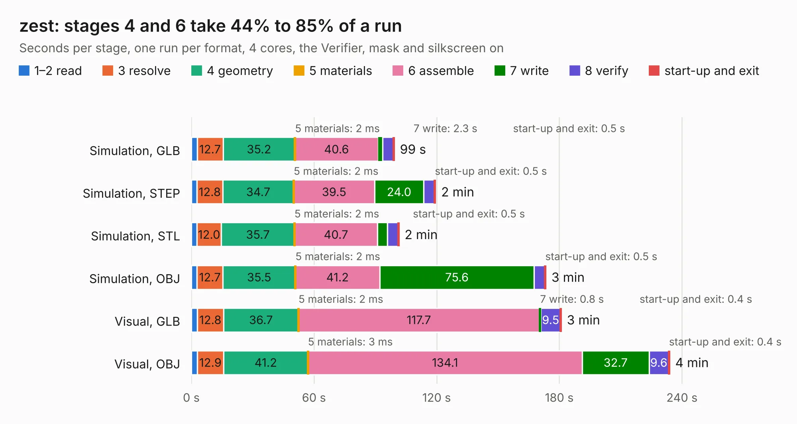

# 565. zest

Board 565 of the 3,108 of [Corpus Testing](../Corpus-Testing.md), on [Corpus Page 6](../CorpusTestingPages/Corpus-Testing-06.md#565-zest).

| Mode and format | 1–2 read | 3 resolve | 4 geometry | 5 materials | 6 assemble | 7 write | 8 verify | start-up and exit | Total |
|---|---:|---:|---:|---:|---:|---:|---:|---:|---:|
| Simulation, GLB | 2.8 | 12.7 | 35.2 | 2&nbsp;ms | 40.6 | 2.3 | 5.2 | 0.5 | 99.3 |
| Simulation, STEP | 2.6 | 12.8 | 34.7 | 2&nbsp;ms | 39.5 | 24.0 | 5.2 | 0.5 | 119.4 |
| Simulation, STL | 2.7 | 12.0 | 35.7 | 2&nbsp;ms | 40.7 | 4.7 | 5.2 | 0.5 | 101.5 |
| Simulation, OBJ | 2.8 | 12.7 | 35.5 | 2&nbsp;ms | 41.2 | 75.6 | 5.2 | 0.5 | 173.4 |
| Visual, GLB | 2.9 | 12.8 | 36.7 | 2&nbsp;ms | 117.7 | 0.8 | 9.5 | 0.4 | 180.9 |
| Visual, OBJ | 2.9 | 12.9 | 41.2 | 3&nbsp;ms | 134.1 | 32.7 | 9.6 | 0.4 | 233.9 |

<table align="center"><tr><td valign="top">

| Board | Repo: [berkeleylab/zest](https://github.com/berkeleylab/zest) Board: `zest.kicad_pcb` |
|---|---|
| Folder | board |
| Complexity | 380&nbsp;/&nbsp;1000 (size&nbsp;265, features&nbsp;115) |
| KESE&nbsp;features | through vias, rounded, trapezoid or chamfered pads, arc tracks, filled zones, copper text, TrueType text, stack-up, dielectric εr and tanδ |
| Tested | 9th November 2026 |
| Copper&nbsp;layers | 8 |
| File&nbsp;format | KiCad 10 (20260206) |
| Parts,&nbsp;tracks,&nbsp;vias | 410, 6,024, 1,118 |
| Triangles,&nbsp;simulation | 10,489,574 in 550 parts |
| Verifier | PASS in all six runs |

</td><td valign="top">

<table>
<tr><th>File type</th><th>File size</th><th>Peak memory used</th></tr>
<tr><th colspan="3" align="left">Simulation</th></tr>
<tr><td>GLB</td><td align="right">348&nbsp;MB</td><td align="right">2.3&nbsp;GB</td></tr>
<tr><td>STEP</td><td align="right">1.1&nbsp;GB</td><td align="right">3.3&nbsp;GB</td></tr>
<tr><td>STL</td><td align="right">525&nbsp;MB</td><td align="right">2.4&nbsp;GB</td></tr>
<tr><td>OBJ</td><td align="right">1.1&nbsp;GB</td><td align="right">6.5&nbsp;GB</td></tr>
<tr><th colspan="3" align="left">Visual</th></tr>
<tr><td>GLB</td><td align="right">168&nbsp;MB</td><td align="right">2.9&nbsp;GB</td></tr>
<tr><td>OBJ</td><td align="right">554&nbsp;MB</td><td align="right">3.7&nbsp;GB</td></tr>
</table>

</td></tr></table>

| Previous | Next |
|:---|---:|
| [564. Obsidian](b0564b_Obsidian_Obsidian.md) | [566. Crazyflie contol board](b0566b_crazyflie-electronics_Crazyflie-contol-board.md) |
