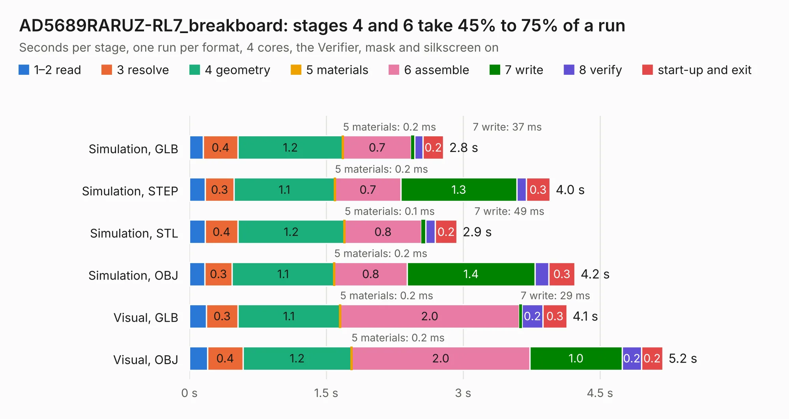

# 568. AD5689RARUZ-RL7_breakboard

Board 568 of the 3,107 of [Corpus Testing](../Corpus-Testing.md), on [Corpus Page 6](../CorpusTestingPages/Corpus-Testing-06.md#568-ad5689raruz-rl7_breakboard).

| Mode and format | 1–2 read | 3 resolve | 4 geometry | 5 materials | 6 assemble | 7 write | 8 verify | start-up and exit | Total |
|---|---:|---:|---:|---:|---:|---:|---:|---:|---:|
| Simulation, GLB | 0.2 | 0.4 | 1.2 | 0.2&nbsp;ms | 0.7 | 37&nbsp;ms | 91&nbsp;ms | 0.2 | 2.8 |
| Simulation, STEP | 0.2 | 0.3 | 1.1 | 0.2&nbsp;ms | 0.7 | 1.3 | 0.1 | 0.3 | 4.0 |
| Simulation, STL | 0.2 | 0.4 | 1.2 | 0.1&nbsp;ms | 0.8 | 49&nbsp;ms | 0.1 | 0.2 | 2.9 |
| Simulation, OBJ | 0.2 | 0.3 | 1.1 | 0.2&nbsp;ms | 0.8 | 1.4 | 0.2 | 0.3 | 4.2 |
| Visual, GLB | 0.2 | 0.3 | 1.1 | 0.2&nbsp;ms | 2.0 | 29&nbsp;ms | 0.2 | 0.3 | 4.1 |
| Visual, OBJ | 0.2 | 0.4 | 1.2 | 0.2&nbsp;ms | 2.0 | 1.0 | 0.2 | 0.2 | 5.2 |

<table align="center"><tr><td valign="top">

| Board | Repo: [bluejayracing/22xt_kicad](https://github.com/bluejayracing/22xt_kicad) Board: `AD5689RARUZ-RL7_breakboard.kicad_pcb` |
|---|---|
| Folder | 01-main_board / AD5689RARUZ-RL7_breakboard |
| Complexity | 163&nbsp;/&nbsp;1000 (size&nbsp;108, features&nbsp;55) |
| KESE&nbsp;features | through vias, rounded, trapezoid or chamfered pads, filled zones, curved board outline |
| Tested | 9th November 2026 |
| Copper&nbsp;layers | 2 |
| File&nbsp;format | KiCad 9 (20241229) |
| Parts,&nbsp;tracks,&nbsp;vias | 5, 41, 12 |
| Triangles,&nbsp;simulation | 184,358 in 27 parts |
| Verifier | PASS in all six runs |

</td><td valign="top">

<table>
<tr><th>File type</th><th>File size</th><th>Peak memory used</th></tr>
<tr><th colspan="3" align="left">Simulation</th></tr>
<tr><td>GLB</td><td align="right">6.5&nbsp;MB</td><td align="right">211&nbsp;MB</td></tr>
<tr><td>STEP</td><td align="right">29&nbsp;MB</td><td align="right">225&nbsp;MB</td></tr>
<tr><td>STL</td><td align="right">9.2&nbsp;MB</td><td align="right">227&nbsp;MB</td></tr>
<tr><td>OBJ</td><td align="right">19&nbsp;MB</td><td align="right">211&nbsp;MB</td></tr>
<tr><th colspan="3" align="left">Visual</th></tr>
<tr><td>GLB</td><td align="right">5.4&nbsp;MB</td><td align="right">194&nbsp;MB</td></tr>
<tr><td>OBJ</td><td align="right">15&nbsp;MB</td><td align="right">192&nbsp;MB</td></tr>
</table>

</td></tr></table>

| Previous | Next |
|:---|---:|
| [567. ESP32S3](b0567b_22xt-kicad_ESP32S3.md) | [569. DB44_breakout](b0569b_22xt-kicad_DB44-breakout.md) |
