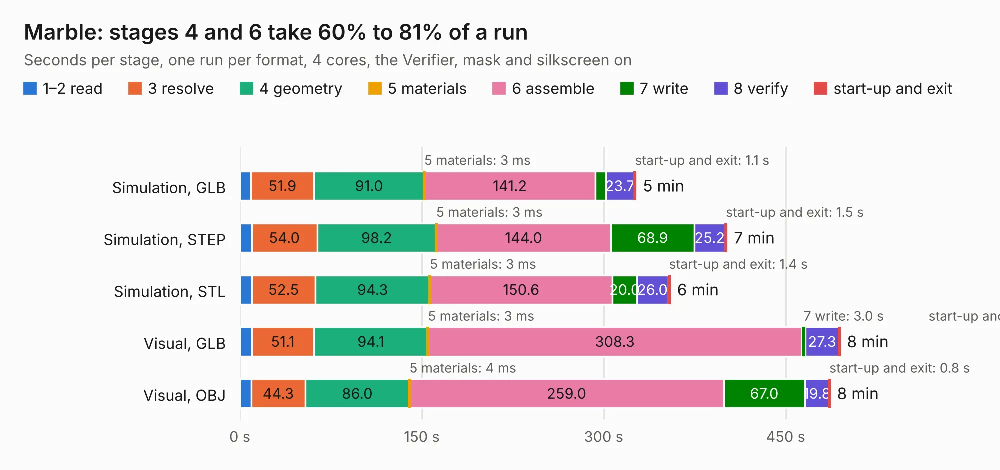

# 569 Marble

Board 569 of the 3,138 of [Corpus Testing](../Corpus-Testing.md), on [Corpus Page 6](../CorpusTestingPages/Corpus-Testing-06.md#569-marble).

| Mode and format | 1–2 read | 3 resolve | 4 geometry | 5 materials | 6 assemble | 7 write | 8 verify | start-up and exit | Total |
|---|---:|---:|---:|---:|---:|---:|---:|---:|---:|
| Simulation, GLB | 9.2 | 51.9 | 91.0 | 3&nbsp;ms | 141.2 | 8.3 | 23.7 | 1.1 | 326.4 |
| Simulation, STEP | 9.7 | 54.0 | 98.2 | 3&nbsp;ms | 144.0 | 68.9 | 25.2 | 1.5 | 401.5 |
| Simulation, STL | 9.9 | 52.5 | 94.3 | 3&nbsp;ms | 150.6 | 20.0 | 26.0 | 1.4 | 354.6 |
| Simulation, OBJ |  |  |  |  |  |  |  |  | exceeded 11 GB on a 15 GB machine (stopped there, not a KESE failure); it will be run again on a machine with more memory |
| Visual, GLB | 9.9 | 51.1 | 94.1 | 3&nbsp;ms | 308.3 | 3.0 | 27.3 | 0.9 | 494.7 |
| Visual, OBJ | 9.5 | 44.3 | 86.0 | 4&nbsp;ms | 259.0 | 67.0 | 19.8 | 0.8 | 486.5 |

<table align="center"><tr><td valign="top">

| Board | Repo: [BerkeleyLab/Marble](https://github.com/BerkeleyLab/Marble) Board: `Marble.kicad_pcb` |
|---|---|
| Folder | design |
| Complexity | 455&nbsp;/&nbsp;1000 (size&nbsp;365, features&nbsp;90) |
| KESE&nbsp;features | through vias, slotted holes, rounded, trapezoid or chamfered pads, filled zones, stack-up, dielectric εr and tanδ, mask and silkscreen colours |
| Tested | 9th November 2026 to 10th November 2026 |
| Copper&nbsp;layers | 12 |
| File&nbsp;format | KiCad 6 (20211014) |
| Parts,&nbsp;tracks,&nbsp;vias | 946, 37,380, 3,664 |
| Triangles,&nbsp;simulation | 40,964,964 in 1396 parts |
| Verifier | Simulation, OBJ: exceeded 11 GB on a 15 GB machine (stopped there, not a KESE failure); it will be run again on a machine with more memory |
| Run&nbsp;again | Visual, OBJ: failed in the corpus run, run again with the memory cap raised from 11 GB to 14.5 GB, and passed |

</td><td valign="top">

<table>
<tr><th>File type</th><th>File size</th><th>Peak memory used</th></tr>
<tr><th colspan="3" align="left">Simulation</th></tr>
<tr><td>GLB</td><td align="right">1.3&nbsp;GB</td><td align="right">7.4&nbsp;GB</td></tr>
<tr><td>STEP</td><td align="right">3.7&nbsp;GB</td><td align="right">10.0&nbsp;GB</td></tr>
<tr><td>STL</td><td align="right">2.0&nbsp;GB</td><td align="right">8.0&nbsp;GB</td></tr>
<tr><td>OBJ</td><td align="right">–</td><td align="right">11&nbsp;GB</td></tr>
<tr><th colspan="3" align="left">Visual</th></tr>
<tr><td>GLB</td><td align="right">488&nbsp;MB</td><td align="right">8.8&nbsp;GB</td></tr>
<tr><td>OBJ</td><td align="right">1.8&nbsp;GB</td><td align="right">11&nbsp;GB</td></tr>
</table>

</td></tr></table>

| Previous | Next |
|:---|---:|
| [568 TMP117_section_5cm](b0568b_DxP-sensor-probes_TMP117-section-5cm.md) | [570 AMC_FMC_Carrier-PcbDoc](b0570b_Marble-Mini_AMC-FMC-Carrier-PcbDoc.md) |
