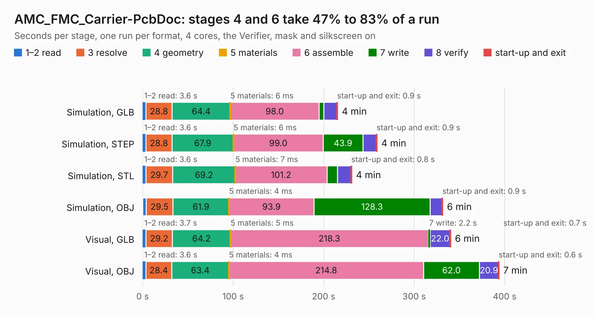

# 570. AMC_FMC_Carrier-PcbDoc

Board 570 of the 3,139 of [Corpus Testing](../Corpus-Testing.md), on [Corpus Page 6](../CorpusTestingPages/Corpus-Testing-06.md#570-amc_fmc_carrier-pcbdoc).

| Mode and format | 1–2 read | 3 resolve | 4 geometry | 5 materials | 6 assemble | 7 write | 8 verify | start-up and exit | Total |
|---|---:|---:|---:|---:|---:|---:|---:|---:|---:|
| Simulation, GLB | 3.6 | 28.8 | 64.4 | 6&nbsp;ms | 98.0 | 5.3 | 14.3 | 0.9 | 215.4 |
| Simulation, STEP | 3.6 | 28.8 | 67.9 | 6&nbsp;ms | 99.0 | 43.9 | 14.7 | 0.9 | 259.0 |
| Simulation, STL | 3.6 | 29.7 | 69.2 | 7&nbsp;ms | 101.2 | 11.6 | 14.9 | 0.8 | 231.0 |
| Simulation, OBJ | 4.0 | 29.5 | 61.9 | 4&nbsp;ms | 93.9 | 128.3 | 13.0 | 0.9 | 331.6 |
| Visual, GLB | 3.7 | 29.2 | 64.2 | 5&nbsp;ms | 218.3 | 2.2 | 22.0 | 0.7 | 340.4 |
| Visual, OBJ | 3.6 | 28.4 | 63.4 | 4&nbsp;ms | 214.8 | 62.0 | 20.9 | 0.6 | 393.7 |

<table align="center"><tr><td valign="top">

| Board | Repo: [BerkeleyLab/Marble-Mini](https://github.com/BerkeleyLab/Marble-Mini) Board: `AMC_FMC_Carrier-PcbDoc.kicad_pcb` |
|---|---|
| Complexity | 380&nbsp;/&nbsp;1000 (size&nbsp;345, features&nbsp;35) |
| KESE&nbsp;features | through vias, slotted holes, rounded, trapezoid or chamfered pads |
| Tested | 9th November 2026 to 10th November 2026 |
| Copper&nbsp;layers | 8 |
| File&nbsp;format | KiCad 5 (20171130) |
| Parts,&nbsp;tracks,&nbsp;vias | 886, 23,129, 2,797 |
| Triangles,&nbsp;simulation | 22,417,338 in 1144 parts |
| Verifier | PASS in all six runs |
| Run&nbsp;again | Simulation, OBJ: failed in the corpus run, run again with the memory cap raised from 11 GB to 14.5 GB, and passed |

</td><td valign="top">

<table>
<tr><th>File type</th><th>File size</th><th>Peak memory used</th></tr>
<tr><th colspan="3" align="left">Simulation</th></tr>
<tr><td>GLB</td><td align="right">748&nbsp;MB</td><td align="right">4.5&nbsp;GB</td></tr>
<tr><td>STEP</td><td align="right">2.2&nbsp;GB</td><td align="right">6.2&nbsp;GB</td></tr>
<tr><td>STL</td><td align="right">1.1&nbsp;GB</td><td align="right">4.5&nbsp;GB</td></tr>
<tr><td>OBJ</td><td align="right">2.5&nbsp;GB</td><td align="right">14&nbsp;GB</td></tr>
<tr><th colspan="3" align="left">Visual</th></tr>
<tr><td>GLB</td><td align="right">351&nbsp;MB</td><td align="right">5.9&nbsp;GB</td></tr>
<tr><td>OBJ</td><td align="right">1.2&nbsp;GB</td><td align="right">7.7&nbsp;GB</td></tr>
</table>

</td></tr></table>

| Previous | Next |
|:---|---:|
| [569. Marble](b0569b_Marble_Marble.md) | [571. Obsidian](b0571b_Obsidian_Obsidian.md) |
