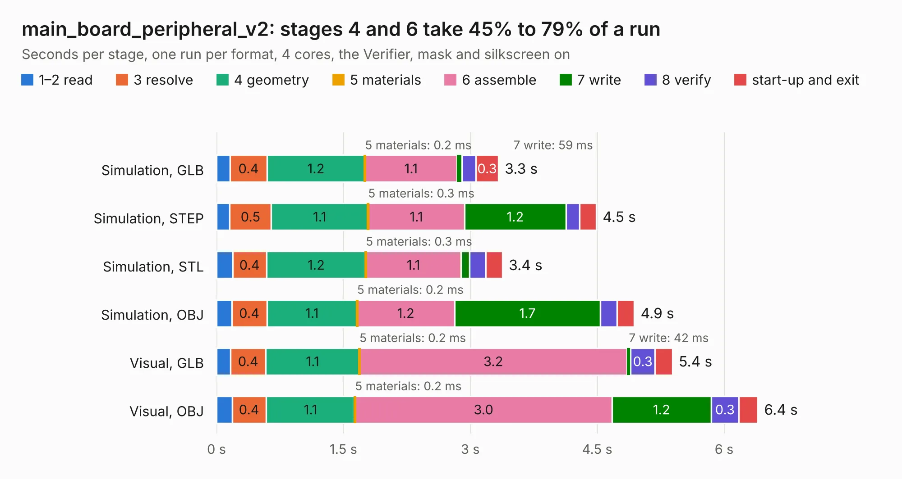

# 571. main_board_peripheral_v2

Board 571 of the 3,107 of [Corpus Testing](../Corpus-Testing.md), on [Corpus Page 6](../CorpusTestingPages/Corpus-Testing-06.md#571-main_board_peripheral_v2).

| Mode and format | 1–2 read | 3 resolve | 4 geometry | 5 materials | 6 assemble | 7 write | 8 verify | start-up and exit | Total |
|---|---:|---:|---:|---:|---:|---:|---:|---:|---:|
| Simulation, GLB | 0.2 | 0.4 | 1.2 | 0.2&nbsp;ms | 1.1 | 59&nbsp;ms | 0.2 | 0.3 | 3.3 |
| Simulation, STEP | 0.2 | 0.5 | 1.1 | 0.3&nbsp;ms | 1.1 | 1.2 | 0.2 | 0.2 | 4.5 |
| Simulation, STL | 0.2 | 0.4 | 1.2 | 0.3&nbsp;ms | 1.1 | 99&nbsp;ms | 0.2 | 0.2 | 3.4 |
| Simulation, OBJ | 0.2 | 0.4 | 1.1 | 0.2&nbsp;ms | 1.2 | 1.7 | 0.2 | 0.2 | 4.9 |
| Visual, GLB | 0.2 | 0.4 | 1.1 | 0.2&nbsp;ms | 3.2 | 42&nbsp;ms | 0.3 | 0.2 | 5.4 |
| Visual, OBJ | 0.2 | 0.4 | 1.1 | 0.2&nbsp;ms | 3.0 | 1.2 | 0.3 | 0.2 | 6.4 |

<table align="center"><tr><td valign="top">

| Board | Repo: [bluejayracing/22xt_kicad](https://github.com/bluejayracing/22xt_kicad) Board: `main_board_peripheral_v2.kicad_pcb` |
|---|---|
| Folder | 01-main_board / main_board_peripheral_v2 |
| Complexity | 241&nbsp;/&nbsp;1000 (size&nbsp;166, features&nbsp;75) |
| KESE&nbsp;features | through vias, rounded, trapezoid or chamfered pads, filled zones, stack-up, dielectric εr and tanδ |
| Tested | 9th November 2026 |
| Copper&nbsp;layers | 4 |
| File&nbsp;format | KiCad 9 (20241229) |
| Parts,&nbsp;tracks,&nbsp;vias | 28, 227, 43 |
| Triangles,&nbsp;simulation | 410,900 in 57 parts |
| Verifier | PASS in all six runs |

</td><td valign="top">

<table>
<tr><th>File type</th><th>File size</th><th>Peak memory used</th></tr>
<tr><th colspan="3" align="left">Simulation</th></tr>
<tr><td>GLB</td><td align="right">14&nbsp;MB</td><td align="right">280&nbsp;MB</td></tr>
<tr><td>STEP</td><td align="right">56&nbsp;MB</td><td align="right">289&nbsp;MB</td></tr>
<tr><td>STL</td><td align="right">21&nbsp;MB</td><td align="right">263&nbsp;MB</td></tr>
<tr><td>OBJ</td><td align="right">42&nbsp;MB</td><td align="right">287&nbsp;MB</td></tr>
<tr><th colspan="3" align="left">Visual</th></tr>
<tr><td>GLB</td><td align="right">9.9&nbsp;MB</td><td align="right">288&nbsp;MB</td></tr>
<tr><td>OBJ</td><td align="right">29&nbsp;MB</td><td align="right">295&nbsp;MB</td></tr>
</table>

</td></tr></table>

| Previous | Next |
|:---|---:|
| [570. main_board_peripheral_v1](b0570b_22xt-kicad_main-board-peripheral-v1.md) | [572. main_board_peripheral_v3](b0572b_22xt-kicad_main-board-peripheral-v3.md) |
