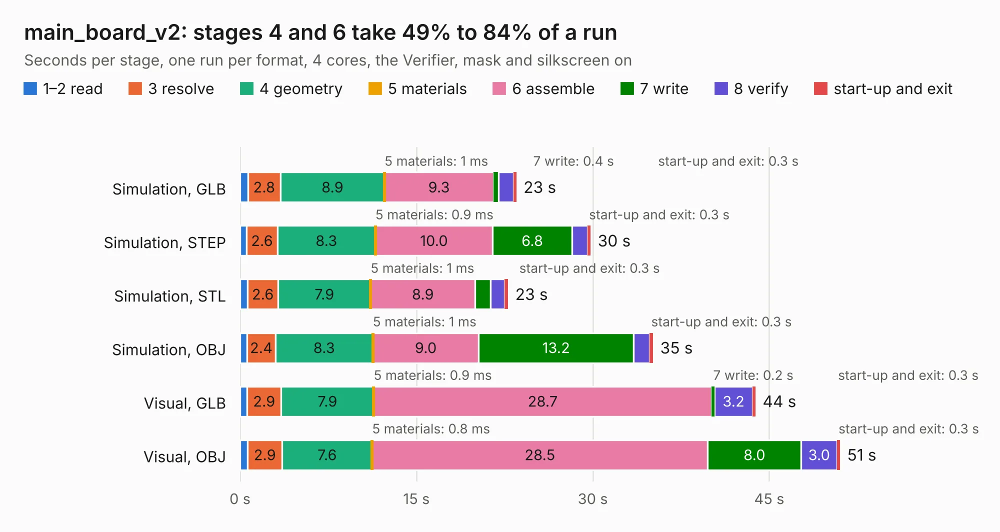

# 572. main_board_v2

Board 572 of the 3,102 of [Corpus Testing](../Corpus-Testing.md), on [Corpus Page 6](../CorpusTestingPages/Corpus-Testing-06.md#572-main_board_v2).

| Mode and format | 1–2 read | 3 resolve | 4 geometry | 5 materials | 6 assemble | 7 write | 8 verify | start-up and exit | Total |
|---|---:|---:|---:|---:|---:|---:|---:|---:|---:|
| Simulation, GLB | 0.7 | 2.8 | 8.9 | 1&nbsp;ms | 9.3 | 0.4 | 1.2 | 0.3 | 23.5 |
| Simulation, STEP | 0.6 | 2.6 | 8.3 | 0.9&nbsp;ms | 10.0 | 6.8 | 1.3 | 0.3 | 29.8 |
| Simulation, STL | 0.6 | 2.6 | 7.9 | 1&nbsp;ms | 8.9 | 1.3 | 1.2 | 0.3 | 22.8 |
| Simulation, OBJ | 0.6 | 2.4 | 8.3 | 1&nbsp;ms | 9.0 | 13.2 | 1.4 | 0.3 | 35.1 |
| Visual, GLB | 0.6 | 2.9 | 7.9 | 0.9&nbsp;ms | 28.7 | 0.2 | 3.2 | 0.3 | 43.8 |
| Visual, OBJ | 0.6 | 2.9 | 7.6 | 0.8&nbsp;ms | 28.5 | 8.0 | 3.0 | 0.3 | 51.0 |

<table align="center"><tr><td valign="top">

| Board | Repo: [bluejayracing/22xt_kicad](https://github.com/bluejayracing/22xt_kicad) Board: `main_board_v2.kicad_pcb` |
|---|---|
| Folder | 01-main_board / main_board_v2 |
| Complexity | 363&nbsp;/&nbsp;1000 (size&nbsp;263, features&nbsp;100) |
| KESE&nbsp;features | through vias, rounded, trapezoid or chamfered pads, arc tracks, filled zones, curved board outline, stack-up, dielectric εr and tanδ |
| Tested | 9th November 2026 |
| Copper&nbsp;layers | 4 |
| File&nbsp;format | KiCad 9 (20241229) |
| Parts,&nbsp;tracks,&nbsp;vias | 144, 1,496, 384 |
| Triangles,&nbsp;simulation | 2,621,604 in 204 parts |
| Verifier | PASS in all six runs |

</td><td valign="top">

<table>
<tr><th>File type</th><th>File size</th><th>Peak memory used</th></tr>
<tr><th colspan="3" align="left">Simulation</th></tr>
<tr><td>GLB</td><td align="right">89&nbsp;MB</td><td align="right">903&nbsp;MB</td></tr>
<tr><td>STEP</td><td align="right">317&nbsp;MB</td><td align="right">1.0&nbsp;GB</td></tr>
<tr><td>STL</td><td align="right">131&nbsp;MB</td><td align="right">892&nbsp;MB</td></tr>
<tr><td>OBJ</td><td align="right">274&nbsp;MB</td><td align="right">1.7&nbsp;GB</td></tr>
<tr><th colspan="3" align="left">Visual</th></tr>
<tr><td>GLB</td><td align="right">55&nbsp;MB</td><td align="right">1.0&nbsp;GB</td></tr>
<tr><td>OBJ</td><td align="right">169&nbsp;MB</td><td align="right">1.2&nbsp;GB</td></tr>
</table>

</td></tr></table>

| Previous | Next |
|:---|---:|
| [571. main_board_v1](b0571b_22xt-kicad_main-board-v1.md) | [573. main_board_v3](b0573b_22xt-kicad_main-board-v3.md) |
