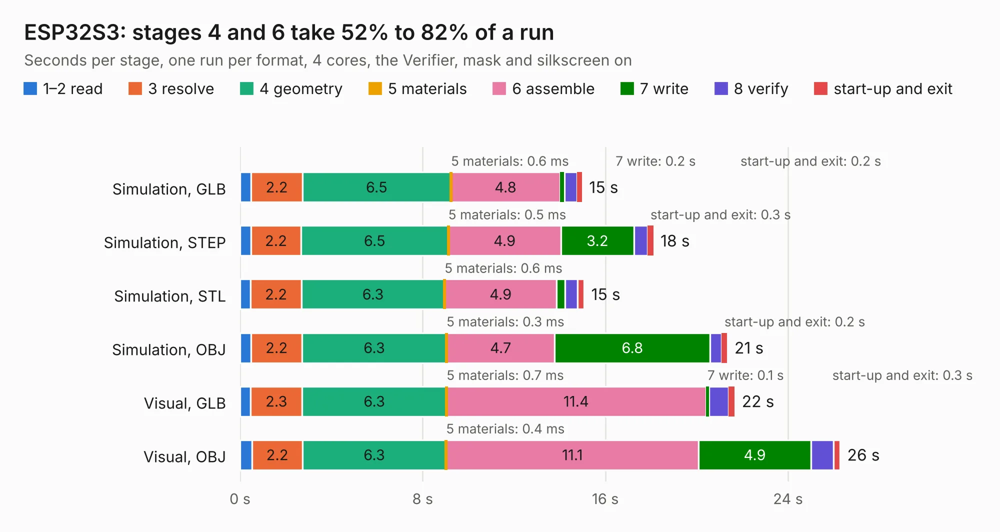

# 573. ESP32S3

Board 573 of the 3,124 of [Corpus Testing](../Corpus-Testing.md), on [Corpus Page 6](../CorpusTestingPages/Corpus-Testing-06.md#573-esp32s3).

| Mode and format | 1–2 read | 3 resolve | 4 geometry | 5 materials | 6 assemble | 7 write | 8 verify | start-up and exit | Total |
|---|---:|---:|---:|---:|---:|---:|---:|---:|---:|
| Simulation, GLB | 0.5 | 2.2 | 6.5 | 0.6&nbsp;ms | 4.8 | 0.2 | 0.5 | 0.2 | 15.0 |
| Simulation, STEP | 0.5 | 2.2 | 6.5 | 0.5&nbsp;ms | 4.9 | 3.2 | 0.6 | 0.3 | 18.1 |
| Simulation, STL | 0.5 | 2.2 | 6.3 | 0.6&nbsp;ms | 4.9 | 0.4 | 0.5 | 0.3 | 15.1 |
| Simulation, OBJ | 0.5 | 2.2 | 6.3 | 0.3&nbsp;ms | 4.7 | 6.8 | 0.5 | 0.2 | 21.3 |
| Visual, GLB | 0.5 | 2.3 | 6.3 | 0.7&nbsp;ms | 11.4 | 0.1 | 0.9 | 0.3 | 21.7 |
| Visual, OBJ | 0.5 | 2.2 | 6.3 | 0.4&nbsp;ms | 11.1 | 4.9 | 1.0 | 0.3 | 26.3 |

<table align="center"><tr><td valign="top">

| Board | Repo: [bluejayracing/22xt_kicad](https://github.com/bluejayracing/22xt_kicad) Board: `ESP32S3.kicad_pcb` |
|---|---|
| Folder | 01-main_board / 00-symbols |
| Complexity | 275&nbsp;/&nbsp;1000 (size&nbsp;225, features&nbsp;50) |
| KESE&nbsp;features | through vias, rounded, trapezoid or chamfered pads, arc tracks, curved board outline |
| Tested | 9th November 2026 |
| Copper&nbsp;layers | 2 |
| File&nbsp;format | KiCad 9 (20241229) |
| Parts,&nbsp;tracks,&nbsp;vias | 61, 1,178, 220 |
| Triangles,&nbsp;simulation | 1,140,700 in 76 parts |
| Verifier | PASS in all six runs |

</td><td valign="top">

<table>
<tr><th>File type</th><th>File size</th><th>Peak memory used</th></tr>
<tr><th colspan="3" align="left">Simulation</th></tr>
<tr><td>GLB</td><td align="right">40&nbsp;MB</td><td align="right">522&nbsp;MB</td></tr>
<tr><td>STEP</td><td align="right">215&nbsp;MB</td><td align="right">590&nbsp;MB</td></tr>
<tr><td>STL</td><td align="right">57&nbsp;MB</td><td align="right">496&nbsp;MB</td></tr>
<tr><td>OBJ</td><td align="right">118&nbsp;MB</td><td align="right">816&nbsp;MB</td></tr>
<tr><th colspan="3" align="left">Visual</th></tr>
<tr><td>GLB</td><td align="right">29&nbsp;MB</td><td align="right">626&nbsp;MB</td></tr>
<tr><td>OBJ</td><td align="right">87&nbsp;MB</td><td align="right">658&nbsp;MB</td></tr>
</table>

</td></tr></table>

| Previous | Next |
|:---|---:|
| [572. Crazyflie contol board](b0572b_crazyflie-electronics_Crazyflie-contol-board.md) | [574. AD5689RARUZ-RL7_breakboard](b0574b_22xt-kicad_AD5689RARUZ-RL7-breakboard.md) |
