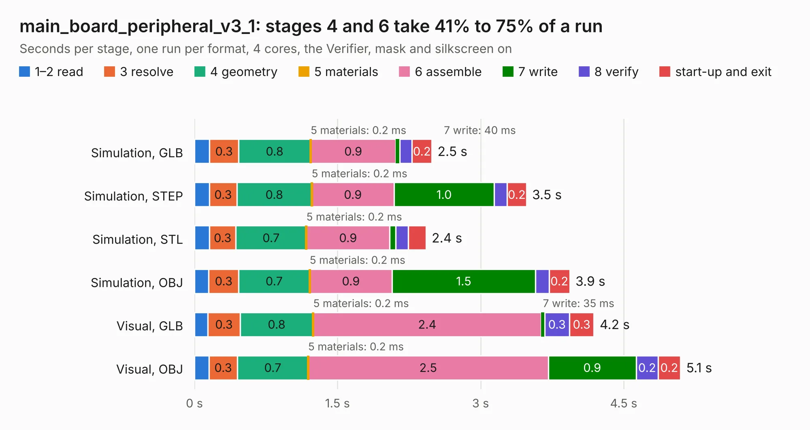

# 573. main_board_peripheral_v3_1

Board 573 of the 3,110 of [Corpus Testing](../Corpus-Testing.md), on [Corpus Page 6](../CorpusTestingPages/Corpus-Testing-06.md#573-main_board_peripheral_v3_1).

| Mode and format | 1–2 read | 3 resolve | 4 geometry | 5 materials | 6 assemble | 7 write | 8 verify | start-up and exit | Total |
|---|---:|---:|---:|---:|---:|---:|---:|---:|---:|
| Simulation, GLB | 0.2 | 0.3 | 0.8 | 0.2&nbsp;ms | 0.9 | 40&nbsp;ms | 0.1 | 0.2 | 2.5 |
| Simulation, STEP | 0.2 | 0.3 | 0.8 | 0.2&nbsp;ms | 0.9 | 1.0 | 0.1 | 0.2 | 3.5 |
| Simulation, STL | 0.2 | 0.3 | 0.7 | 0.2&nbsp;ms | 0.9 | 62&nbsp;ms | 0.1 | 0.2 | 2.4 |
| Simulation, OBJ | 0.1 | 0.3 | 0.7 | 0.2&nbsp;ms | 0.9 | 1.5 | 0.1 | 0.2 | 3.9 |
| Visual, GLB | 0.1 | 0.3 | 0.8 | 0.2&nbsp;ms | 2.4 | 35&nbsp;ms | 0.3 | 0.3 | 4.2 |
| Visual, OBJ | 0.2 | 0.3 | 0.7 | 0.2&nbsp;ms | 2.5 | 0.9 | 0.2 | 0.2 | 5.1 |

<table align="center"><tr><td valign="top">

| Board | Repo: [bluejayracing/22xt_kicad](https://github.com/bluejayracing/22xt_kicad) Board: `main_board_peripheral_v3_1.kicad_pcb` |
|---|---|
| Folder | 01-main_board / main_board_peripheral_v3_1 |
| Complexity | 284&nbsp;/&nbsp;1000 (size&nbsp;159, features&nbsp;125) |
| KESE&nbsp;features | through vias, custom pads, rounded, trapezoid or chamfered pads, arc tracks, filled zones, copper drawings, curved board outline, stack-up, dielectric εr and tanδ |
| Tested | 9th November 2026 to 10th November 2026 |
| Copper&nbsp;layers | 4 |
| File&nbsp;format | KiCad 9 (20241229) |
| Parts,&nbsp;tracks,&nbsp;vias | 16, 242, 31 |
| Triangles,&nbsp;simulation | 270,052 in 34 parts |
| Verifier | PASS in all six runs |
| Run&nbsp;again | Visual, GLB; Visual, OBJ: failed in the corpus run, run again with fixes to KESE made after the corpus run, and passed |

</td><td valign="top">

<table>
<tr><th>File type</th><th>File size</th><th>Peak memory used</th></tr>
<tr><th colspan="3" align="left">Simulation</th></tr>
<tr><td>GLB</td><td align="right">9.4&nbsp;MB</td><td align="right">228&nbsp;MB</td></tr>
<tr><td>STEP</td><td align="right">36&nbsp;MB</td><td align="right">249&nbsp;MB</td></tr>
<tr><td>STL</td><td align="right">14&nbsp;MB</td><td align="right">231&nbsp;MB</td></tr>
<tr><td>OBJ</td><td align="right">27&nbsp;MB</td><td align="right">233&nbsp;MB</td></tr>
<tr><th colspan="3" align="left">Visual</th></tr>
<tr><td>GLB</td><td align="right">7.0&nbsp;MB</td><td align="right">238&nbsp;MB</td></tr>
<tr><td>OBJ</td><td align="right">20&nbsp;MB</td><td align="right">227&nbsp;MB</td></tr>
</table>

</td></tr></table>

| Previous | Next |
|:---|---:|
| [572. main_board_peripheral_v3](b0572b_22xt-kicad_main-board-peripheral-v3.md) | [574. main_board_v1](b0574b_22xt-kicad_main-board-v1.md) |
