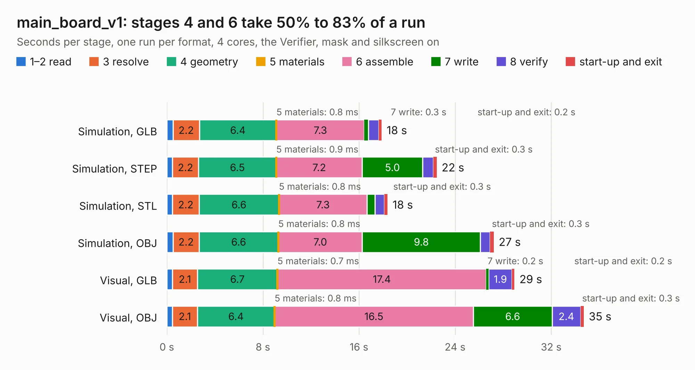

# 574. main_board_v1

Board 574 of the 3,108 of [Corpus Testing](../Corpus-Testing.md), on [Corpus Page 6](../CorpusTestingPages/Corpus-Testing-06.md#574-main_board_v1).

| Mode and format | 1–2 read | 3 resolve | 4 geometry | 5 materials | 6 assemble | 7 write | 8 verify | start-up and exit | Total |
|---|---:|---:|---:|---:|---:|---:|---:|---:|---:|
| Simulation, GLB | 0.5 | 2.2 | 6.4 | 0.8&nbsp;ms | 7.3 | 0.3 | 0.9 | 0.2 | 17.9 |
| Simulation, STEP | 0.5 | 2.2 | 6.5 | 0.9&nbsp;ms | 7.2 | 5.0 | 0.9 | 0.3 | 22.5 |
| Simulation, STL | 0.5 | 2.2 | 6.6 | 0.8&nbsp;ms | 7.3 | 0.6 | 0.8 | 0.3 | 18.4 |
| Simulation, OBJ | 0.5 | 2.2 | 6.6 | 0.8&nbsp;ms | 7.0 | 9.8 | 0.8 | 0.3 | 27.2 |
| Visual, GLB | 0.5 | 2.1 | 6.7 | 0.7&nbsp;ms | 17.4 | 0.2 | 1.9 | 0.2 | 28.9 |
| Visual, OBJ | 0.5 | 2.1 | 6.4 | 0.8&nbsp;ms | 16.5 | 6.6 | 2.4 | 0.3 | 34.7 |

<table align="center"><tr><td valign="top">

| Board | Repo: [bluejayracing/22xt_kicad](https://github.com/bluejayracing/22xt_kicad) Board: `main_board_v1.kicad_pcb` |
|---|---|
| Folder | 01-main_board / main_board_v1 |
| Complexity | 365&nbsp;/&nbsp;1000 (size&nbsp;265, features&nbsp;100) |
| KESE&nbsp;features | through vias, rounded, trapezoid or chamfered pads, arc tracks, filled zones, curved board outline, stack-up, dielectric εr and tanδ |
| Tested | 9th November 2026 |
| Copper&nbsp;layers | 4 |
| File&nbsp;format | KiCad 9 (20241229) |
| Parts,&nbsp;tracks,&nbsp;vias | 147, 1,956, 332 |
| Triangles,&nbsp;simulation | 2,398,958 in 209 parts |
| Verifier | PASS in all six runs |

</td><td valign="top">

<table>
<tr><th>File type</th><th>File size</th><th>Peak memory used</th></tr>
<tr><th colspan="3" align="left">Simulation</th></tr>
<tr><td>GLB</td><td align="right">82&nbsp;MB</td><td align="right">749&nbsp;MB</td></tr>
<tr><td>STEP</td><td align="right">314&nbsp;MB</td><td align="right">972&nbsp;MB</td></tr>
<tr><td>STL</td><td align="right">120&nbsp;MB</td><td align="right">752&nbsp;MB</td></tr>
<tr><td>OBJ</td><td align="right">252&nbsp;MB</td><td align="right">1.6&nbsp;GB</td></tr>
<tr><th colspan="3" align="left">Visual</th></tr>
<tr><td>GLB</td><td align="right">52&nbsp;MB</td><td align="right">1.1&nbsp;GB</td></tr>
<tr><td>OBJ</td><td align="right">162&nbsp;MB</td><td align="right">1.2&nbsp;GB</td></tr>
</table>

</td></tr></table>

| Previous | Next |
|:---|---:|
| [573. main_board_peripheral_v3_1](b0573b_22xt-kicad_main-board-peripheral-v3-1.md) | [575. main_board_v2](b0575b_22xt-kicad_main-board-v2.md) |
