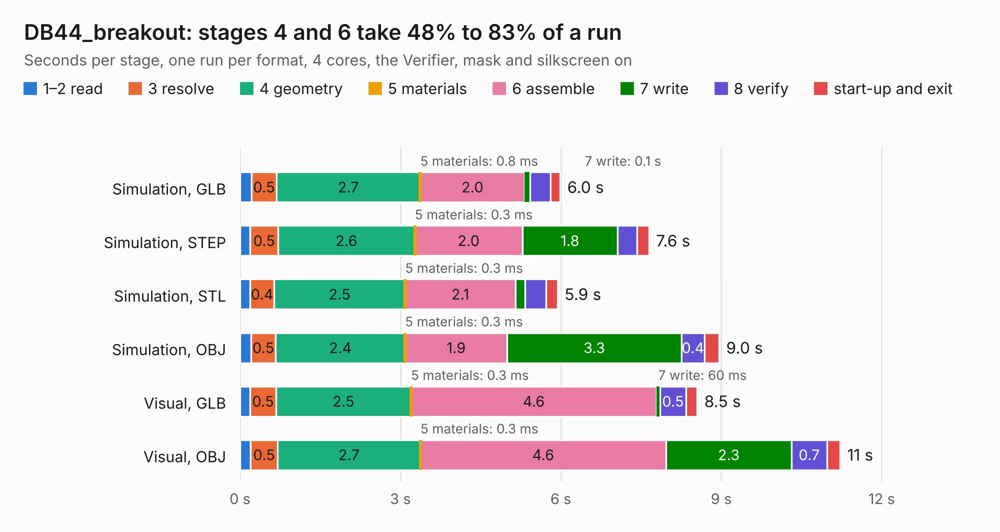

# 575. DB44_breakout

Board 575 of the 3,129 of [Corpus Testing](../Corpus-Testing.md), on [Corpus Page 6](../CorpusTestingPages/Corpus-Testing-06.md#575-db44_breakout).

| Mode and format | 1–2 read | 3 resolve | 4 geometry | 5 materials | 6 assemble | 7 write | 8 verify | start-up and exit | Total |
|---|---:|---:|---:|---:|---:|---:|---:|---:|---:|
| Simulation, GLB | 0.2 | 0.5 | 2.7 | 0.8&nbsp;ms | 2.0 | 0.1 | 0.4 | 0.2 | 6.0 |
| Simulation, STEP | 0.2 | 0.5 | 2.6 | 0.3&nbsp;ms | 2.0 | 1.8 | 0.4 | 0.2 | 7.6 |
| Simulation, STL | 0.2 | 0.4 | 2.5 | 0.3&nbsp;ms | 2.1 | 0.2 | 0.4 | 0.2 | 5.9 |
| Simulation, OBJ | 0.2 | 0.5 | 2.4 | 0.3&nbsp;ms | 1.9 | 3.3 | 0.4 | 0.3 | 9.0 |
| Visual, GLB | 0.2 | 0.5 | 2.5 | 0.3&nbsp;ms | 4.6 | 60&nbsp;ms | 0.5 | 0.2 | 8.5 |
| Visual, OBJ | 0.2 | 0.5 | 2.7 | 0.3&nbsp;ms | 4.6 | 2.3 | 0.7 | 0.2 | 11.2 |

<table align="center"><tr><td valign="top">

| Board | Repo: [bluejayracing/22xt_kicad](https://github.com/bluejayracing/22xt_kicad) Board: `DB44_breakout.kicad_pcb` |
|---|---|
| Folder | 01-main_board / DB44_ Breakout |
| Complexity | 154&nbsp;/&nbsp;1000 (size&nbsp;124, features&nbsp;30) |
| KESE&nbsp;features | rounded, trapezoid or chamfered pads, filled zones |
| Tested | 9th November 2026 |
| Copper&nbsp;layers | 2 |
| File&nbsp;format | KiCad 9 (20241229) |
| Parts,&nbsp;tracks,&nbsp;vias | 6, 192, 0 |
| Triangles,&nbsp;simulation | 609,768 in 56 parts |
| Verifier | PASS in all six runs |

</td><td valign="top">

<table>
<tr><th>File type</th><th>File size</th><th>Peak memory used</th></tr>
<tr><th colspan="3" align="left">Simulation</th></tr>
<tr><td>GLB</td><td align="right">20&nbsp;MB</td><td align="right">323&nbsp;MB</td></tr>
<tr><td>STEP</td><td align="right">86&nbsp;MB</td><td align="right">371&nbsp;MB</td></tr>
<tr><td>STL</td><td align="right">30&nbsp;MB</td><td align="right">321&nbsp;MB</td></tr>
<tr><td>OBJ</td><td align="right">61&nbsp;MB</td><td align="right">387&nbsp;MB</td></tr>
<tr><th colspan="3" align="left">Visual</th></tr>
<tr><td>GLB</td><td align="right">14&nbsp;MB</td><td align="right">406&nbsp;MB</td></tr>
<tr><td>OBJ</td><td align="right">43&nbsp;MB</td><td align="right">404&nbsp;MB</td></tr>
</table>

</td></tr></table>

| Previous | Next |
|:---|---:|
| [574. AD5689RARUZ-RL7_breakboard](b0574b_22xt-kicad_AD5689RARUZ-RL7-breakboard.md) | [576. main_board_peripheral_v1](b0576b_22xt-kicad_main-board-peripheral-v1.md) |
