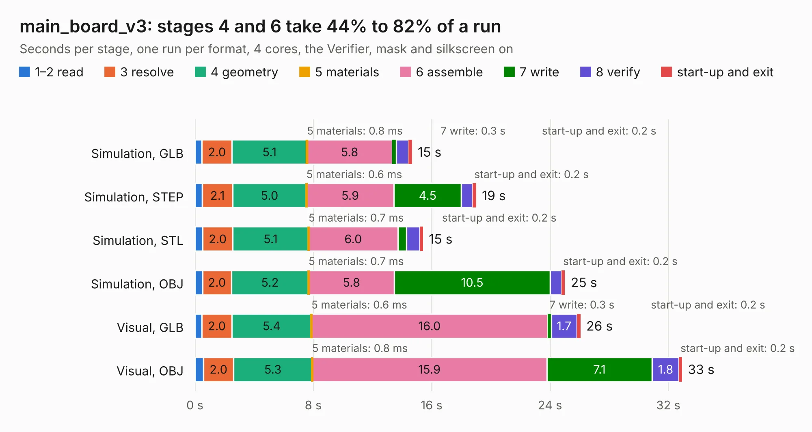

# 575. main_board_v3

Board 575 of the 3,105 of [Corpus Testing](../Corpus-Testing.md), on [Corpus Page 6](../CorpusTestingPages/Corpus-Testing-06.md#575-main_board_v3).

| Mode and format | 1–2 read | 3 resolve | 4 geometry | 5 materials | 6 assemble | 7 write | 8 verify | start-up and exit | Total |
|---|---:|---:|---:|---:|---:|---:|---:|---:|---:|
| Simulation, GLB | 0.5 | 2.0 | 5.1 | 0.8&nbsp;ms | 5.8 | 0.3 | 0.8 | 0.2 | 14.7 |
| Simulation, STEP | 0.5 | 2.1 | 5.0 | 0.6&nbsp;ms | 5.9 | 4.5 | 0.8 | 0.2 | 19.0 |
| Simulation, STL | 0.5 | 2.0 | 5.1 | 0.7&nbsp;ms | 6.0 | 0.6 | 0.9 | 0.2 | 15.4 |
| Simulation, OBJ | 0.5 | 2.0 | 5.2 | 0.7&nbsp;ms | 5.8 | 10.5 | 0.8 | 0.2 | 25.0 |
| Visual, GLB | 0.5 | 2.0 | 5.4 | 0.6&nbsp;ms | 16.0 | 0.3 | 1.7 | 0.2 | 26.1 |
| Visual, OBJ | 0.6 | 2.0 | 5.3 | 0.8&nbsp;ms | 15.9 | 7.1 | 1.8 | 0.2 | 32.9 |

<table align="center"><tr><td valign="top">

| Board | Repo: [bluejayracing/22xt_kicad](https://github.com/bluejayracing/22xt_kicad) Board: `main_board_v3.kicad_pcb` |
|---|---|
| Folder | 01-main_board / main_board_v3 |
| Complexity | 353&nbsp;/&nbsp;1000 (size&nbsp;253, features&nbsp;100) |
| KESE&nbsp;features | through vias, rounded, trapezoid or chamfered pads, arc tracks, filled zones, curved board outline, stack-up, dielectric εr and tanδ |
| Tested | 9th November 2026 |
| Copper&nbsp;layers | 4 |
| File&nbsp;format | KiCad 9 (20241229) |
| Parts,&nbsp;tracks,&nbsp;vias | 116, 1,661, 285 |
| Triangles,&nbsp;simulation | 1,943,674 in 157 parts |
| Verifier | PASS in all six runs |

</td><td valign="top">

<table>
<tr><th>File type</th><th>File size</th><th>Peak memory used</th></tr>
<tr><th colspan="3" align="left">Simulation</th></tr>
<tr><td>GLB</td><td align="right">66&nbsp;MB</td><td align="right">768&nbsp;MB</td></tr>
<tr><td>STEP</td><td align="right">250&nbsp;MB</td><td align="right">800&nbsp;MB</td></tr>
<tr><td>STL</td><td align="right">97&nbsp;MB</td><td align="right">772&nbsp;MB</td></tr>
<tr><td>OBJ</td><td align="right">201&nbsp;MB</td><td align="right">1.3&nbsp;GB</td></tr>
<tr><th colspan="3" align="left">Visual</th></tr>
<tr><td>GLB</td><td align="right">46&nbsp;MB</td><td align="right">860&nbsp;MB</td></tr>
<tr><td>OBJ</td><td align="right">142&nbsp;MB</td><td align="right">982&nbsp;MB</td></tr>
</table>

</td></tr></table>

| Previous | Next |
|:---|---:|
| [574. main_board_v2](b0574b_22xt-kicad_main-board-v2.md) | [576. AD5626BRMZ-kent](b0576b_22xt-kicad_AD5626BRMZ-kent.md) |
