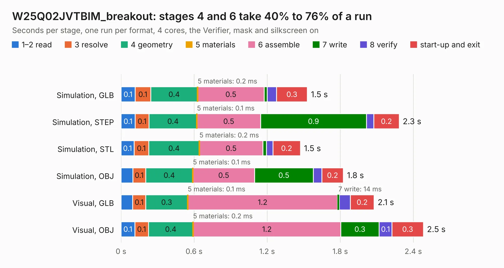

# 576. W25Q02JVTBIM_breakout

Board 576 of the 3,100 of [Corpus Testing](../Corpus-Testing.md), on [Corpus Page 6](../CorpusTestingPages/Corpus-Testing-06.md#576-w25q02jvtbim_breakout).

| Mode and format | 1–2 read | 3 resolve | 4 geometry | 5 materials | 6 assemble | 7 write | 8 verify | start-up and exit | Total |
|---|---:|---:|---:|---:|---:|---:|---:|---:|---:|
| Simulation, GLB | 0.1 | 0.1 | 0.4 | 0.2&nbsp;ms | 0.5 | 25&nbsp;ms | 76&nbsp;ms | 0.3 | 1.5 |
| Simulation, STEP | 0.1 | 0.1 | 0.4 | 0.1&nbsp;ms | 0.5 | 0.9 | 60&nbsp;ms | 0.2 | 2.3 |
| Simulation, STL | 0.1 | 0.1 | 0.4 | 0.2&nbsp;ms | 0.5 | 30&nbsp;ms | 52&nbsp;ms | 0.2 | 1.5 |
| Simulation, OBJ | 97&nbsp;ms | 0.1 | 0.4 | 0.1&nbsp;ms | 0.5 | 0.5 | 70&nbsp;ms | 0.2 | 1.8 |
| Visual, GLB | 96&nbsp;ms | 0.1 | 0.3 | 0.1&nbsp;ms | 1.2 | 14&nbsp;ms | 90&nbsp;ms | 0.2 | 2.1 |
| Visual, OBJ | 0.1 | 0.1 | 0.4 | 0.2&nbsp;ms | 1.2 | 0.3 | 0.1 | 0.3 | 2.5 |

<table align="center"><tr><td valign="top">

| Board | Repo: [bluejayracing/22xt_kicad](https://github.com/bluejayracing/22xt_kicad) Board: `W25Q02JVTBIM_breakout.kicad_pcb` |
|---|---|
| Folder | 02-wsg / W25Q02JVTBIM_breakout |
| Complexity | 146&nbsp;/&nbsp;1000 (size&nbsp;101, features&nbsp;45) |
| KESE&nbsp;features | through vias, rounded, trapezoid or chamfered pads, filled zones |
| Tested | 9th November 2026 |
| Copper&nbsp;layers | 2 |
| File&nbsp;format | KiCad 9 (20241229) |
| Parts,&nbsp;tracks,&nbsp;vias | 5, 41, 4 |
| Triangles,&nbsp;simulation | 97,656 in 32 parts |
| Verifier | PASS in all six runs |

</td><td valign="top">

<table>
<tr><th>File type</th><th>File size</th><th>Peak memory used</th></tr>
<tr><th colspan="3" align="left">Simulation</th></tr>
<tr><td>GLB</td><td align="right">3.4&nbsp;MB</td><td align="right">180&nbsp;MB</td></tr>
<tr><td>STEP</td><td align="right">16&nbsp;MB</td><td align="right">190&nbsp;MB</td></tr>
<tr><td>STL</td><td align="right">4.9&nbsp;MB</td><td align="right">186&nbsp;MB</td></tr>
<tr><td>OBJ</td><td align="right">9.5&nbsp;MB</td><td align="right">185&nbsp;MB</td></tr>
<tr><th colspan="3" align="left">Visual</th></tr>
<tr><td>GLB</td><td align="right">2.7&nbsp;MB</td><td align="right">152&nbsp;MB</td></tr>
<tr><td>OBJ</td><td align="right">7.5&nbsp;MB</td><td align="right">153&nbsp;MB</td></tr>
</table>

</td></tr></table>

| Previous | Next |
|:---|---:|
| [575. esp32s3](b0575b_22xt-kicad_esp32s3.md) | [577. WSG_2.0](b0577b_22xt-kicad_WSG-2-0.md) |
