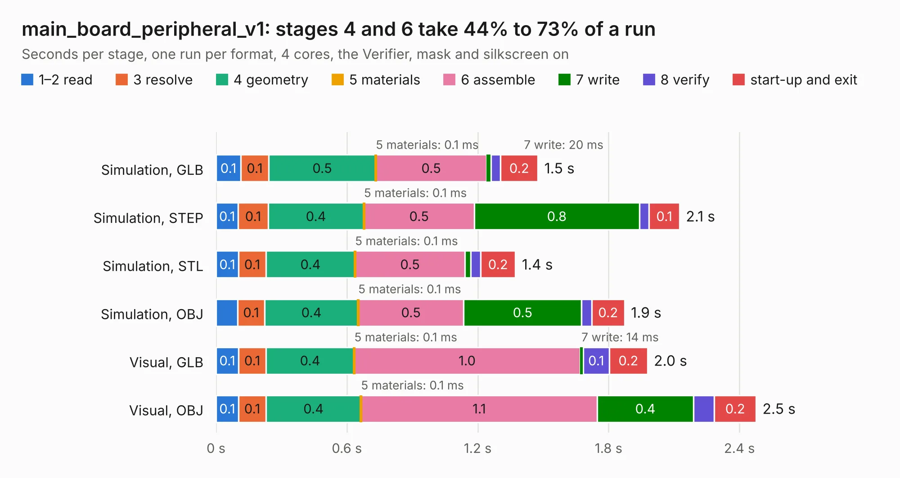

# 577 main_board_peripheral_v1

Board 577 of the 3,138 of [Corpus Testing](../Corpus-Testing.md), on [Corpus Page 6](../CorpusTestingPages/Corpus-Testing-06.md#577-main_board_peripheral_v1).

| Mode and format | 1–2 read | 3 resolve | 4 geometry | 5 materials | 6 assemble | 7 write | 8 verify | start-up and exit | Total |
|---|---:|---:|---:|---:|---:|---:|---:|---:|---:|
| Simulation, GLB | 0.1 | 0.1 | 0.5 | 0.1&nbsp;ms | 0.5 | 20&nbsp;ms | 45&nbsp;ms | 0.2 | 1.5 |
| Simulation, STEP | 0.1 | 0.1 | 0.4 | 0.1&nbsp;ms | 0.5 | 0.8 | 44&nbsp;ms | 0.1 | 2.1 |
| Simulation, STL | 0.1 | 0.1 | 0.4 | 0.1&nbsp;ms | 0.5 | 26&nbsp;ms | 46&nbsp;ms | 0.2 | 1.4 |
| Simulation, OBJ | 99&nbsp;ms | 0.1 | 0.4 | 0.1&nbsp;ms | 0.5 | 0.5 | 46&nbsp;ms | 0.2 | 1.9 |
| Visual, GLB | 0.1 | 0.1 | 0.4 | 0.1&nbsp;ms | 1.0 | 14&nbsp;ms | 0.1 | 0.2 | 2.0 |
| Visual, OBJ | 0.1 | 0.1 | 0.4 | 0.1&nbsp;ms | 1.1 | 0.4 | 96&nbsp;ms | 0.2 | 2.5 |

<table align="center"><tr><td valign="top">

| Board | Repo: [bluejayracing/22xt_kicad](https://github.com/bluejayracing/22xt_kicad) Board: `main_board_peripheral_v1.kicad_pcb` |
|---|---|
| Folder | 01-main_board / main_board_peripheral_v1 |
| Complexity | 198&nbsp;/&nbsp;1000 (size&nbsp;108, features&nbsp;90) |
| KESE&nbsp;features | through vias, rounded, trapezoid or chamfered pads, arc tracks, filled zones, stack-up, dielectric εr and tanδ |
| Tested | 9th November 2026 |
| Copper&nbsp;layers | 2 |
| File&nbsp;format | KiCad 9 (20241229) |
| Parts,&nbsp;tracks,&nbsp;vias | 4, 82, 3 |
| Triangles,&nbsp;simulation | 130,504 in 22 parts |
| Verifier | PASS in all six runs |

</td><td valign="top">

<table>
<tr><th>File type</th><th>File size</th><th>Peak memory used</th></tr>
<tr><th colspan="3" align="left">Simulation</th></tr>
<tr><td>GLB</td><td align="right">4.6&nbsp;MB</td><td align="right">189&nbsp;MB</td></tr>
<tr><td>STEP</td><td align="right">23&nbsp;MB</td><td align="right">205&nbsp;MB</td></tr>
<tr><td>STL</td><td align="right">6.5&nbsp;MB</td><td align="right">186&nbsp;MB</td></tr>
<tr><td>OBJ</td><td align="right">13&nbsp;MB</td><td align="right">190&nbsp;MB</td></tr>
<tr><th colspan="3" align="left">Visual</th></tr>
<tr><td>GLB</td><td align="right">3.6&nbsp;MB</td><td align="right">161&nbsp;MB</td></tr>
<tr><td>OBJ</td><td align="right">10.0&nbsp;MB</td><td align="right">157&nbsp;MB</td></tr>
</table>

</td></tr></table>

| Previous | Next |
|:---|---:|
| [576 DB44_breakout](b0576b_22xt-kicad_DB44-breakout.md) | [578 main_board_peripheral_v2](b0578b_22xt-kicad_main-board-peripheral-v2.md) |
