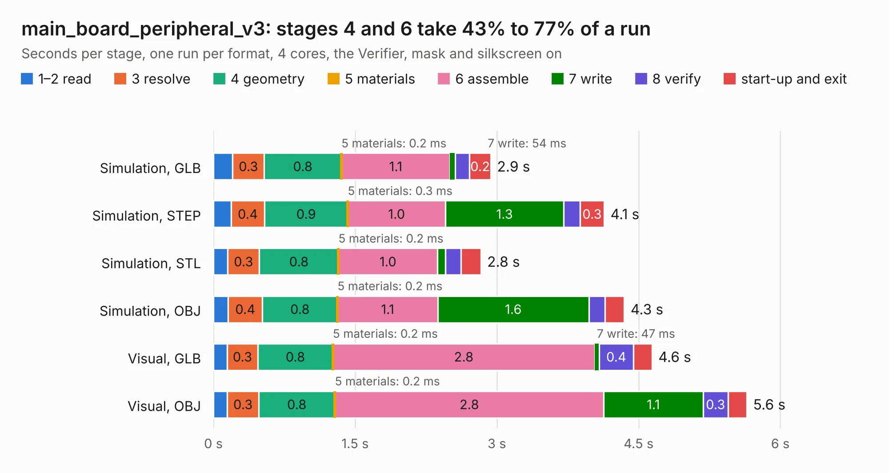

# 579. main_board_peripheral_v3

Board 579 of the 3,139 of [Corpus Testing](../Corpus-Testing.md), on [Corpus Page 6](../CorpusTestingPages/Corpus-Testing-06.md#579-main_board_peripheral_v3).

| Mode and format | 1–2 read | 3 resolve | 4 geometry | 5 materials | 6 assemble | 7 write | 8 verify | start-up and exit | Total |
|---|---:|---:|---:|---:|---:|---:|---:|---:|---:|
| Simulation, GLB | 0.2 | 0.3 | 0.8 | 0.2&nbsp;ms | 1.1 | 54&nbsp;ms | 0.2 | 0.2 | 2.9 |
| Simulation, STEP | 0.2 | 0.4 | 0.9 | 0.3&nbsp;ms | 1.0 | 1.3 | 0.2 | 0.3 | 4.1 |
| Simulation, STL | 0.2 | 0.3 | 0.8 | 0.2&nbsp;ms | 1.0 | 84&nbsp;ms | 0.2 | 0.2 | 2.8 |
| Simulation, OBJ | 0.2 | 0.4 | 0.8 | 0.2&nbsp;ms | 1.1 | 1.6 | 0.2 | 0.2 | 4.3 |
| Visual, GLB | 0.1 | 0.3 | 0.8 | 0.2&nbsp;ms | 2.8 | 47&nbsp;ms | 0.4 | 0.2 | 4.6 |
| Visual, OBJ | 0.1 | 0.3 | 0.8 | 0.2&nbsp;ms | 2.8 | 1.1 | 0.3 | 0.2 | 5.6 |

<table align="center"><tr><td valign="top">

| Board | Repo: [bluejayracing/22xt_kicad](https://github.com/bluejayracing/22xt_kicad) Board: `main_board_peripheral_v3.kicad_pcb` |
|---|---|
| Folder | 01-main_board / main_board_peripheral_v3 |
| Complexity | 262&nbsp;/&nbsp;1000 (size&nbsp;162, features&nbsp;100) |
| KESE&nbsp;features | through vias, rounded, trapezoid or chamfered pads, arc tracks, filled zones, curved board outline, stack-up, dielectric εr and tanδ |
| Tested | 9th November 2026 to 10th November 2026 |
| Copper&nbsp;layers | 4 |
| File&nbsp;format | KiCad 9 (20241229) |
| Parts,&nbsp;tracks,&nbsp;vias | 18, 254, 40 |
| Triangles,&nbsp;simulation | 305,866 in 34 parts |
| Verifier | PASS in all six runs |
| Run&nbsp;again | Visual, GLB; Visual, OBJ: failed in the corpus run, run again with fixes to KESE made after the corpus run, and passed |

</td><td valign="top">

<table>
<tr><th>File type</th><th>File size</th><th>Peak memory used</th></tr>
<tr><th colspan="3" align="left">Simulation</th></tr>
<tr><td>GLB</td><td align="right">11&nbsp;MB</td><td align="right">241&nbsp;MB</td></tr>
<tr><td>STEP</td><td align="right">40&nbsp;MB</td><td align="right">259&nbsp;MB</td></tr>
<tr><td>STL</td><td align="right">15&nbsp;MB</td><td align="right">232&nbsp;MB</td></tr>
<tr><td>OBJ</td><td align="right">31&nbsp;MB</td><td align="right">255&nbsp;MB</td></tr>
<tr><th colspan="3" align="left">Visual</th></tr>
<tr><td>GLB</td><td align="right">7.8&nbsp;MB</td><td align="right">243&nbsp;MB</td></tr>
<tr><td>OBJ</td><td align="right">23&nbsp;MB</td><td align="right">245&nbsp;MB</td></tr>
</table>

</td></tr></table>

| Previous | Next |
|:---|---:|
| [578. main_board_peripheral_v2](b0578b_22xt-kicad_main-board-peripheral-v2.md) | [580. main_board_peripheral_v3_1](b0580b_22xt-kicad_main-board-peripheral-v3-1.md) |
