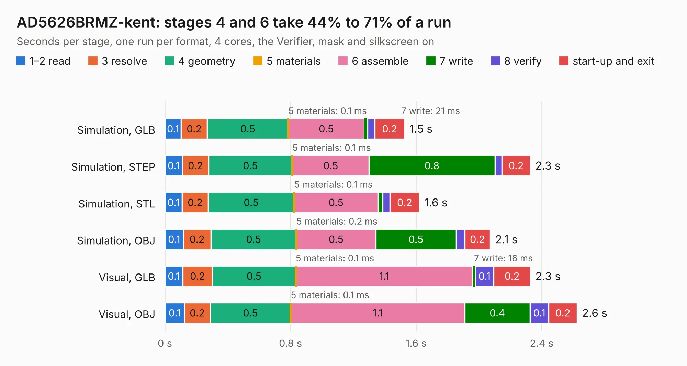

# 582. AD5626BRMZ-kent

Board 582 of the 3,122 of [Corpus Testing](../Corpus-Testing.md), on [Corpus Page 6](../CorpusTestingPages/Corpus-Testing-06.md#582-ad5626brmz-kent).

| Mode and format | 1–2 read | 3 resolve | 4 geometry | 5 materials | 6 assemble | 7 write | 8 verify | start-up and exit | Total |
|---|---:|---:|---:|---:|---:|---:|---:|---:|---:|
| Simulation, GLB | 0.1 | 0.2 | 0.5 | 0.1&nbsp;ms | 0.5 | 21&nbsp;ms | 45&nbsp;ms | 0.2 | 1.5 |
| Simulation, STEP | 0.1 | 0.2 | 0.5 | 0.1&nbsp;ms | 0.5 | 0.8 | 45&nbsp;ms | 0.2 | 2.3 |
| Simulation, STL | 0.1 | 0.2 | 0.5 | 0.1&nbsp;ms | 0.5 | 30&nbsp;ms | 45&nbsp;ms | 0.2 | 1.6 |
| Simulation, OBJ | 0.1 | 0.2 | 0.5 | 0.2&nbsp;ms | 0.5 | 0.5 | 54&nbsp;ms | 0.2 | 2.1 |
| Visual, GLB | 0.1 | 0.2 | 0.5 | 0.1&nbsp;ms | 1.1 | 16&nbsp;ms | 0.1 | 0.2 | 2.3 |
| Visual, OBJ | 0.1 | 0.2 | 0.5 | 0.1&nbsp;ms | 1.1 | 0.4 | 0.1 | 0.2 | 2.6 |

<table align="center"><tr><td valign="top">

| Board | Repo: [bluejayracing/22xt_kicad](https://github.com/bluejayracing/22xt_kicad) Board: `AD5626BRMZ-kent.kicad_pcb` |
|---|---|
| Folder | 02-wsg / AD5626BRMZ-breakout / AD5626BRMZ-kent |
| Complexity | 156&nbsp;/&nbsp;1000 (size&nbsp;101, features&nbsp;55) |
| KESE&nbsp;features | through vias, rounded, trapezoid or chamfered pads, filled zones, curved board outline |
| Tested | 9th November 2026 |
| Copper&nbsp;layers | 2 |
| File&nbsp;format | KiCad 9 (20241229) |
| Parts,&nbsp;tracks,&nbsp;vias | 5, 29, 8 |
| Triangles,&nbsp;simulation | 128,706 in 19 parts |
| Verifier | PASS in all six runs |

</td><td valign="top">

<table>
<tr><th>File type</th><th>File size</th><th>Peak memory used</th></tr>
<tr><th colspan="3" align="left">Simulation</th></tr>
<tr><td>GLB</td><td align="right">4.6&nbsp;MB</td><td align="right">195&nbsp;MB</td></tr>
<tr><td>STEP</td><td align="right">22&nbsp;MB</td><td align="right">209&nbsp;MB</td></tr>
<tr><td>STL</td><td align="right">6.4&nbsp;MB</td><td align="right">197&nbsp;MB</td></tr>
<tr><td>OBJ</td><td align="right">13&nbsp;MB</td><td align="right">198&nbsp;MB</td></tr>
<tr><th colspan="3" align="left">Visual</th></tr>
<tr><td>GLB</td><td align="right">3.9&nbsp;MB</td><td align="right">158&nbsp;MB</td></tr>
<tr><td>OBJ</td><td align="right">11&nbsp;MB</td><td align="right">162&nbsp;MB</td></tr>
</table>

</td></tr></table>

| Previous | Next |
|:---|---:|
| [581. main_board_v3](b0581b_22xt-kicad_main-board-v3.md) | [583. ADS1120IPWR](b0583b_22xt-kicad_ADS1120IPWR.md) |
