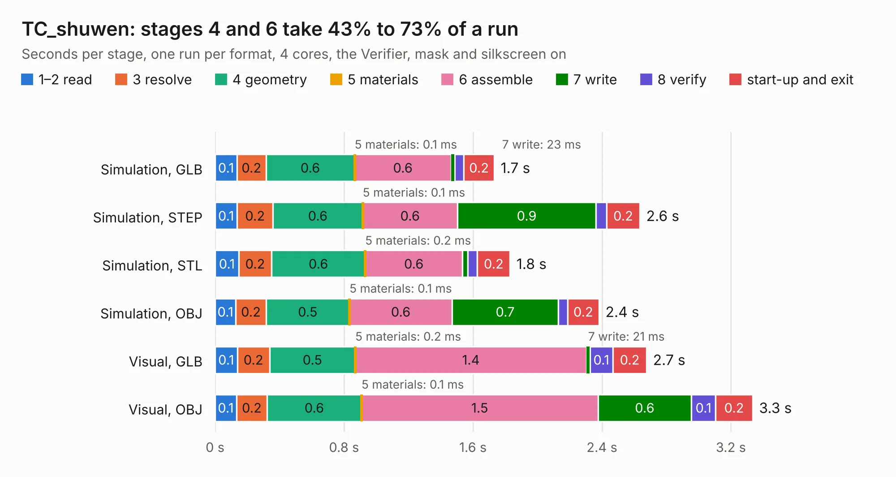

# 583. TC_shuwen

Board 583 of the 3,107 of [Corpus Testing](../Corpus-Testing.md), on [Corpus Page 6](../CorpusTestingPages/Corpus-Testing-06.md#583-tc_shuwen).

| Mode and format | 1–2 read | 3 resolve | 4 geometry | 5 materials | 6 assemble | 7 write | 8 verify | start-up and exit | Total |
|---|---:|---:|---:|---:|---:|---:|---:|---:|---:|
| Simulation, GLB | 0.1 | 0.2 | 0.6 | 0.1&nbsp;ms | 0.6 | 23&nbsp;ms | 56&nbsp;ms | 0.2 | 1.7 |
| Simulation, STEP | 0.1 | 0.2 | 0.6 | 0.1&nbsp;ms | 0.6 | 0.9 | 65&nbsp;ms | 0.2 | 2.6 |
| Simulation, STL | 0.1 | 0.2 | 0.6 | 0.2&nbsp;ms | 0.6 | 34&nbsp;ms | 58&nbsp;ms | 0.2 | 1.8 |
| Simulation, OBJ | 0.1 | 0.2 | 0.5 | 0.1&nbsp;ms | 0.6 | 0.7 | 57&nbsp;ms | 0.2 | 2.4 |
| Visual, GLB | 0.1 | 0.2 | 0.5 | 0.2&nbsp;ms | 1.4 | 21&nbsp;ms | 0.1 | 0.2 | 2.7 |
| Visual, OBJ | 0.1 | 0.2 | 0.6 | 0.1&nbsp;ms | 1.5 | 0.6 | 0.1 | 0.2 | 3.3 |

<table align="center"><tr><td valign="top">

| Board | Repo: [bluejayracing/22xt_kicad](https://github.com/bluejayracing/22xt_kicad) Board: `TC_shuwen.kicad_pcb` |
|---|---|
| Folder | 04-dyno_daq / TC_shuwen |
| Complexity | 159&nbsp;/&nbsp;1000 (size&nbsp;114, features&nbsp;45) |
| KESE&nbsp;features | through vias, rounded, trapezoid or chamfered pads, filled zones |
| Tested | 9th November 2026 |
| Copper&nbsp;layers | 2 |
| File&nbsp;format | KiCad 9 (20241229) |
| Parts,&nbsp;tracks,&nbsp;vias | 9, 37, 15 |
| Triangles,&nbsp;simulation | 138,080 in 20 parts |
| Verifier | PASS in all six runs |

</td><td valign="top">

<table>
<tr><th>File type</th><th>File size</th><th>Peak memory used</th></tr>
<tr><th colspan="3" align="left">Simulation</th></tr>
<tr><td>GLB</td><td align="right">4.9&nbsp;MB</td><td align="right">201&nbsp;MB</td></tr>
<tr><td>STEP</td><td align="right">23&nbsp;MB</td><td align="right">214&nbsp;MB</td></tr>
<tr><td>STL</td><td align="right">6.9&nbsp;MB</td><td align="right">204&nbsp;MB</td></tr>
<tr><td>OBJ</td><td align="right">14&nbsp;MB</td><td align="right">205&nbsp;MB</td></tr>
<tr><th colspan="3" align="left">Visual</th></tr>
<tr><td>GLB</td><td align="right">4.3&nbsp;MB</td><td align="right">172&nbsp;MB</td></tr>
<tr><td>OBJ</td><td align="right">12&nbsp;MB</td><td align="right">165&nbsp;MB</td></tr>
</table>

</td></tr></table>

| Previous | Next |
|:---|---:|
| [582. TC_kent](b0582b_22xt-kicad_TC-kent.md) | [584. thermistor circuit](b0584b_22xt-kicad_thermistor-circuit.md) |
