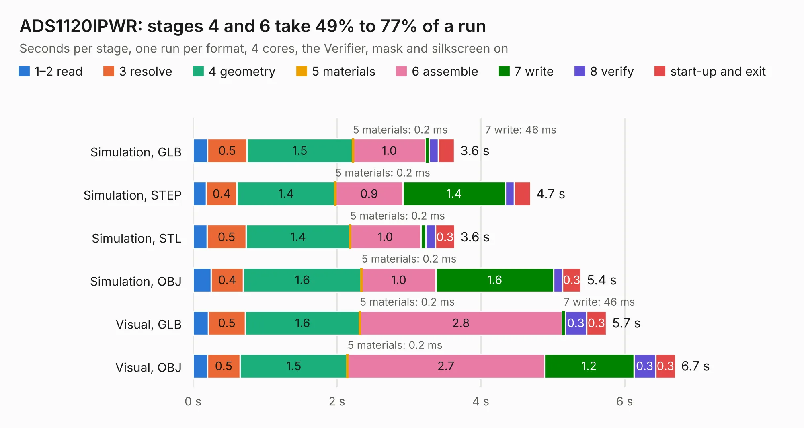

# 585. ADS1120IPWR

Board 585 of the 3,131 of [Corpus Testing](../Corpus-Testing.md), on [Corpus Page 6](../CorpusTestingPages/Corpus-Testing-06.md#585-ads1120ipwr).

| Mode and format | 1–2 read | 3 resolve | 4 geometry | 5 materials | 6 assemble | 7 write | 8 verify | start-up and exit | Total |
|---|---:|---:|---:|---:|---:|---:|---:|---:|---:|
| Simulation, GLB | 0.2 | 0.5 | 1.5 | 0.2&nbsp;ms | 1.0 | 46&nbsp;ms | 0.1 | 0.2 | 3.6 |
| Simulation, STEP | 0.2 | 0.4 | 1.4 | 0.2&nbsp;ms | 0.9 | 1.4 | 0.1 | 0.2 | 4.7 |
| Simulation, STL | 0.2 | 0.5 | 1.4 | 0.2&nbsp;ms | 1.0 | 71&nbsp;ms | 0.1 | 0.3 | 3.6 |
| Simulation, OBJ | 0.3 | 0.4 | 1.6 | 0.2&nbsp;ms | 1.0 | 1.6 | 0.1 | 0.3 | 5.4 |
| Visual, GLB | 0.2 | 0.5 | 1.6 | 0.2&nbsp;ms | 2.8 | 46&nbsp;ms | 0.3 | 0.3 | 5.7 |
| Visual, OBJ | 0.2 | 0.5 | 1.5 | 0.2&nbsp;ms | 2.7 | 1.2 | 0.3 | 0.3 | 6.7 |

<table align="center"><tr><td valign="top">

| Board | Repo: [bluejayracing/22xt_kicad](https://github.com/bluejayracing/22xt_kicad) Board: `ADS1120IPWR.kicad_pcb` |
|---|---|
| Folder | 02-wsg / ADS1120IPWR |
| Complexity | 201&nbsp;/&nbsp;1000 (size&nbsp;116, features&nbsp;85) |
| KESE&nbsp;features | through vias, rounded, trapezoid or chamfered pads, filled zones, curved board outline, stack-up, dielectric εr and tanδ |
| Tested | 9th November 2026 |
| Copper&nbsp;layers | 2 |
| File&nbsp;format | KiCad 9 (20241229) |
| Parts,&nbsp;tracks,&nbsp;vias | 7, 69, 12 |
| Triangles,&nbsp;simulation | 255,938 in 26 parts |
| Verifier | PASS in all six runs |

</td><td valign="top">

<table>
<tr><th>File type</th><th>File size</th><th>Peak memory used</th></tr>
<tr><th colspan="3" align="left">Simulation</th></tr>
<tr><td>GLB</td><td align="right">9.1&nbsp;MB</td><td align="right">244&nbsp;MB</td></tr>
<tr><td>STEP</td><td align="right">42&nbsp;MB</td><td align="right">253&nbsp;MB</td></tr>
<tr><td>STL</td><td align="right">13&nbsp;MB</td><td align="right">240&nbsp;MB</td></tr>
<tr><td>OBJ</td><td align="right">26&nbsp;MB</td><td align="right">238&nbsp;MB</td></tr>
<tr><th colspan="3" align="left">Visual</th></tr>
<tr><td>GLB</td><td align="right">7.5&nbsp;MB</td><td align="right">220&nbsp;MB</td></tr>
<tr><td>OBJ</td><td align="right">22&nbsp;MB</td><td align="right">222&nbsp;MB</td></tr>
</table>

</td></tr></table>

| Previous | Next |
|:---|---:|
| [584. AD5626BRMZ-kent](b0584b_22xt-kicad_AD5626BRMZ-kent.md) | [586. esp32s3](b0586b_22xt-kicad_esp32s3.md) |
