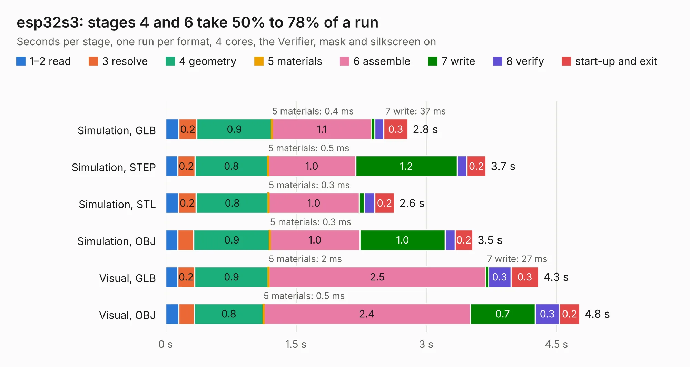

# 585. esp32s3

Board 585 of the 3,127 of [Corpus Testing](../Corpus-Testing.md), on [Corpus Page 6](../CorpusTestingPages/Corpus-Testing-06.md#585-esp32s3).

| Mode and format | 1–2 read | 3 resolve | 4 geometry | 5 materials | 6 assemble | 7 write | 8 verify | start-up and exit | Total |
|---|---:|---:|---:|---:|---:|---:|---:|---:|---:|
| Simulation, GLB | 0.2 | 0.2 | 0.9 | 0.4&nbsp;ms | 1.1 | 37&nbsp;ms | 0.1 | 0.3 | 2.8 |
| Simulation, STEP | 0.1 | 0.2 | 0.8 | 0.5&nbsp;ms | 1.0 | 1.2 | 0.1 | 0.2 | 3.7 |
| Simulation, STL | 0.1 | 0.2 | 0.8 | 0.3&nbsp;ms | 1.0 | 58&nbsp;ms | 0.1 | 0.2 | 2.6 |
| Simulation, OBJ | 0.1 | 0.2 | 0.9 | 0.3&nbsp;ms | 1.0 | 1.0 | 0.1 | 0.2 | 3.5 |
| Visual, GLB | 0.1 | 0.2 | 0.9 | 2&nbsp;ms | 2.5 | 27&nbsp;ms | 0.3 | 0.3 | 4.3 |
| Visual, OBJ | 0.1 | 0.2 | 0.8 | 0.5&nbsp;ms | 2.4 | 0.7 | 0.3 | 0.2 | 4.8 |

<table align="center"><tr><td valign="top">

| Board | Repo: [bluejayracing/22xt_kicad](https://github.com/bluejayracing/22xt_kicad) Board: `esp32s3.kicad_pcb` |
|---|---|
| Folder | 02-wsg / esp32s3 |
| Complexity | 106&nbsp;/&nbsp;1000 (size&nbsp;96, features&nbsp;10) |
| KESE&nbsp;features | rounded, trapezoid or chamfered pads |
| Tested | 9th November 2026 |
| Copper&nbsp;layers | 2 |
| File&nbsp;format | KiCad 8 (20240108) |
| Parts,&nbsp;tracks,&nbsp;vias | 36, 0, 0 |
| Triangles,&nbsp;simulation | 181,256 in 76 parts |
| Verifier | PASS in all six runs |

</td><td valign="top">

<table>
<tr><th>File type</th><th>File size</th><th>Peak memory used</th></tr>
<tr><th colspan="3" align="left">Simulation</th></tr>
<tr><td>GLB</td><td align="right">6.5&nbsp;MB</td><td align="right">221&nbsp;MB</td></tr>
<tr><td>STEP</td><td align="right">34&nbsp;MB</td><td align="right">246&nbsp;MB</td></tr>
<tr><td>STL</td><td align="right">9.1&nbsp;MB</td><td align="right">222&nbsp;MB</td></tr>
<tr><td>OBJ</td><td align="right">19&nbsp;MB</td><td align="right">222&nbsp;MB</td></tr>
<tr><th colspan="3" align="left">Visual</th></tr>
<tr><td>GLB</td><td align="right">5.5&nbsp;MB</td><td align="right">242&nbsp;MB</td></tr>
<tr><td>OBJ</td><td align="right">16&nbsp;MB</td><td align="right">237&nbsp;MB</td></tr>
</table>

</td></tr></table>

| Previous | Next |
|:---|---:|
| [584. ADS1120IPWR](b0584b_22xt-kicad_ADS1120IPWR.md) | [586. W25Q02JVTBIM_breakout](b0586b_22xt-kicad_W25Q02JVTBIM-breakout.md) |
