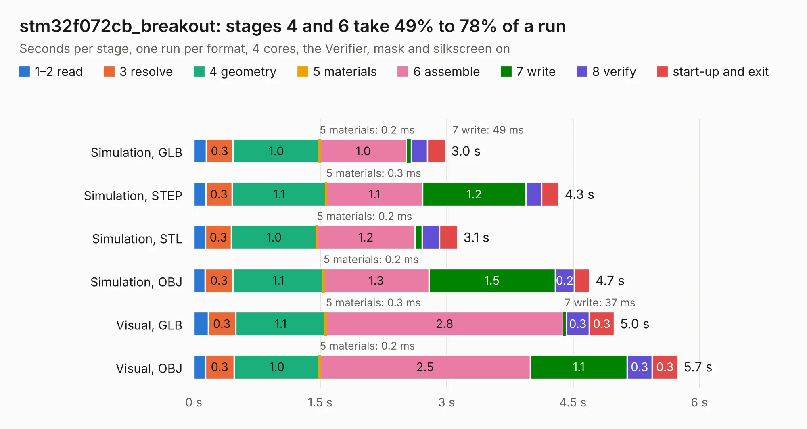

# 587. stm32f072cb_breakout

Board 587 of the 3,109 of [Corpus Testing](../Corpus-Testing.md), on [Corpus Page 6](../CorpusTestingPages/Corpus-Testing-06.md#587-stm32f072cb_breakout).

| Mode and format | 1–2 read | 3 resolve | 4 geometry | 5 materials | 6 assemble | 7 write | 8 verify | start-up and exit | Total |
|---|---:|---:|---:|---:|---:|---:|---:|---:|---:|
| Simulation, GLB | 0.1 | 0.3 | 1.0 | 0.2&nbsp;ms | 1.0 | 49&nbsp;ms | 0.2 | 0.2 | 3.0 |
| Simulation, STEP | 0.1 | 0.3 | 1.1 | 0.3&nbsp;ms | 1.1 | 1.2 | 0.2 | 0.2 | 4.3 |
| Simulation, STL | 0.1 | 0.3 | 1.0 | 0.2&nbsp;ms | 1.2 | 89&nbsp;ms | 0.2 | 0.2 | 3.1 |
| Simulation, OBJ | 0.1 | 0.3 | 1.1 | 0.2&nbsp;ms | 1.3 | 1.5 | 0.2 | 0.2 | 4.7 |
| Visual, GLB | 0.2 | 0.3 | 1.1 | 0.3&nbsp;ms | 2.8 | 37&nbsp;ms | 0.3 | 0.3 | 5.0 |
| Visual, OBJ | 0.1 | 0.3 | 1.0 | 0.2&nbsp;ms | 2.5 | 1.1 | 0.3 | 0.3 | 5.7 |

<table align="center"><tr><td valign="top">

| Board | Repo: [bluejayracing/22xt_kicad](https://github.com/bluejayracing/22xt_kicad) Board: `stm32f072cb_breakout.kicad_pcb` |
|---|---|
| Folder | 05-can_encoder / stm32f072cb-breakout / stm32f072cb_breakout |
| Complexity | 233&nbsp;/&nbsp;1000 (size&nbsp;148, features&nbsp;85) |
| KESE&nbsp;features | through vias, rounded, trapezoid or chamfered pads, filled zones, curved board outline, stack-up, dielectric εr and tanδ |
| Tested | 9th November 2026 |
| Copper&nbsp;layers | 4 |
| File&nbsp;format | KiCad 9 (20241229) |
| Parts,&nbsp;tracks,&nbsp;vias | 11, 138, 24 |
| Triangles,&nbsp;simulation | 312,444 in 56 parts |
| Verifier | PASS in all six runs |

</td><td valign="top">

<table>
<tr><th>File type</th><th>File size</th><th>Peak memory used</th></tr>
<tr><th colspan="3" align="left">Simulation</th></tr>
<tr><td>GLB</td><td align="right">11&nbsp;MB</td><td align="right">235&nbsp;MB</td></tr>
<tr><td>STEP</td><td align="right">43&nbsp;MB</td><td align="right">263&nbsp;MB</td></tr>
<tr><td>STL</td><td align="right">16&nbsp;MB</td><td align="right">235&nbsp;MB</td></tr>
<tr><td>OBJ</td><td align="right">31&nbsp;MB</td><td align="right">268&nbsp;MB</td></tr>
<tr><th colspan="3" align="left">Visual</th></tr>
<tr><td>GLB</td><td align="right">7.4&nbsp;MB</td><td align="right">247&nbsp;MB</td></tr>
<tr><td>OBJ</td><td align="right">22&nbsp;MB</td><td align="right">246&nbsp;MB</td></tr>
</table>

</td></tr></table>

| Previous | Next |
|:---|---:|
| [586. as5047p-atsm_breakout](b0586b_22xt-kicad_as5047p-atsm-breakout.md) | [588. accessory_peripheral](b0588b_bjr-kicad_accessory-peripheral.md) |
