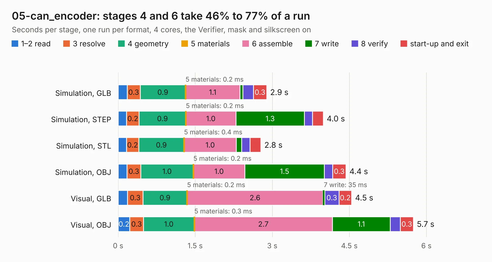

# 588. 05-can_encoder

Board 588 of the 3,116 of [Corpus Testing](../Corpus-Testing.md), on [Corpus Page 6](../CorpusTestingPages/Corpus-Testing-06.md#588-05-can_encoder).

| Mode and format | 1–2 read | 3 resolve | 4 geometry | 5 materials | 6 assemble | 7 write | 8 verify | start-up and exit | Total |
|---|---:|---:|---:|---:|---:|---:|---:|---:|---:|
| Simulation, GLB | 0.2 | 0.3 | 0.9 | 0.2&nbsp;ms | 1.1 | 60&nbsp;ms | 0.2 | 0.3 | 2.9 |
| Simulation, STEP | 0.2 | 0.2 | 0.9 | 0.2&nbsp;ms | 1.0 | 1.3 | 0.2 | 0.2 | 4.0 |
| Simulation, STL | 0.2 | 0.2 | 0.9 | 0.4&nbsp;ms | 1.0 | 0.1 | 0.2 | 0.2 | 2.8 |
| Simulation, OBJ | 0.2 | 0.3 | 1.0 | 0.2&nbsp;ms | 1.0 | 1.5 | 0.2 | 0.3 | 4.4 |
| Visual, GLB | 0.2 | 0.3 | 0.9 | 0.2&nbsp;ms | 2.6 | 35&nbsp;ms | 0.3 | 0.2 | 4.5 |
| Visual, OBJ | 0.2 | 0.3 | 1.0 | 0.3&nbsp;ms | 2.7 | 1.1 | 0.2 | 0.3 | 5.7 |

<table align="center"><tr><td valign="top">

| Board | Repo: [bluejayracing/22xt_kicad](https://github.com/bluejayracing/22xt_kicad) Board: `05-can_encoder.kicad_pcb` |
|---|---|
| Folder | 05-can_encoder |
| Complexity | 194&nbsp;/&nbsp;1000 (size&nbsp;139, features&nbsp;55) |
| KESE&nbsp;features | through vias, rounded, trapezoid or chamfered pads, filled zones, curved board outline |
| Tested | 9th November 2026 |
| Copper&nbsp;layers | 2 |
| File&nbsp;format | KiCad 9 (20241229) |
| Parts,&nbsp;tracks,&nbsp;vias | 20, 175, 20 |
| Triangles,&nbsp;simulation | 239,482 in 64 parts |
| Verifier | PASS in all six runs |

</td><td valign="top">

<table>
<tr><th>File type</th><th>File size</th><th>Peak memory used</th></tr>
<tr><th colspan="3" align="left">Simulation</th></tr>
<tr><td>GLB</td><td align="right">8.4&nbsp;MB</td><td align="right">232&nbsp;MB</td></tr>
<tr><td>STEP</td><td align="right">41&nbsp;MB</td><td align="right">248&nbsp;MB</td></tr>
<tr><td>STL</td><td align="right">12&nbsp;MB</td><td align="right">237&nbsp;MB</td></tr>
<tr><td>OBJ</td><td align="right">24&nbsp;MB</td><td align="right">236&nbsp;MB</td></tr>
<tr><th colspan="3" align="left">Visual</th></tr>
<tr><td>GLB</td><td align="right">6.9&nbsp;MB</td><td align="right">229&nbsp;MB</td></tr>
<tr><td>OBJ</td><td align="right">20&nbsp;MB</td><td align="right">227&nbsp;MB</td></tr>
</table>

</td></tr></table>

| Previous | Next |
|:---|---:|
| [587. thermistor circuit](b0587b_22xt-kicad_thermistor-circuit.md) | [589. as5047p-atsm_breakout](b0589b_22xt-kicad_as5047p-atsm-breakout.md) |
