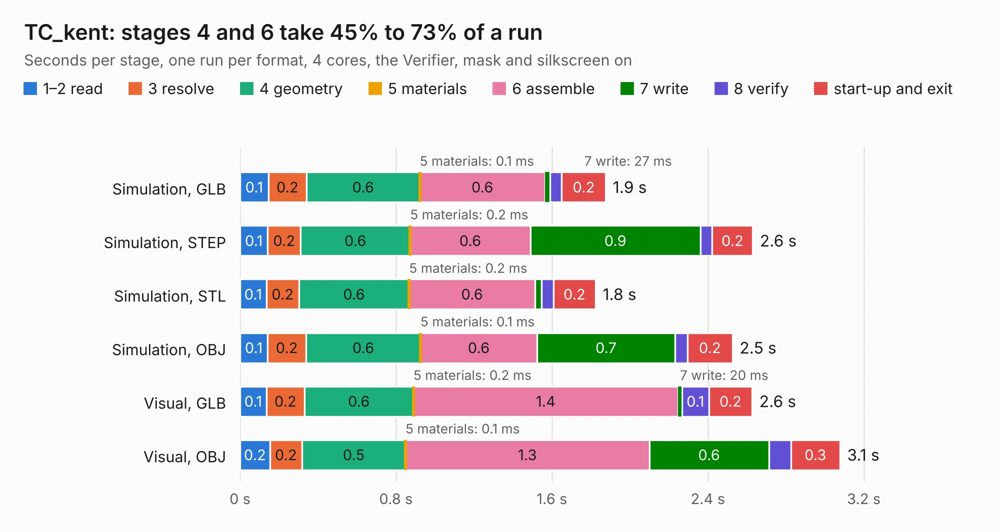

# 588. TC_kent

Board 588 of the 3,124 of [Corpus Testing](../Corpus-Testing.md), on [Corpus Page 6](../CorpusTestingPages/Corpus-Testing-06.md#588-tc_kent).

| Mode and format | 1–2 read | 3 resolve | 4 geometry | 5 materials | 6 assemble | 7 write | 8 verify | start-up and exit | Total |
|---|---:|---:|---:|---:|---:|---:|---:|---:|---:|
| Simulation, GLB | 0.1 | 0.2 | 0.6 | 0.1&nbsp;ms | 0.6 | 27&nbsp;ms | 60&nbsp;ms | 0.2 | 1.9 |
| Simulation, STEP | 0.1 | 0.2 | 0.6 | 0.2&nbsp;ms | 0.6 | 0.9 | 61&nbsp;ms | 0.2 | 2.6 |
| Simulation, STL | 0.1 | 0.2 | 0.6 | 0.2&nbsp;ms | 0.6 | 34&nbsp;ms | 60&nbsp;ms | 0.2 | 1.8 |
| Simulation, OBJ | 0.1 | 0.2 | 0.6 | 0.1&nbsp;ms | 0.6 | 0.7 | 64&nbsp;ms | 0.2 | 2.5 |
| Visual, GLB | 0.1 | 0.2 | 0.6 | 0.2&nbsp;ms | 1.4 | 20&nbsp;ms | 0.1 | 0.2 | 2.6 |
| Visual, OBJ | 0.2 | 0.2 | 0.5 | 0.1&nbsp;ms | 1.3 | 0.6 | 0.1 | 0.3 | 3.1 |

<table align="center"><tr><td valign="top">

| Board | Repo: [bluejayracing/22xt_kicad](https://github.com/bluejayracing/22xt_kicad) Board: `TC_kent.kicad_pcb` |
|---|---|
| Folder | 04-dyno_daq / TC_kent |
| Complexity | 162&nbsp;/&nbsp;1000 (size&nbsp;117, features&nbsp;45) |
| KESE&nbsp;features | through vias, rounded, trapezoid or chamfered pads, filled zones |
| Tested | 9th November 2026 |
| Copper&nbsp;layers | 2 |
| File&nbsp;format | KiCad 9 (20241229) |
| Parts,&nbsp;tracks,&nbsp;vias | 9, 44, 19 |
| Triangles,&nbsp;simulation | 129,482 in 20 parts |
| Verifier | PASS in all six runs |

</td><td valign="top">

<table>
<tr><th>File type</th><th>File size</th><th>Peak memory used</th></tr>
<tr><th colspan="3" align="left">Simulation</th></tr>
<tr><td>GLB</td><td align="right">4.5&nbsp;MB</td><td align="right">191&nbsp;MB</td></tr>
<tr><td>STEP</td><td align="right">21&nbsp;MB</td><td align="right">203&nbsp;MB</td></tr>
<tr><td>STL</td><td align="right">6.5&nbsp;MB</td><td align="right">196&nbsp;MB</td></tr>
<tr><td>OBJ</td><td align="right">13&nbsp;MB</td><td align="right">193&nbsp;MB</td></tr>
<tr><th colspan="3" align="left">Visual</th></tr>
<tr><td>GLB</td><td align="right">3.7&nbsp;MB</td><td align="right">158&nbsp;MB</td></tr>
<tr><td>OBJ</td><td align="right">10&nbsp;MB</td><td align="right">158&nbsp;MB</td></tr>
</table>

</td></tr></table>

| Previous | Next |
|:---|---:|
| [587. WSG_2.0](b0587b_22xt-kicad_WSG-2-0.md) | [589. TC_shuwen](b0589b_22xt-kicad_TC-shuwen.md) |
