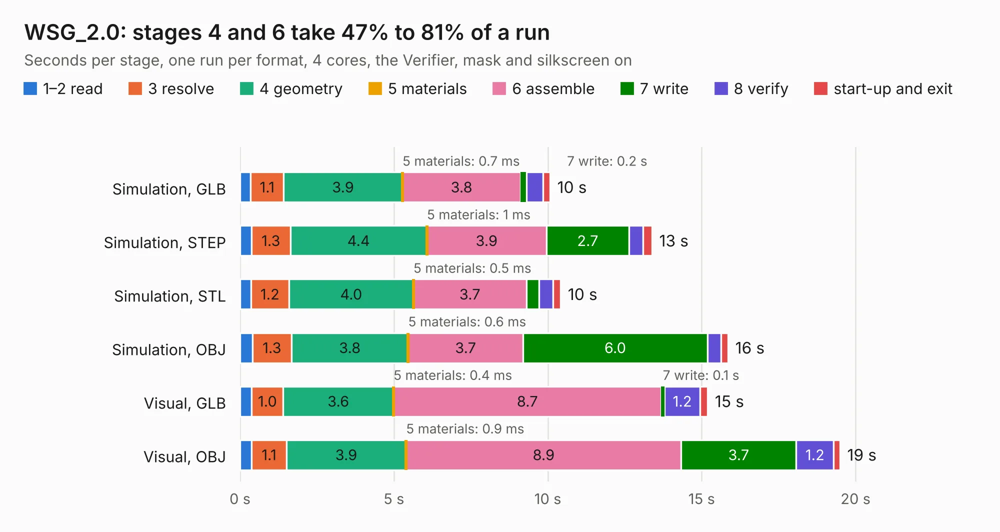

# 588 WSG_2.0

Board 588 of the 3,138 of [Corpus Testing](../Corpus-Testing.md), on [Corpus Page 6](../CorpusTestingPages/Corpus-Testing-06.md#588-wsg_20).

| Mode and format | 1–2 read | 3 resolve | 4 geometry | 5 materials | 6 assemble | 7 write | 8 verify | start-up and exit | Total |
|---|---:|---:|---:|---:|---:|---:|---:|---:|---:|
| Simulation, GLB | 0.3 | 1.1 | 3.9 | 0.7&nbsp;ms | 3.8 | 0.2 | 0.5 | 0.2 | 10.1 |
| Simulation, STEP | 0.4 | 1.3 | 4.4 | 1&nbsp;ms | 3.9 | 2.7 | 0.5 | 0.3 | 13.4 |
| Simulation, STL | 0.4 | 1.2 | 4.0 | 0.5&nbsp;ms | 3.7 | 0.4 | 0.5 | 0.3 | 10.4 |
| Simulation, OBJ | 0.4 | 1.3 | 3.8 | 0.6&nbsp;ms | 3.7 | 6.0 | 0.4 | 0.2 | 15.9 |
| Visual, GLB | 0.4 | 1.0 | 3.6 | 0.4&nbsp;ms | 8.7 | 0.1 | 1.2 | 0.2 | 15.2 |
| Visual, OBJ | 0.4 | 1.1 | 3.9 | 0.9&nbsp;ms | 8.9 | 3.7 | 1.2 | 0.2 | 19.5 |

<table align="center"><tr><td valign="top">

| Board | Repo: [bluejayracing/22xt_kicad](https://github.com/bluejayracing/22xt_kicad) Board: `WSG_2.0.kicad_pcb` |
|---|---|
| Folder | 02-wsg / WSG_2.0 |
| Complexity | 297&nbsp;/&nbsp;1000 (size&nbsp;197, features&nbsp;100) |
| KESE&nbsp;features | through vias, rounded, trapezoid or chamfered pads, arc tracks, filled zones, curved board outline, stack-up, dielectric εr and tanδ |
| Tested | 9th November 2026 |
| Copper&nbsp;layers | 4 |
| File&nbsp;format | KiCad 9 (20241229) |
| Parts,&nbsp;tracks,&nbsp;vias | 86, 654, 164 |
| Triangles,&nbsp;simulation | 983,438 in 94 parts |
| Verifier | PASS in all six runs |

</td><td valign="top">

<table>
<tr><th>File type</th><th>File size</th><th>Peak memory used</th></tr>
<tr><th colspan="3" align="left">Simulation</th></tr>
<tr><td>GLB</td><td align="right">34&nbsp;MB</td><td align="right">427&nbsp;MB</td></tr>
<tr><td>STEP</td><td align="right">132&nbsp;MB</td><td align="right">506&nbsp;MB</td></tr>
<tr><td>STL</td><td align="right">49&nbsp;MB</td><td align="right">416&nbsp;MB</td></tr>
<tr><td>OBJ</td><td align="right">99&nbsp;MB</td><td align="right">704&nbsp;MB</td></tr>
<tr><th colspan="3" align="left">Visual</th></tr>
<tr><td>GLB</td><td align="right">23&nbsp;MB</td><td align="right">526&nbsp;MB</td></tr>
<tr><td>OBJ</td><td align="right">69&nbsp;MB</td><td align="right">580&nbsp;MB</td></tr>
</table>

</td></tr></table>

| Previous | Next |
|:---|---:|
| [587 W25Q02JVTBIM_breakout](b0587b_22xt-kicad_W25Q02JVTBIM-breakout.md) | [589 TC_kent](b0589b_22xt-kicad_TC-kent.md) |
