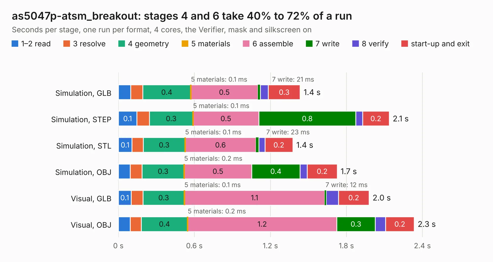

# 589. as5047p-atsm_breakout

Board 589 of the 3,116 of [Corpus Testing](../Corpus-Testing.md), on [Corpus Page 6](../CorpusTestingPages/Corpus-Testing-06.md#589-as5047p-atsm_breakout).

| Mode and format | 1–2 read | 3 resolve | 4 geometry | 5 materials | 6 assemble | 7 write | 8 verify | start-up and exit | Total |
|---|---:|---:|---:|---:|---:|---:|---:|---:|---:|
| Simulation, GLB | 98&nbsp;ms | 94&nbsp;ms | 0.4 | 0.1&nbsp;ms | 0.5 | 21&nbsp;ms | 62&nbsp;ms | 0.3 | 1.4 |
| Simulation, STEP | 0.1 | 99&nbsp;ms | 0.3 | 0.1&nbsp;ms | 0.5 | 0.8 | 53&nbsp;ms | 0.2 | 2.1 |
| Simulation, STL | 0.1 | 90&nbsp;ms | 0.3 | 0.1&nbsp;ms | 0.6 | 23&nbsp;ms | 49&nbsp;ms | 0.2 | 1.4 |
| Simulation, OBJ | 94&nbsp;ms | 93&nbsp;ms | 0.3 | 0.2&nbsp;ms | 0.5 | 0.4 | 56&nbsp;ms | 0.2 | 1.7 |
| Visual, GLB | 0.1 | 94&nbsp;ms | 0.3 | 0.1&nbsp;ms | 1.1 | 12&nbsp;ms | 96&nbsp;ms | 0.2 | 2.0 |
| Visual, OBJ | 93&nbsp;ms | 88&nbsp;ms | 0.4 | 0.2&nbsp;ms | 1.2 | 0.3 | 81&nbsp;ms | 0.2 | 2.3 |

<table align="center"><tr><td valign="top">

| Board | Repo: [bluejayracing/22xt_kicad](https://github.com/bluejayracing/22xt_kicad) Board: `as5047p-atsm_breakout.kicad_pcb` |
|---|---|
| Folder | 05-can_encoder / as5047p-atsm_breakout / as5047p-atsm_breakout |
| Complexity | 149&nbsp;/&nbsp;1000 (size&nbsp;94, features&nbsp;55) |
| KESE&nbsp;features | through vias, rounded, trapezoid or chamfered pads, filled zones, curved board outline |
| Tested | 9th November 2026 |
| Copper&nbsp;layers | 2 |
| File&nbsp;format | KiCad 9 (20241229) |
| Parts,&nbsp;tracks,&nbsp;vias | 4, 25, 4 |
| Triangles,&nbsp;simulation | 78,930 in 23 parts |
| Verifier | PASS in all six runs |

</td><td valign="top">

<table>
<tr><th>File type</th><th>File size</th><th>Peak memory used</th></tr>
<tr><th colspan="3" align="left">Simulation</th></tr>
<tr><td>GLB</td><td align="right">2.7&nbsp;MB</td><td align="right">179&nbsp;MB</td></tr>
<tr><td>STEP</td><td align="right">11&nbsp;MB</td><td align="right">182&nbsp;MB</td></tr>
<tr><td>STL</td><td align="right">3.9&nbsp;MB</td><td align="right">180&nbsp;MB</td></tr>
<tr><td>OBJ</td><td align="right">7.5&nbsp;MB</td><td align="right">172&nbsp;MB</td></tr>
<tr><th colspan="3" align="left">Visual</th></tr>
<tr><td>GLB</td><td align="right">2.1&nbsp;MB</td><td align="right">150&nbsp;MB</td></tr>
<tr><td>OBJ</td><td align="right">5.9&nbsp;MB</td><td align="right">152&nbsp;MB</td></tr>
</table>

</td></tr></table>

| Previous | Next |
|:---|---:|
| [588. 05-can_encoder](b0588b_22xt-kicad_05-can-encoder.md) | [590. stm32f072cb_breakout](b0590b_22xt-kicad_stm32f072cb-breakout.md) |
