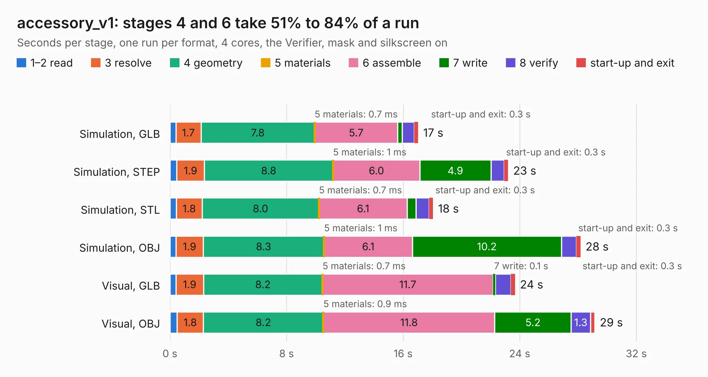

# 590. accessory_v1

Board 590 of the 3,112 of [Corpus Testing](../Corpus-Testing.md), on [Corpus Page 6](../CorpusTestingPages/Corpus-Testing-06.md#590-accessory_v1).

| Mode and format | 1–2 read | 3 resolve | 4 geometry | 5 materials | 6 assemble | 7 write | 8 verify | start-up and exit | Total |
|---|---:|---:|---:|---:|---:|---:|---:|---:|---:|
| Simulation, GLB | 0.4 | 1.7 | 7.8 | 0.7&nbsp;ms | 5.7 | 0.3 | 0.8 | 0.3 | 17.0 |
| Simulation, STEP | 0.5 | 1.9 | 8.8 | 1&nbsp;ms | 6.0 | 4.9 | 0.9 | 0.3 | 23.2 |
| Simulation, STL | 0.4 | 1.8 | 8.0 | 0.7&nbsp;ms | 6.1 | 0.6 | 0.9 | 0.3 | 18.0 |
| Simulation, OBJ | 0.4 | 1.9 | 8.3 | 1&nbsp;ms | 6.1 | 10.2 | 1.0 | 0.3 | 28.2 |
| Visual, GLB | 0.4 | 1.9 | 8.2 | 0.7&nbsp;ms | 11.7 | 0.1 | 1.1 | 0.3 | 23.7 |
| Visual, OBJ | 0.5 | 1.8 | 8.2 | 0.9&nbsp;ms | 11.8 | 5.2 | 1.3 | 0.3 | 29.1 |

<table align="center"><tr><td valign="top">

| Board | Repo: [bluejayracing/bjr_kicad](https://github.com/bluejayracing/bjr_kicad) Board: `accessory_v1.kicad_pcb` |
|---|---|
| Folder | 21xt / 01-accessory / accessory_v1 |
| Complexity | 320&nbsp;/&nbsp;1000 (size&nbsp;235, features&nbsp;85) |
| KESE&nbsp;features | through vias, rounded, trapezoid or chamfered pads, filled zones, copper drawings, stack-up, dielectric εr and tanδ |
| Tested | 9th November 2026 |
| Copper&nbsp;layers | 4 |
| File&nbsp;format | KiCad 7 (20221018) |
| Parts,&nbsp;tracks,&nbsp;vias | 72, 851, 97 |
| Triangles,&nbsp;simulation | 1,732,066 in 178 parts |
| Verifier | PASS in all six runs |

</td><td valign="top">

<table>
<tr><th>File type</th><th>File size</th><th>Peak memory used</th></tr>
<tr><th colspan="3" align="left">Simulation</th></tr>
<tr><td>GLB</td><td align="right">59&nbsp;MB</td><td align="right">609&nbsp;MB</td></tr>
<tr><td>STEP</td><td align="right">236&nbsp;MB</td><td align="right">667&nbsp;MB</td></tr>
<tr><td>STL</td><td align="right">87&nbsp;MB</td><td align="right">595&nbsp;MB</td></tr>
<tr><td>OBJ</td><td align="right">180&nbsp;MB</td><td align="right">1.2&nbsp;GB</td></tr>
<tr><th colspan="3" align="left">Visual</th></tr>
<tr><td>GLB</td><td align="right">30&nbsp;MB</td><td align="right">657&nbsp;MB</td></tr>
<tr><td>OBJ</td><td align="right">90&nbsp;MB</td><td align="right">702&nbsp;MB</td></tr>
</table>

</td></tr></table>

| Previous | Next |
|:---|---:|
| [589. accessory_peripheral](b0589b_bjr-kicad_accessory-peripheral.md) | [591. accessory_v2](b0591b_bjr-kicad_accessory-v2.md) |
