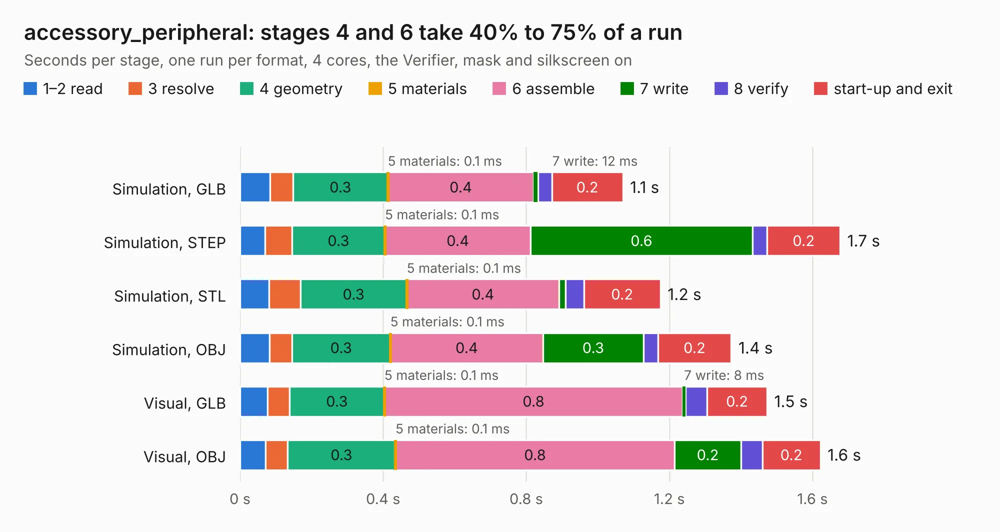

# 594. accessory_peripheral

Board 594 of the 3,130 of [Corpus Testing](../Corpus-Testing.md), on [Corpus Page 6](../CorpusTestingPages/Corpus-Testing-06.md#594-accessory_peripheral).

| Mode and format | 1–2 read | 3 resolve | 4 geometry | 5 materials | 6 assemble | 7 write | 8 verify | start-up and exit | Total |
|---|---:|---:|---:|---:|---:|---:|---:|---:|---:|
| Simulation, GLB | 83&nbsp;ms | 65&nbsp;ms | 0.3 | 0.1&nbsp;ms | 0.4 | 12&nbsp;ms | 38&nbsp;ms | 0.2 | 1.1 |
| Simulation, STEP | 70&nbsp;ms | 75&nbsp;ms | 0.3 | 0.1&nbsp;ms | 0.4 | 0.6 | 42&nbsp;ms | 0.2 | 1.7 |
| Simulation, STL | 82&nbsp;ms | 87&nbsp;ms | 0.3 | 0.1&nbsp;ms | 0.4 | 19&nbsp;ms | 51&nbsp;ms | 0.2 | 1.2 |
| Simulation, OBJ | 82&nbsp;ms | 63&nbsp;ms | 0.3 | 0.1&nbsp;ms | 0.4 | 0.3 | 41&nbsp;ms | 0.2 | 1.4 |
| Visual, GLB | 76&nbsp;ms | 62&nbsp;ms | 0.3 | 0.1&nbsp;ms | 0.8 | 8&nbsp;ms | 60&nbsp;ms | 0.2 | 1.5 |
| Visual, OBJ | 72&nbsp;ms | 61&nbsp;ms | 0.3 | 0.1&nbsp;ms | 0.8 | 0.2 | 59&nbsp;ms | 0.2 | 1.6 |

<table align="center"><tr><td valign="top">

| Board | Repo: [bluejayracing/bjr_kicad](https://github.com/bluejayracing/bjr_kicad) Board: `accessory_peripheral.kicad_pcb` |
|---|---|
| Folder | 21xt / 01-accessory / accessory_peripheral / accessory_peripheral |
| Complexity | 126&nbsp;/&nbsp;1000 (size&nbsp;96, features&nbsp;30) |
| KESE&nbsp;features | rounded, trapezoid or chamfered pads, filled zones |
| Tested | 9th November 2026 |
| Copper&nbsp;layers | 2 |
| File&nbsp;format | KiCad 7 (20221018) |
| Parts,&nbsp;tracks,&nbsp;vias | 4, 42, 0 |
| Triangles,&nbsp;simulation | 73,532 in 21 parts |
| Verifier | PASS in all six runs |

</td><td valign="top">

<table>
<tr><th>File type</th><th>File size</th><th>Peak memory used</th></tr>
<tr><th colspan="3" align="left">Simulation</th></tr>
<tr><td>GLB</td><td align="right">2.6&nbsp;MB</td><td align="right">167&nbsp;MB</td></tr>
<tr><td>STEP</td><td align="right">12&nbsp;MB</td><td align="right">176&nbsp;MB</td></tr>
<tr><td>STL</td><td align="right">3.7&nbsp;MB</td><td align="right">170&nbsp;MB</td></tr>
<tr><td>OBJ</td><td align="right">7.1&nbsp;MB</td><td align="right">170&nbsp;MB</td></tr>
<tr><th colspan="3" align="left">Visual</th></tr>
<tr><td>GLB</td><td align="right">1.7&nbsp;MB</td><td align="right">146&nbsp;MB</td></tr>
<tr><td>OBJ</td><td align="right">4.7&nbsp;MB</td><td align="right">151&nbsp;MB</td></tr>
</table>

</td></tr></table>

| Previous | Next |
|:---|---:|
| [593. stm32f072cb_breakout](b0593b_22xt-kicad_stm32f072cb-breakout.md) | [595. accessory_v1](b0595b_bjr-kicad_accessory-v1.md) |
