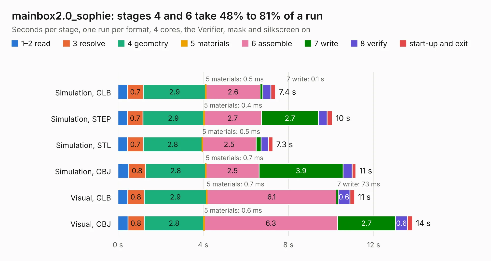

# 595. mainbox2.0_sophie

Board 595 of the 3,109 of [Corpus Testing](../Corpus-Testing.md), on [Corpus Page 6](../CorpusTestingPages/Corpus-Testing-06.md#595-mainbox20_sophie).

| Mode and format | 1–2 read | 3 resolve | 4 geometry | 5 materials | 6 assemble | 7 write | 8 verify | start-up and exit | Total |
|---|---:|---:|---:|---:|---:|---:|---:|---:|---:|
| Simulation, GLB | 0.4 | 0.7 | 2.9 | 0.5&nbsp;ms | 2.6 | 0.1 | 0.4 | 0.2 | 7.4 |
| Simulation, STEP | 0.4 | 0.7 | 2.9 | 0.4&nbsp;ms | 2.7 | 2.7 | 0.4 | 0.2 | 10.1 |
| Simulation, STL | 0.4 | 0.7 | 2.8 | 0.5&nbsp;ms | 2.5 | 0.2 | 0.3 | 0.2 | 7.3 |
| Simulation, OBJ | 0.5 | 0.8 | 2.8 | 0.7&nbsp;ms | 2.5 | 3.9 | 0.4 | 0.2 | 11.2 |
| Visual, GLB | 0.5 | 0.8 | 2.9 | 0.7&nbsp;ms | 6.1 | 73&nbsp;ms | 0.6 | 0.2 | 11.1 |
| Visual, OBJ | 0.5 | 0.8 | 2.8 | 0.6&nbsp;ms | 6.3 | 2.7 | 0.6 | 0.2 | 13.8 |

<table align="center"><tr><td valign="top">

| Board | Repo: [bluejayracing/bjr_kicad](https://github.com/bluejayracing/bjr_kicad) Board: `mainbox2.0_sophie.kicad_pcb` |
|---|---|
| Folder | 21xt / 02-mainbox / bjr_kicad_aaren_copy / 21xt / 02-mainbox / mainbox2.0 |
| Complexity | 150&nbsp;/&nbsp;1000 (size&nbsp;80, features&nbsp;70) |
| KESE&nbsp;features | rounded, trapezoid or chamfered pads, filled zones, copper text, stack-up, dielectric εr and tanδ |
| Tested | 9th November 2026 |
| Copper&nbsp;layers | 4 |
| File&nbsp;format | KiCad 7 (20221018) |
| Parts,&nbsp;tracks,&nbsp;vias | 75, 0, 0 |
| Triangles,&nbsp;simulation | 751,698 in 182 parts |
| Note | mostly unrouted |
| Verifier | PASS in all six runs |

</td><td valign="top">

<table>
<tr><th>File type</th><th>File size</th><th>Peak memory used</th></tr>
<tr><th colspan="3" align="left">Simulation</th></tr>
<tr><td>GLB</td><td align="right">25&nbsp;MB</td><td align="right">384&nbsp;MB</td></tr>
<tr><td>STEP</td><td align="right">121&nbsp;MB</td><td align="right">447&nbsp;MB</td></tr>
<tr><td>STL</td><td align="right">38&nbsp;MB</td><td align="right">385&nbsp;MB</td></tr>
<tr><td>OBJ</td><td align="right">76&nbsp;MB</td><td align="right">543&nbsp;MB</td></tr>
<tr><th colspan="3" align="left">Visual</th></tr>
<tr><td>GLB</td><td align="right">18&nbsp;MB</td><td align="right">457&nbsp;MB</td></tr>
<tr><td>OBJ</td><td align="right">54&nbsp;MB</td><td align="right">464&nbsp;MB</td></tr>
</table>

</td></tr></table>

| Previous | Next |
|:---|---:|
| [594. mainbox2.0](b0594b_bjr-kicad_21xt-02-mainbox-bjr-kicad-aaren-copy-21xt-02-mainbox-mainbox2-0_mainbox2-0.md) | [596. AD5626_Breakout](b0596b_bjr-kicad_AD5626-Breakout.md) |
