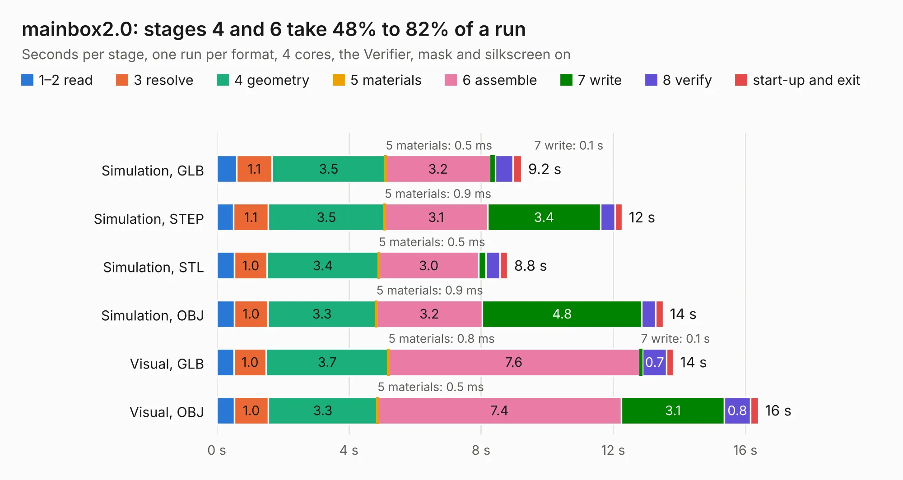

# 596. mainbox2.0

Board 596 of the 3,101 of [Corpus Testing](../Corpus-Testing.md), on [Corpus Page 6](../CorpusTestingPages/Corpus-Testing-06.md#596-mainbox20).

| Mode and format | 1–2 read | 3 resolve | 4 geometry | 5 materials | 6 assemble | 7 write | 8 verify | start-up and exit | Total |
|---|---:|---:|---:|---:|---:|---:|---:|---:|---:|
| Simulation, GLB | 0.6 | 1.1 | 3.5 | 0.5&nbsp;ms | 3.2 | 0.1 | 0.5 | 0.3 | 9.2 |
| Simulation, STEP | 0.5 | 1.1 | 3.5 | 0.9&nbsp;ms | 3.1 | 3.4 | 0.4 | 0.2 | 12.3 |
| Simulation, STL | 0.5 | 1.0 | 3.4 | 0.5&nbsp;ms | 3.0 | 0.2 | 0.4 | 0.2 | 8.8 |
| Simulation, OBJ | 0.5 | 1.0 | 3.3 | 0.9&nbsp;ms | 3.2 | 4.8 | 0.4 | 0.2 | 13.5 |
| Visual, GLB | 0.5 | 1.0 | 3.7 | 0.8&nbsp;ms | 7.6 | 0.1 | 0.7 | 0.2 | 13.8 |
| Visual, OBJ | 0.5 | 1.0 | 3.3 | 0.5&nbsp;ms | 7.4 | 3.1 | 0.8 | 0.3 | 16.4 |

<table align="center"><tr><td valign="top">

| Board | Repo: [bluejayracing/bjr_kicad](https://github.com/bluejayracing/bjr_kicad) Board: `mainbox2.0.kicad_pcb` |
|---|---|
| Folder | 21xt / 02-mainbox / mainbox2.0 |
| Complexity | 206&nbsp;/&nbsp;1000 (size&nbsp;121, features&nbsp;85) |
| KESE&nbsp;features | through vias, rounded, trapezoid or chamfered pads, filled zones, copper text, stack-up, dielectric εr and tanδ |
| Tested | 9th November 2026 |
| Copper&nbsp;layers | 4 |
| File&nbsp;format | KiCad 7 (20221018) |
| Parts,&nbsp;tracks,&nbsp;vias | 75, 5, 2 |
| Triangles,&nbsp;simulation | 771,626 in 182 parts |
| Note | mostly unrouted |
| Verifier | PASS in all six runs |

</td><td valign="top">

<table>
<tr><th>File type</th><th>File size</th><th>Peak memory used</th></tr>
<tr><th colspan="3" align="left">Simulation</th></tr>
<tr><td>GLB</td><td align="right">26&nbsp;MB</td><td align="right">399&nbsp;MB</td></tr>
<tr><td>STEP</td><td align="right">127&nbsp;MB</td><td align="right">446&nbsp;MB</td></tr>
<tr><td>STL</td><td align="right">39&nbsp;MB</td><td align="right">400&nbsp;MB</td></tr>
<tr><td>OBJ</td><td align="right">79&nbsp;MB</td><td align="right">546&nbsp;MB</td></tr>
<tr><th colspan="3" align="left">Visual</th></tr>
<tr><td>GLB</td><td align="right">19&nbsp;MB</td><td align="right">536&nbsp;MB</td></tr>
<tr><td>OBJ</td><td align="right">56&nbsp;MB</td><td align="right">581&nbsp;MB</td></tr>
</table>

</td></tr></table>

| Previous | Next |
|:---|---:|
| [595. mainbox1.0](b0595b_bjr-kicad_21xt-02-mainbox-mainbox1-0_mainbox1-0.md) | [597. mainbox2.1](b0597b_bjr-kicad_mainbox2-1.md) |
