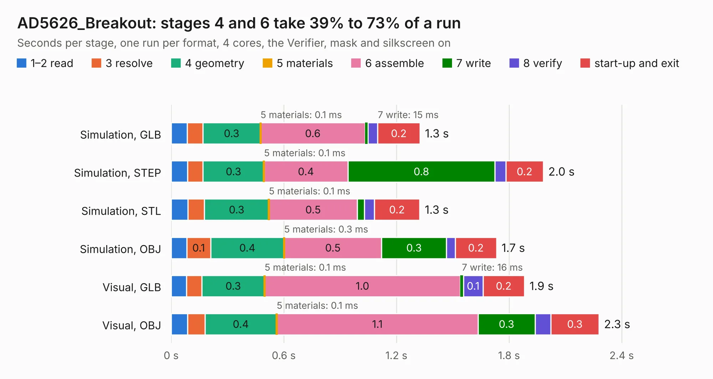

# 596. AD5626_Breakout

Board 596 of the 3,109 of [Corpus Testing](../Corpus-Testing.md), on [Corpus Page 6](../CorpusTestingPages/Corpus-Testing-06.md#596-ad5626_breakout).

| Mode and format | 1–2 read | 3 resolve | 4 geometry | 5 materials | 6 assemble | 7 write | 8 verify | start-up and exit | Total |
|---|---:|---:|---:|---:|---:|---:|---:|---:|---:|
| Simulation, GLB | 86&nbsp;ms | 83&nbsp;ms | 0.3 | 0.1&nbsp;ms | 0.6 | 15&nbsp;ms | 52&nbsp;ms | 0.2 | 1.3 |
| Simulation, STEP | 87&nbsp;ms | 83&nbsp;ms | 0.3 | 0.1&nbsp;ms | 0.4 | 0.8 | 58&nbsp;ms | 0.2 | 2.0 |
| Simulation, STL | 90&nbsp;ms | 88&nbsp;ms | 0.3 | 0.1&nbsp;ms | 0.5 | 38&nbsp;ms | 52&nbsp;ms | 0.2 | 1.3 |
| Simulation, OBJ | 83&nbsp;ms | 0.1 | 0.4 | 0.3&nbsp;ms | 0.5 | 0.3 | 47&nbsp;ms | 0.2 | 1.7 |
| Visual, GLB | 81&nbsp;ms | 83&nbsp;ms | 0.3 | 0.1&nbsp;ms | 1.0 | 16&nbsp;ms | 0.1 | 0.2 | 1.9 |
| Visual, OBJ | 88&nbsp;ms | 92&nbsp;ms | 0.4 | 0.1&nbsp;ms | 1.1 | 0.3 | 84&nbsp;ms | 0.3 | 2.3 |

<table align="center"><tr><td valign="top">

| Board | Repo: [bluejayracing/bjr_kicad](https://github.com/bluejayracing/bjr_kicad) Board: `AD5626_Breakout.kicad_pcb` |
|---|---|
| Folder | 21xt / 02-mainbox / bjr_kicad_aaren_copy / 21xt / 03-wireless_strain_gauge / AD5626_Breakout |
| Complexity | 149&nbsp;/&nbsp;1000 (size&nbsp;104, features&nbsp;45) |
| KESE&nbsp;features | through vias, rounded, trapezoid or chamfered pads, filled zones |
| Tested | 9th November 2026 |
| Copper&nbsp;layers | 2 |
| File&nbsp;format | KiCad 7 (20221018) |
| Parts,&nbsp;tracks,&nbsp;vias | 4, 54, 6 |
| Triangles,&nbsp;simulation | 79,746 in 19 parts |
| Verifier | PASS in all six runs |

</td><td valign="top">

<table>
<tr><th>File type</th><th>File size</th><th>Peak memory used</th></tr>
<tr><th colspan="3" align="left">Simulation</th></tr>
<tr><td>GLB</td><td align="right">2.8&nbsp;MB</td><td align="right">173&nbsp;MB</td></tr>
<tr><td>STEP</td><td align="right">12&nbsp;MB</td><td align="right">182&nbsp;MB</td></tr>
<tr><td>STL</td><td align="right">4.0&nbsp;MB</td><td align="right">175&nbsp;MB</td></tr>
<tr><td>OBJ</td><td align="right">7.6&nbsp;MB</td><td align="right">174&nbsp;MB</td></tr>
<tr><th colspan="3" align="left">Visual</th></tr>
<tr><td>GLB</td><td align="right">2.0&nbsp;MB</td><td align="right">152&nbsp;MB</td></tr>
<tr><td>OBJ</td><td align="right">5.6&nbsp;MB</td><td align="right">151&nbsp;MB</td></tr>
</table>

</td></tr></table>

| Previous | Next |
|:---|---:|
| [595. mainbox2.0_sophie](b0595b_bjr-kicad_mainbox2-0-sophie.md) | [597. wsg1.0](b0597b_bjr-kicad_wsg1-0.md) |
