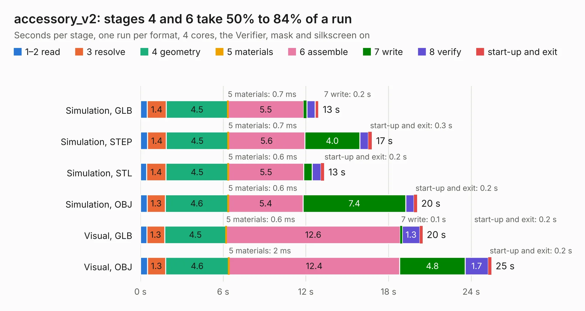

# 596. accessory_v2

Board 596 of the 3,130 of [Corpus Testing](../Corpus-Testing.md), on [Corpus Page 6](../CorpusTestingPages/Corpus-Testing-06.md#596-accessory_v2).

| Mode and format | 1–2 read | 3 resolve | 4 geometry | 5 materials | 6 assemble | 7 write | 8 verify | start-up and exit | Total |
|---|---:|---:|---:|---:|---:|---:|---:|---:|---:|
| Simulation, GLB | 0.5 | 1.4 | 4.5 | 0.7&nbsp;ms | 5.5 | 0.2 | 0.6 | 0.3 | 12.9 |
| Simulation, STEP | 0.5 | 1.4 | 4.5 | 0.7&nbsp;ms | 5.6 | 4.0 | 0.6 | 0.3 | 16.8 |
| Simulation, STL | 0.4 | 1.4 | 4.5 | 0.6&nbsp;ms | 5.5 | 0.6 | 0.7 | 0.2 | 13.3 |
| Simulation, OBJ | 0.5 | 1.3 | 4.6 | 0.6&nbsp;ms | 5.4 | 7.4 | 0.6 | 0.2 | 20.1 |
| Visual, GLB | 0.5 | 1.3 | 4.5 | 0.6&nbsp;ms | 12.6 | 0.1 | 1.3 | 0.2 | 20.5 |
| Visual, OBJ | 0.5 | 1.3 | 4.6 | 2&nbsp;ms | 12.4 | 4.8 | 1.7 | 0.2 | 25.5 |

<table align="center"><tr><td valign="top">

| Board | Repo: [bluejayracing/bjr_kicad](https://github.com/bluejayracing/bjr_kicad) Board: `accessory_v2.kicad_pcb` |
|---|---|
| Folder | 21xt / 01-accessory / accessory_v2 |
| Complexity | 311&nbsp;/&nbsp;1000 (size&nbsp;211, features&nbsp;100) |
| KESE&nbsp;features | through vias, rounded, trapezoid or chamfered pads, arc tracks, filled zones, curved board outline, stack-up, dielectric εr and tanδ |
| Tested | 9th November 2026 |
| Copper&nbsp;layers | 4 |
| File&nbsp;format | KiCad 8 (20240108) |
| Parts,&nbsp;tracks,&nbsp;vias | 146, 1,346, 195 |
| Triangles,&nbsp;simulation | 1,800,918 in 169 parts |
| Verifier | PASS in all six runs |

</td><td valign="top">

<table>
<tr><th>File type</th><th>File size</th><th>Peak memory used</th></tr>
<tr><th colspan="3" align="left">Simulation</th></tr>
<tr><td>GLB</td><td align="right">61&nbsp;MB</td><td align="right">623&nbsp;MB</td></tr>
<tr><td>STEP</td><td align="right">264&nbsp;MB</td><td align="right">772&nbsp;MB</td></tr>
<tr><td>STL</td><td align="right">90&nbsp;MB</td><td align="right">679&nbsp;MB</td></tr>
<tr><td>OBJ</td><td align="right">186&nbsp;MB</td><td align="right">1.2&nbsp;GB</td></tr>
<tr><th colspan="3" align="left">Visual</th></tr>
<tr><td>GLB</td><td align="right">40&nbsp;MB</td><td align="right">889&nbsp;MB</td></tr>
<tr><td>OBJ</td><td align="right">121&nbsp;MB</td><td align="right">912&nbsp;MB</td></tr>
</table>

</td></tr></table>

| Previous | Next |
|:---|---:|
| [595. accessory_v1](b0595b_bjr-kicad_accessory-v1.md) | [597. ad5689r](b0597b_bjr-kicad_ad5689r.md) |
